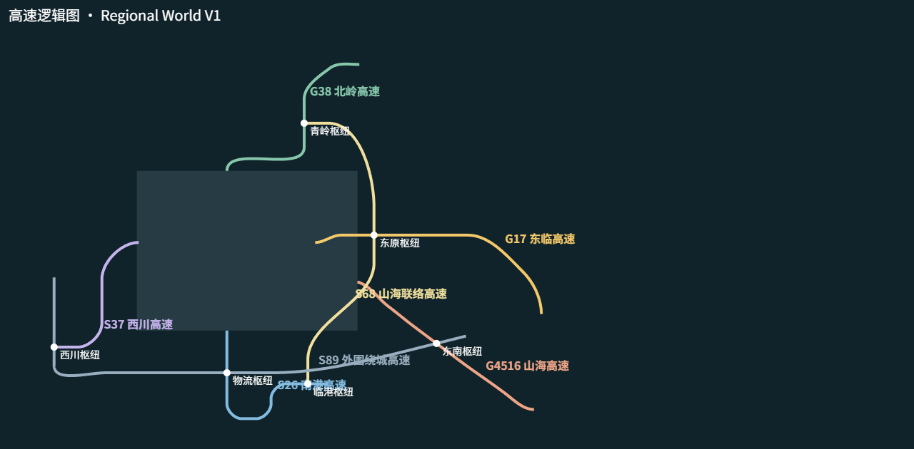
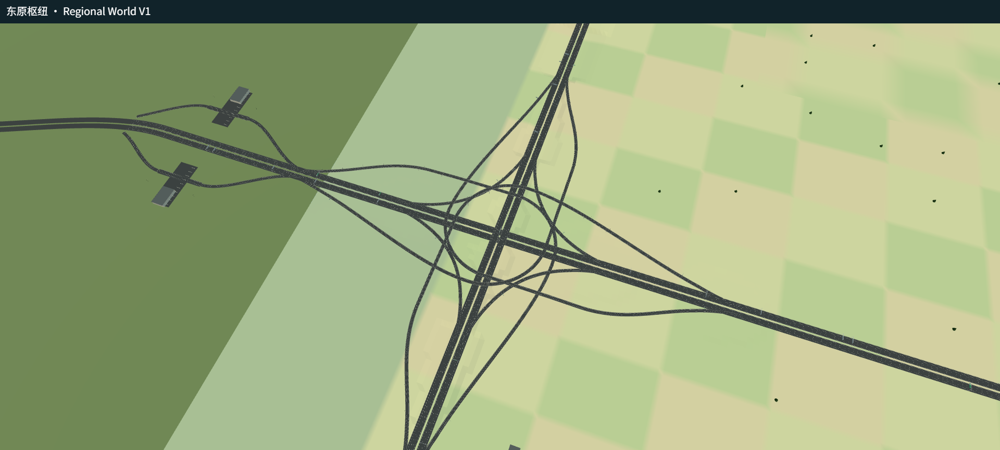

# Regional World V1 — 十个预览

以下图像来自共享 CityGround / RoadBuilder 的实际渲染；高速逻辑图使用同一世界坐标和路线元数据。

| 视角 | 文件 |
|---|---|
| 区域总览 | [overview.png](previews/overview.png) |
| 高速逻辑图 | [logical.png](previews/logical.png) |
| 东部平原 / G17 | [east.png](previews/east.png) |
| 北部山地 / G38 | [north.png](previews/north.png) |
| 东原涡轮式枢纽 | [dongyuan.png](previews/dongyuan.png) |
| 青岭三向枢纽 | [qingling.png](previews/qingling.png) |
| 临港不对称枢纽 | [lingang.png](previews/lingang.png) |
| 东临大河桥 | [bridge.png](previews/bridge.png) |
| 东临服务区 | [service.png](previews/service.png) |
| Streaming 调试 | [streaming.png](previews/streaming.png) |

交互预览：[打开十视角预览](http://127.0.0.1:4175/artifacts/regional-world/preview.html)。需要本项目 Vite dev server；若服务器已停止，可运行 `pnpm run dev -- --host 127.0.0.1 --port 4175`。

正式游戏仍使用 `start-game.cmd` 和已更新的 `dist`，选择 City Main。生产调试开关为 `?regionalDebug=1`。

