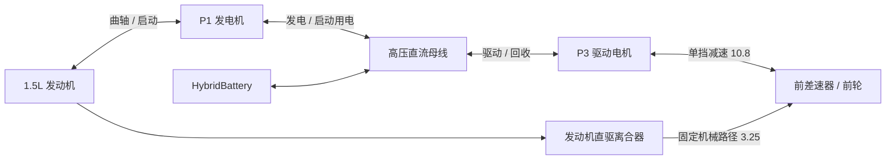

# 秦 PLUS DM-i 210KM 与可复用 EHS 架构

日期：2026-11-14。本页说明架构和参数；后续五项复核、实际 GPU/音频证据及构建/Release 结果见 [本轮复核记录](QIN_PLUS_EHS_REVIEW_2026-11-14.md)。

## 车型基准与资料

锁定中国市场 **2026 年 1 月 8 日上市的秦 PLUS DM-i 210KM 进取型**，车辆 ID 为 `byd-qin-plus-dmi-210-2026`。没有使用 2027 换代秦 PLUS、秦 L、旧款 55/120KM 或坦克500的标定。

优先资料为[比亚迪 2026 款秦 PLUS DM-i 用户手册](https://www.byd.com/material/domestic-official/user-manual/dynasty/2026%E6%AC%BE%E7%A7%A6PLUS%20DM-i%E7%94%A8%E6%88%B7%E6%89%8B%E5%86%8C260430-new.pdf)。手册第 32–33 页明确描述 EV 优先、发动机串联发电、中高速部分工况并联，以及发动机和电机共同驱动；充电章节支持外接交流/直流及行驶回收。手册不提供本次需要的完整 P1 参数、齿比或效率图，以下没有将这些估值写成原厂数据。

| 项目 | 本轮采用值 | 依据与可信边界 |
|---|---|---|
| 年款/配置 | 2026 年 1 月款，210KM 进取型 | [比亚迪王朝武汉中欣4S店车型页](https://dealer.yiche.com/100234749/price_detail/186133.html?leads_source=p033001)确认上市日期与具体配置 |
| 发动机 | 1.498 L，自然吸气直列四缸；74 kW、126 Nm | 上述经销商页面确认排量级别与功率/扭矩；[车型参数参考表](https://detail.zol.com.cn/2154/2153652/param.shtml)列出 BYD472QC 与 1498 mL。完整曲线及功率峰值转速为估值 |
| P3 驱动电机 | 前置永磁同步，120 kW、210 Nm | [对应 210KM 进取型车型页](https://price.pcauto.com.cn/m138738/?ad=21496)列出这组参数；没有套用早期 132/145 kW、316/325 Nm 的 DM-i 电机 |
| 动力电池 | 25.28 kWh，磷酸铁锂 | 上述对应车型页与[2026 年 1 月上市报道](https://www.autohome.com.cn/news/202601/1311669.html?from=m&platform-key=pc)交叉核对。25.28 是公开容量；将其作为全部可积分容量是游戏简化 |
| 车身 | 4780 × 1837 × 1515 mm，轴距 2718 mm | 经销商页面确认长宽高；对应车型页确认轴距 |
| 轮胎 | 前后 225/60 R16 | [对应年款参数索引](https://m.zhichepai.com/auto/7549/peizhi/226029)及[对应进取型参数索引](https://car.autohome.com.cn/config/spec/76109.html)。几何/物理统一使用约 0.338 m 半径、0.225 m 胎宽 |
| 整备质量 | 暂以 1580 kg 标定 | [对应车型参数参考](https://www.shenyangcar.com/chexing/76109.htm)有此记录；缺少厂家独立确认，仍按**工程暂定值**处理。基础车质量扣除 65 L 汽油质量，FuelSystem 再按实际余油加入，避免重复计算 |
| 纯电续航 | 标称 CLTC 210 km | 对应车型页。未运行 CLTC 工况，不宣称模拟已复现认证续航 |
| 加速/最高车速 | 资料标称 7.6 s、180 km/h | 经销商车型页。其他媒体有 185 km/h 记录，不混用；模拟最高速度由实际齿比、电机转速和阻力产生，未做极速验收 |
| 综合动力 | 未设置“74 + 120 = 194 kW”系统额定值 | 每步按曲轴转速、P1/P3 曲线、母线、一个电池预算与两条实际传动路径求输出 |

除明确指出的公开规格外，以下均为**工程估值**：P1 发电峰值 65 kW/125 Nm、启动峰值 12 kW/85 Nm；P1 与曲轴按 1:1 等效耦合；P3 减速比 10.8、发动机直驱总减速比 3.25；电机效率图、铜损、逆变器效率 97.5%、母线效率 99%；电池标称电压 355 V、内阻 0.065 Ω、135/48 kW 放电/充电上限、温度模型；AC 6.6 kW/92% 效率；底盘、制动、SOC 门限、传动损耗和启停控制。48 kW DC 在公开配置表中有记录，但充电曲线与效率仍为估计。发动机燃油模型沿用 FuelSystem，峰值热效率取 40%，不冒充厂家完整 BSFC 图。

## 动力关系



`EhsHybridSystem` 没有继承、调用或复制 P2HybridPowertrain 的 K0 分配逻辑。P1 不向轮端单独加扭矩；P3 始终通过自己的减速器驱动前轴。发动机仅在直驱离合器传递正扭矩时参与轮端驱动。串联状态的发动机轮端扭矩严格为零。

复用 Engine/FuelSystem 的转动、燃油与声音生命周期；Engine 的积分惯量包括曲轴和 P1 转子。`ICEPowertrain` 仅作为现有生命周期/遥测兼容基类，其普通 clutch/gearbox 不参与 EHS 的机械计算。新增可选变速器注入，避免生成假想的皮带 CVT。`EhsTransmission` 在旧接口中用 `CVT` 标识 E-CVT，实际没有变速滑轮、模拟挡位或换挡过程；PRND 与固定物理传动比独立。

## 工作状态与能量管理

内部只定义三种动力路径，避免为直驱复制第四条动力链：

| 路径 | 发动机/P1 | 发动机直驱离合器 | P3 |
|---|---|---|---|
| EV | 发动机停止，P1 不发电 | 断开 | 独立前驱，支持回收 |
| SERIES | 发动机按功率需求选择高效转速，P1 发电 | 断开 | 承担全部轮端驱动 |
| PARALLEL | 发动机与 P1 按需分配曲轴功率 | 同步后渐进接合 | 补足目标轮端扭矩 |
| DIRECT 显示状态 | PARALLEL 中发动机承担主要驱动 | 接合 | 辅助很小或接近零；没有另一套直驱算法 |

`path` 表示控制器请求路径；`state` 结合实际离合器接合状态显示。请求并联而仍在同步时，工作显示保持 SERIES。独立 P1/P3 机械功率与 DC 功率、离合器实际扭矩和滑差均可读取。

`EhsEnergyManagement` 使用规则、线性查表和滞环：

- HEV 在高 SOC、低功率需求下保留 EV；EV 策略提高发动机介入门限，但低电、温度导致放电不足或高负载仍可进入 HEV，与官方手册的保护性切换一致。
- 普通保电储备在 SOC 22% 启动、恢复到 28% 后解除；驾驶员 HOLD 可设置 20–80% 目标。请求随 SOC 偏差产生最多 18 kW 补电需求。
- 发动机启停同时考虑 SOC、轮端需求功率、可用电池功率和驾驶策略，具有最小运行/停机时间；不是单一车速开关。
- 并联要求前进、非制动、合适的直驱曲轴转速和负载。低 SOC 时把补电需求也计入负载，直驱不能满足时保留串联，避免低速机械路径拖低可持续功率。
- 串联用功率查表选择约 1800–6000 rpm 的目标，发动机通过节气门与 P1 负载调速；没有将车轮转速复制给发动机。
- P1 启动用电从同一 DC 母线支付；发电前预留升转扭矩。并联先同步，再用有限容量、有限接合速度的离合器传扭。
- P3 补偿机械分支扭矩变化；最终仍受电池、转速、热、牵引和 ABS 的实际限制。没有修改车辆速度或姿态维持平顺性。

## 电池、制动与能量账目

`HybridBatteryConfig` 是独立于 P2/EHS 的储能和充电契约。HybridBattery 继续使用 BatteryPack 的 OCV、IR 压降、电流、SOC、效率、冷/热降额及热积分，原 P2 配置仍可按结构兼容传入。

母线统一计算：

`P_battery_terminal = P_P3_DC + P_P1_DC + P_auxiliary`

约定电池和电机 DC 正值为耗电，负值为向母线送电；P1GenerationPowerW 是扣除发电/逆变器/母线及铜损后的正发电功率。只对电池执行一次 step，不把 P1 发电同时重复算作“给电池充电”和“直接供 P3”的两份能量。

制动在普通 BrakeTorqueCoordinator/ABS 路径中进行：P3 的实际负扭矩提供回收，液压制动补足，ABS 同步削减刚性前轴的回收能力。电池在 finishStep 中才积分，使用 ABS 修正后的扭矩。P1 的过剩发电也会在同一步削减，并把未使用的负载冲量返回曲轴。满电仍允许回收电能供附件，不能存入的部分由液压制动承担。

台架能量检查边界为：

`燃油化学能 + 电池化学能输出 + 电网输入 = 轮端功 + 曲轴/P1 转动能变化 + 总损耗`

总损耗分别记录燃油转换、发动机摩擦、P1/P3 电气转换与铜损、母线、传动、直驱离合器、电池和充电器损耗以及附件消耗。净曲轴功率与燃烧功率分开，不能用发电目标功率代替实际轴功率扣油。电池化学能变化来自实际存储量差值，不通过直接改 SOC 生成电量。

轮端功率使用当前固定物理步的轴速度采样，整车四轮积分沿用既有求解器；台架残差不能解释成整车轮胎/路面/刚体积分的机器精度守恒认证。

## 外观、座舱与声音

独立 QinPlusExterior、QinPlusWheels、QinPlusCabin 和 QinPlusDisplay：2026 年 1 月款三厢比例、Dragon Face 横向格栅/灯带、尾灯、225/60 R16 轮胎、16 英寸轮毂与制动件；双拼座舱、三辐方向盘、8.8 英寸浮动仪表及 10.1 英寸中控的程序化近似。前后轴、轮胎、碰撞长度和镜面位置使用同一尺寸基准。

能量屏显示实际 EV/HEV 与路径、P1 发电、P3 输出、母线/电池功率、SOC/kWh、发动机转速、温度、保电目标和直驱离合器。点击中控或使用已有中控翻页命令可切到导航；导航借用 SharedVehicleData，不建立专属传感器。关闭电源后可显示真实外接充电状态。

导航/仪表 CanvasTexture、内饰和其他可变材质均由实例拥有；使用现有 VehicleAssetRegistry 共享静态资源，测试覆盖同一注册表中的第二辆实例及先实例、后注册表的释放顺序。整车 138 个 Mesh（含已有镜面和显示结构），没有用大量细碎 Mesh 堆造型。

QinPlusAudioProfile 复用未改动的 EngineAudio：自然吸气四缸和轻量电驱合成声；发动机音调用真实曲轴转速、节气门和燃烧负载，串联时不随车速强制变调；并联叠加电机声。没有原厂录音；已完成实际 GPU/Web Audio 复核，主观音色与驾驶感受仍等待用户验收。

## 专项验证

执行命令（esbuild 仅打包测试脚本，不是生产构建）：

```powershell
pnpm exec esbuild scripts/run-ehs-selftests.ts --bundle --platform=node --format=esm --outfile=.tmp-ehs-selftests.mjs
node .tmp-ehs-selftests.mjs
pnpm exec tsc --noEmit
```

专项结果：**16 组动力专项通过；7566 项车辆集成断言通过；17 项几何/材质/HMI 断言通过。** 后续六车回归、闭环驾驶热工况、轻量构建和 Release 结果记录于复核文档；未运行全量 selftests。

| 用户要求 | 对应验证及结果 |
|---|---|
| 1. EV 起步/巡航/加速 | 0、12、25 m/s 台架高 SOC 低中负载：P1 为零、发动机关闭、P3 正驱动、电量下降；另测整车加速 |
| 2. 独立串联发电 | 同等功率需求下，车速 12→16 m/s，发动机约 3614.63→3614.60 rpm；P1 约 39.35 kW，机械直驱扭矩为零 |
| 3. 串联→并联 | 速度渐升，真实离合器同步接合；部分负载专项最大单步轮端变化约 20.10 Nm；新增全负载过渡断言 |
| 4. 发动机/P3 并联 | 接合后曲轴与 P3 同时有正扭矩，路径和实际输出一致 |
| 5. 高速直驱 | 31 m/s 中低负载，离合器接合，进入 DIRECT 显示状态 |
| 6. 深踩油门 | 高 SOC 仍按需求进入 HEV；整车轨迹包含串联升转和高速并联 |
| 7. 低 SOC 持续行驶 | 360 s、18 m/s 中等台架负载，SOC 18%→约 23.80%，持续消耗真实燃油并提供驱动 |
| 8. 高 SOC 纯电优先 | 三组部分负载 EV 台架保持发动机关闭 |
| 9. 发电与补电 | 驻车保电 60 s，存入约 0.28273 kWh，消耗约 0.10646 L 燃油，P3 轮端功为零 |
| 10. 回收与 ABS | 台架同一步回收撤销；整车冰面 469 步 ABS 释放并削减回收；60%/满电两组均由液压完成停车 |
| 11. 外接充电 | AC 120 s，电网输入 0.220 kWh，电池实际增加约 0.19767 kWh；上电及挂 D 互锁生效 |
| 12. 高低温限制 | -20°C 不能充电且放电降额；65°C 放电从 135 kW 降至约 16.40 kW，继续按实际预算供能 |
| 13. 持续负载/热稳定 | 600 s 重负载台架状态有限；P1/P3/电池约 81.92/72.76/23.00°C。超出可持续发电功率时 SOC 会下降，不能承诺任意功率永久保电 |
| 14. 启停与切换连续性 | P1 启动及发动机停机时保留 P3 驱动；单独启停场景最大单步轮端变化约 14.36 Nm；物理功率保护优先，严重热限功率时不保证相同平顺指标 |

附加检查包括单包电功率限值、P1/P3 机械功率限值、每个损耗分量不得产生能量、燃油不足时禁止发电、倒车 P3 独驱、P 挡移动锁止、配置深复制，以及已有 ICE/P2/EV 的工厂类型。既有车型仅检查工厂接入，没有运行完整回归并声称其所有行为通过。

台架能量残差在此次测试中小于 0.000001 W（断言门限 2 W），微小负损耗约 10^-11 W 属浮点舍入。没有把这个数字当成标定准确度。

原始报告：[动力/能量](../artifacts/qin-plus-ehs/powertrain.json)、[整车/ABS](../artifacts/qin-plus-ehs/vehicle.json)、[几何/HMI](../artifacts/qin-plus-ehs/visual.json)。

## 修改文件与共享接入

新增的通用架构与标定：

- `src/vehicle/config/HybridBatteryConfig.ts`
- `src/vehicle/config/EhsHybridConfig.ts`
- `src/vehicle/config/validateEhsHybridConfig.ts`
- `src/vehicle/config/qinPlusDmiPhysicsConfig.ts`
- `src/vehicle/powertrain/EhsHybridSystem.ts`
- `src/vehicle/powertrain/EhsEnergyManagement.ts`
- `src/vehicle/powertrain/createVehiclePowertrain.ts`
- `src/vehicle/transmission/EhsTransmission.ts`

新增的车型、控制和测试：

- `src/vehicle/visual/QinPlusVisualConfig.ts`
- `src/vehicle/visual/QinPlusExterior.ts`
- `src/vehicle/visual/QinPlusWheels.ts`
- `src/vehicle/visual/QinPlusCabin.ts`
- `src/vehicle/visual/QinPlusDisplays.ts`
- `src/audio/QinPlusAudioProfile.ts`
- `src/ui/EhsControlPanel.ts`
- `src/vehicle/EhsHybrid.selftest.ts`
- `src/vehicle/EhsVehicle.selftest.ts`
- `src/vehicle/visual/QinPlusVisual.selftest.ts`
- `scripts/run-ehs-selftests.ts`
- 本文与 `artifacts/qin-plus-ehs/` 中的三份报告。

共享文件仅增加必要接入：

| 文件 | 本轮接入内容 |
|---|---|
| `src/vehicle/VehicleCatalog.ts` | 新车型 ID、配置/音频/视觉注册，独立配置复制，排除纯燃油测试目录 |
| `src/vehicle/physics/VehicleDynamics.ts` | 将原构造分派委托给 createVehiclePowertrain，仍使用同一个轮端/制动接口 |
| `src/vehicle/powertrain/ICEPowertrain.ts` | 可选安装 TransmissionSystem；默认构造保持原行为 |
| `src/vehicle/powertrain/HybridBattery.ts` | 构造参数改为独立电池/充电契约，积分逻辑未修改 |
| `src/vehicle/powertrain/Powertrain.ts` | 可选 ehs 遥测和初始/恢复状态 |
| `src/vehicle/config/validateVehiclePlatformConfig.ts` | EHS 专项配置校验入口 |
| `src/vehicle/visual/VehicleVisualConfig.ts` | 秦 PLUS 外观类型 |
| `src/vehicle/visual/VehicleStaticAssets.ts` | 外观/轮毂构建与包络接入 |
| `src/vehicle/visual/CockpitLayout.ts` | 秦 PLUS 座舱结构参数 |
| `src/vehicle/visual/Cockpit.ts` | 独立座舱构建、更新及中控翻页 |
| `src/vehicle/visual/InstrumentCluster.ts` | 独立仪表与 ehs 显示数据 |
| `src/vehicle/visual/VehicleVisual.ts` | 使用独立座椅，避免叠加通用座椅 |
| `src/game/DrivingGame.ts` | EHS 控制面板、显示遥测、发动机/电驱音频层接入 |

没有修改 P2HybridPowertrain、P2 能量分配/变速器、坦克500车型文件、地图、天气、依赖或构建/发布脚本。当前工作区原有未提交改动均保留；上述共享文件的完整 git diff 可能包含本轮之前的其他修改，不能将整个 diff 都算作 EHS 改动。

## 已知简化与人工验收

- P1、传动比、可用电池窗口、内阻/效率/热图及悬架为工程模型，后续取得原厂数据可单独替换标定。没有认证油耗/CLTC 循环、外接充电站交互、原厂 CAN 控制或完整 EHS 内部齿轮/弹性扭振模型。
- 复核后全链路 0–100 km/h 默认 HEV 约 **8.12 s**、EV 优先约 **8.28 s**，尚未匹配资料标称 7.6 s；没有通过改速度、虚增电机功率或抓地力追数字。无极速或实车标定准确度结论。
- 能量流图和外观为程序化近似；已补充实际 NVIDIA GPU 渲染检查并修复内衬/B柱穿出、仪表遮挡，已保存真实合成音频。几何/HMI 的 canvas mock 仍只承担结构测试，主观听感不能由信号测量替代。
- 结构上复用 ICE 生命周期基类，保留其兼容用 clutch/gearbox 持有对象，但不让其进入 EHS 动力路径。若未来拆分更细的燃烧源服务，可迁移适配器，本轮不重构全局车辆核心。
- 没有强行填平热保护、耗尽电量或牵引限制下无法提供的扭矩。没有开展本任务之外的整车调优或完整车队回归。

人工验收清单：

- [ ] 开发环境从车型菜单选择“BYD 秦PLUS DM-i 210KM (2026 进取型)”，检查驾驶视角、比例、轮胎、后视镜、仪表和光照。
- [ ] 在高 SOC、部分踏板下确认安静 EV；HOLD 提高目标后确认串联发电声不机械追随车速。
- [ ] 前进渐加速，确认串联同步到并联平顺；高速中等负载观察 DIRECT，深踩时观察发动机与 P3 助力。
- [ ] 低 SOC 行驶观察发动机持续补能，制动时观察 P3 回收和液压补足，冰面确认 ABS 提示/回收减弱。
- [ ] 停车挂 P 并关闭电源，连接 AC，观察实际功率/SOC 增加；断开后恢复 READY。
- [ ] 点击中控切换导航/能量页，反复换车或重新载入，确认屏幕、材质和车轮动画不串车、不丢失。

本轮没有未完成的共享接口接入；剩余人工视觉、声音、驾驶体验与实车标定验收按以上边界保留。
