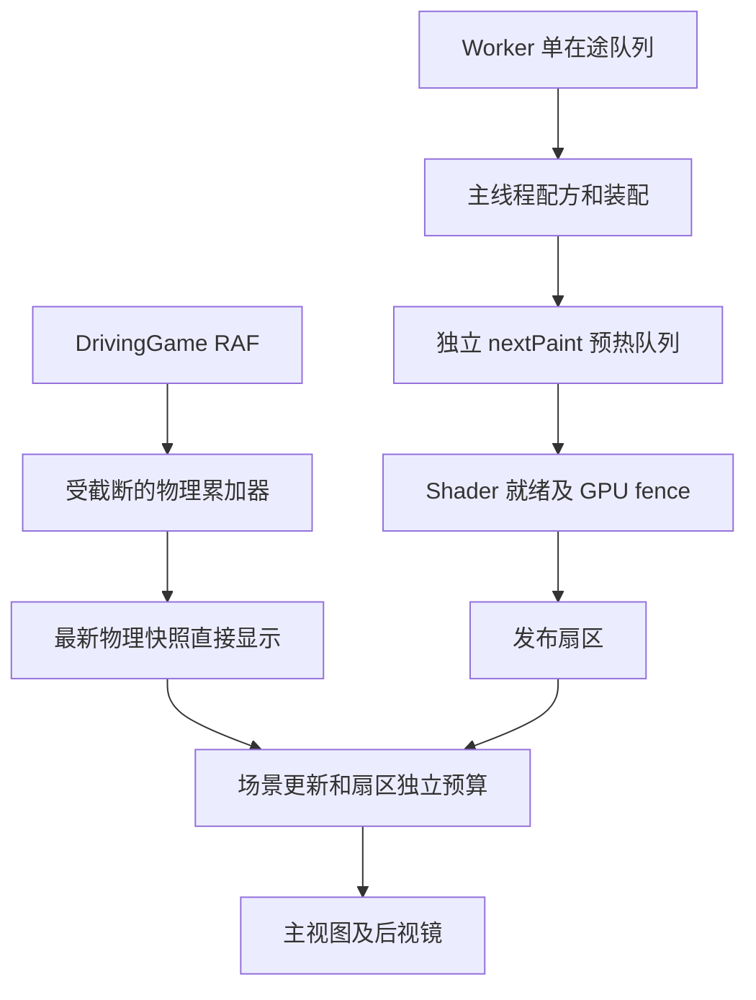
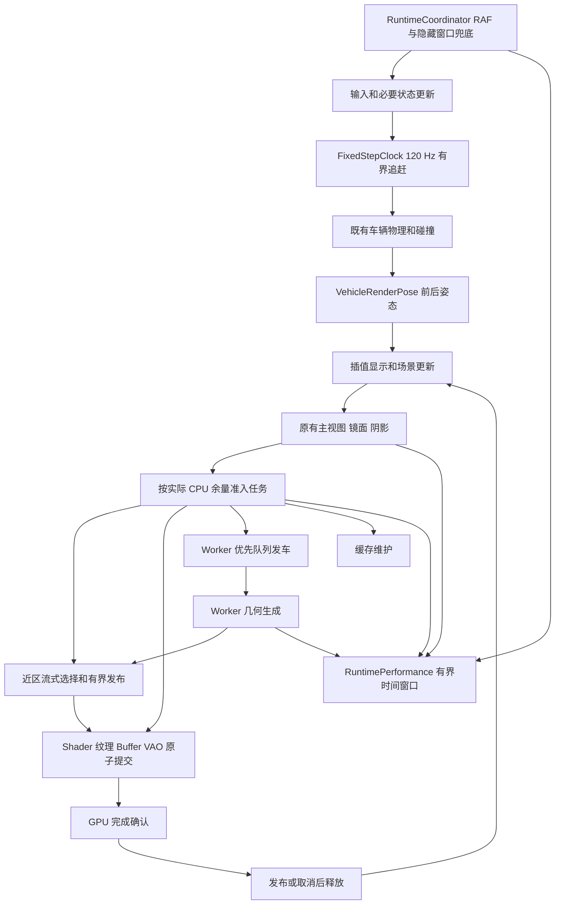

# Runtime V2 第一阶段

本轮已将生产驾驶帧、物理时间管理、车辆显示插值、城市发布、Worker 发车和 GPU 预热接入统一协调器。保留 Three.js、多视图、现有道路几何及碰撞模型。按用户最后指示，完整构建在核心验证期间主动停止，构建与发布由并行坦克 500 任务负责。本报告中的专项验证和驾驶采样均已完成。

## 现有架构与结构性问题

审查以实际调用链为准，覆盖 DrivingGame、StartupApplication、SectorManager、CityGround、VisualStreamingWorker、StreamingShaderWarmup、MirrorSystem、FixedStepClock 所替换的累加逻辑，以及 Electron 窗口创建。

- DrivingGame 同时拥有 RAF、输入、物理循环、场景更新、发布请求与多视图渲染。原先对墙钟 delta 限制 100ms，再限制物理累加器，超过限制的驾驶时间会丢失。物理完成后的最新姿态直接用于显示。
- SectorManager 原先根据帧间隔独立切换 1.5/3ms 预算，ShaderWarmup 则通过自己的下一帧队列和 GPU fence 单独发车。两个系统不能共享当前输入、物理和渲染已经消耗的 CPU 预算。
- Worker 原有单在途、优先队列、可转移缓冲和协作取消继续有效。Worker 生成完成、主线程装配完成、GPU 准备完成、实际发布是不同边界。把 Worker 编译 CPU 与主线程接收等待相加会掩盖真正的发布成本。
- 静态道路、地形和实例模板已有共享与释放规则。ShaderWarmup、SectorManager 的异步准备会借用几何，卸载必须等待借用结束。协调器调度任务，资源所有权继续归现有资源模块。
- 主视图每帧准备阴影，镜面禁用重复的自动阴影更新并复用相同场景资源。CPU render 调用会包含同步驱动等待，不能直接当成 GPU 执行时间。
- Electron 的可见状态、后台节流和合成不由游戏控制。原始应用路径没有完整逐帧显示呈现遥测。关闭采样窗口节流会改变页面可见性语义，后台恢复验收必须单独使用正常节流。

旧数据流如下。

## 新运行时与模块职责

| 模块 | 实际职责 |
|---|---|
| RuntimeCoordinator | 单一驾驶 RAF、当前 CPU 余量、优先级、任务合并、暂停、继续、取消、失败和退出 |
| FixedStepClock | 固定 1/120s 步进，单帧最多 16 步并受 5ms CPU 追赶预算限制，保留未消费的活动时间 |
| VehicleRenderPose | 用固定容量数组保存前后两个车身、车轮和转向姿态，角度取短弧插值 |
| RuntimePerformance | 记录 CPU 分段、RAF、物理债务、实际绘制、资源数量、Worker、GPU 查询及稀疏浏览器呈现证据 |
| DrivingGround 接口与 CityGround | 向城市流式系统注入协调器，提供慢帧时的轻量运行状态 |
| SectorManager | 使用协调器剩余期限推进装配与发布，缓存维护独立为低优先级任务 |
| VisualStreamingWorker | 将原有优先队列发车纳入协调器，继续管理单在途任务、去重、取消与迟到结果 |
| StreamingShaderWarmup | 将纹理、程序准备、Buffer/VAO 绘制拆成协调器原子任务，继续等待真实 GPU 完成 |

优先顺序是必要输入与物理、当前场景、近区资源、远景和维护。输入和物理仍是明确的主循环阶段。资源任务在本帧正常渲染后准入，使用当前 CPU 实耗及平滑值计算剩余预算。所有嵌套发布共享协调器期限。任务超过可抢占边界时会记录原子成本；个别 Shader、上传和扇区选择仍可能超预算。长期无空闲时，有限的饥饿保护允许少量任务继续前进。

同 ID 任务共享生命周期，暂停状态保留 continuation，取消和过期会完成生命周期并阻止执行。Shader 等待 GPU fence 时不占用执行额度。发布、实例模板所有权和延迟释放继续使用既有机制。每个主线程生成 continuation 每帧最多被调用一次，内部生成器仍按剩余期限推进。

## Simulation 与显示

350ms 活动时间的专项验证先消费最多 16 步，再在后续帧消费剩余时间，总计 42 个 120Hz 步，未删除时间债务。单个不可打断的物理步骤可能超过预算，协调器不会修改动力学结果去压缩耗时。

显示使用两个固定步姿态和累加器余量插值，最多引入一个物理步的显示延迟。物理快照、碰撞、导航、仪表与控制继续读取真实当前状态。重生、换车和恢复会重置插值端点。窗口隐藏与菜单暂停期间不积累驾驶时间，回到前台后重新起算。

## 性能记录的口径

- 每个驾驶会话保存最近 4,096 帧的固定容量数值环，慢帧上下文最多 96 条，原子成本 128 条，Worker 与 GPU 样本分别最多 256 条。导出时形成秒级窗口，平时不做全图统计。
- CPU 按 simulation、scene、render、streaming、assets、background、maintenance 记录。帧内实际提交会累计主视图、镜面、阴影与准备绘制，另外记录排除资源准备绘制的实际视图提交和唯一对象 ID。
- GPU 使用可用的 EXT_disjoint_timer_query_webgl2 稀疏异步查询，丢弃 disjoint 结果。外部采样已占用同一查询目标时不嵌套查询。
- Three.js 几何、纹理和程序数量来自 renderer.info。Heap 来自可用的 performance.memory，主线程与 Worker 的独立 Heap 通过验证窗口的 CDP 分别采样。
- 生产遥测将 GPU Buffer 总字节及完整呈现间隔记为 null，并说明接口限制。验收入口复用原有 WebGL 分配观察器记录实际 Buffer 分配，未把它当显存总量。Long Animation Frame 的时间戳单独保留，无法据此生成完整显示器呈现序列。
- 准备中的地图 CPU 索引、首屏真实渲染和 PMREM 仍有现有加载阶段的 measure。它们发生在正常驾驶就绪之前，并未全部迁入资源任务调度。

## 相同路线和画质的实测

本轮冻结开工源码为基线，使用既有 v507 全图和 preload-profile 出生点、test-6at-sedan、1186×658 视口、DPR 1.5、120Hz、相同 60 秒驾驶输入控制器。两边均跨扇区并完成掉头。正常物理时间处理改变了在慢帧下的前进进度，因此 60 秒后的精确站位和驻留集合会略有差异。

| 指标 | 本轮冻结基线 | 最终实现 |
|---|---:|---:|
| 驾驶 P95 / P99 | 27.6 / 52.6 ms | 16.3 / 31.9 ms |
| 超过 33 / 50 / 100 ms | 116 / 53 / 6 | 55 / 12 / 1 |
| 最大驾驶帧间隔 | 305.6 ms | 151.5 ms |
| 点击至驾驶就绪 | 10.88 s | 9.29 s |
| performance.memory 驾驶峰值 | 543.5 MiB | 580.6 MiB |
| CDP 主线程 JS Heap 采样峰值 | 353.1 MiB | 368.5 MiB |
| CDP Worker JS Heap 采样峰值 | 436.1 MiB | 410.5 MiB |
| GL Buffer 峰值 | 99.68 MiB | 83.78 MiB |
| 稀疏 GPU 执行 P95 | 15.77 ms | 12.24 ms |
| 全视图 Draw Calls P95 | 1,394 | 1,266 |
| 阴影调用 P95 | 132 | 132 |
| 远景页调用 P95 | 41 | 44 |
| 提交三角形 P95 | 861,856 | 898,095 |

11 月 9 日历史样本的 P99 为 41.8ms、每分钟超过 50ms 约 15 帧、最大 61.2ms。本次冻结基线测到的波动更大，因此历史样本只作为参考。最终最大帧间隔仍高于那个历史样本，不能宣称全部指标都优于历史。初次候选数据也保留在 after-*，其 P99 为 36.3ms、超过 50ms 15 帧、最大 205.3ms。最终数据来自加入完整可见对象监控后的源码，没有从多次同版运行中挑最佳值。

最终遥测保留窗口中的主线程总 CPU P95/P99 为 14.6/16.5ms，render 段为 12.6/14.3ms，场景段 P99 为 1.8ms。最长流式调用仍为 19.5ms。最慢 151.5ms 间隔出现在驾驶约 35.29 秒，前一帧 CPU 约 14.2ms，下一帧 CPU 约 13.5ms，物理债务随后消化。证据不足以将这个空档归因于 GC、GPU 或 Electron 合成。

主线程 Heap 峰值有所上升，不能报告内存全面改善。驻留几何、已消费活动时间及浏览器分配/回收时机均会影响样本，本轮没有证实其中哪一项主导 Heap 变化。退出后日间和生命周期验收的配方、实例模板及观测到的 GL 缓冲均归零。

## 回归结果与构建交接

- 运行时专项 22 项通过，覆盖 120Hz 保留时间、追赶预算、姿态与角度插值、重生、优先级、continuation、暂停取消、任务合并、记录容量及退出。
- 加载、取消重试、迟到发布、GPU 程序就绪、GPU fence、实例材质和共享资源释放专项通过。现有 loading 集成通过。
- 完成一轮 15 秒雨夜驾驶，雨量为 0.5，夜间、左右镜面、阴影与菜单暂停检查通过。雨夜冷加载约 42.1 秒，尚无本轮同条件旧版雨夜加载对照，保留为后续问题。
- 最初的可见性回归因采样窗口禁用节流，页面一直保持 visible 而未通过。恢复正常 Electron 窗口节流后，以单独 1 秒驾驶的生命周期场景验证了真实隐藏、物理静止、恢复和镜面阴影。恢复后的物理余量约 7.7ms，未追赶隐藏时间。
- 完整类型检查通过。正常完整 build 已启动，类型检查和 v507 批准门禁通过。随后用户要求坦克 500 任务负责构建与发布，本轮停止自身构建子进程，退出记录为 stopped-by-user。核心回归和完整构建没有完成，不能记为通过。dist 未由该次中断构建更新。
- 开工时记录 1,100 个文件和两个发布归档指纹。正式地图与 Git HEAD 保全通过。并行坦克任务的车辆文件改动独立列在 preservation.json，本轮没有编辑这些文件。性能终版记录写于 00:15，所记录的坦克并行变更自 00:19 后开始。坦克任务后续变化由其最终统一构建检查。

[专项日志](../artifacts/runtime-v2/runtime-selftest-final.log) · [加载回归](../artifacts/runtime-v2/loading-selftest.log) · [GPU 回归](../artifacts/runtime-v2/gpu-check.json) · [真实窗口生命周期](../artifacts/runtime-v2/lifecycle-runtime-regression.json) · [雨夜检查记录](../artifacts/runtime-v2/regression-runtime-regression.json) · [停止构建说明](../artifacts/runtime-v2/build-stop.txt)

## 第二阶段的静态世界方向

远景页面数量不是唯一判断依据。最终路线结束有 65 个页面，实际远景调用 P95 为 44，全视图总调用 P95 为 1,266。当前按较大的 8×8 扇区桶接纳不可变页，有的页跨越较大空间，部分方向仍会让宽包围体通过剔除。页面追加减少上传成本，却可能提高多视图提交次数。

第二阶段宜先建立固定空间簇与内容边界的两层索引。上层用于粗略剔除，下层保留道路、路口、桥隧支撑层和建筑组的可见性。实例模板与材质继续共享，同材质的静态数据在空间簇内批量提交，避免全城一个大包围体。HLOD 可以按同样簇边界复用原远景资产，先核对斜视角、镜面和高架层级再推广。

阴影需要单独区分静态世界与动态车辆的更新条件，在原画质下验证缓存失效。现有 Three.js 主视图与镜面仍共享几何及纹理，下一阶段应复用这些资源，不为每个视图复制世界。空间簇和阴影优化应接入本轮记录的可见对象、远景调用和 CPU/GPU 时间，不能只用页数推断收益。

第一阶段仍保留 DrivingGame 的功能编排、MenuScene 的独立菜单渲染、构造前的 runBatched 准备、物理安全预备以及首屏真实渲染。Three.js、道路几何、天气和 Electron 呈现链均沿用现有实现。它们是后续按证据迁移的边界。

## 修改文件与记录

新增 runtime/FixedStepClock.ts、RuntimeCoordinator.ts、RuntimePerformance.ts、VehicleRenderPose.ts、RuntimeCoordinator.selftest.ts，以及 scripts/run-runtime-selftests.mjs。现有源码仅修改 DrivingGame.ts、StreamingShaderWarmup.ts、DrivingGround.ts、CityGround.ts、SectorManager.ts、VisualStreamingWorker.ts，验证入口修改 scripts/performance-preload.ts。

[完整文件及并行改动记录](../artifacts/runtime-v2/preservation.json) · [性能比较](../artifacts/runtime-v2/comparison.json) · [调度与绘制比较](../artifacts/runtime-v2/runtime-comparison.json) · [最终逐帧](../artifacts/runtime-v2/final-cold-day.json) · [运行时窗口和慢帧上下文](../artifacts/runtime-v2/final-cold-day-runtime.json) · [日间截图](../artifacts/runtime-v2/final-drive-cold-day.png) · [雨夜截图](../artifacts/runtime-v2/regression-drive-rain-night.png)
