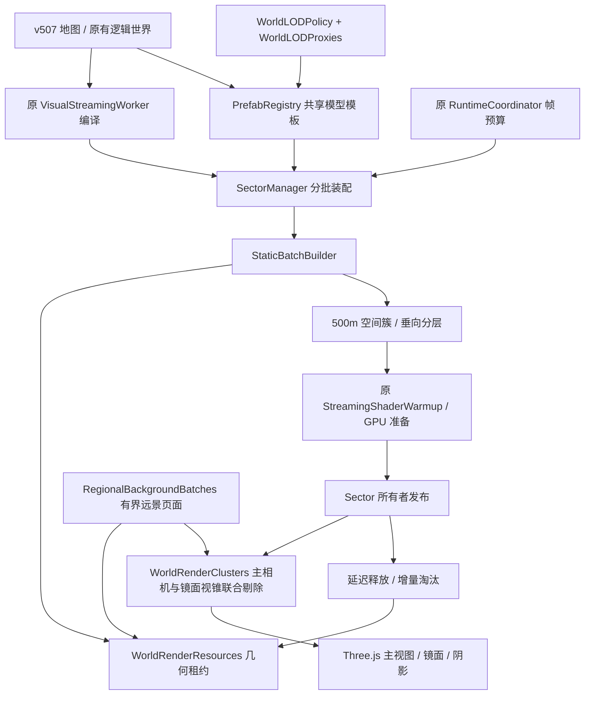

# Runtime V2 Phase 2 — World Rendering Architecture

日期：2026-11-16。工作区起点 HEAD：`e42346815360428daf9d90f4e805f527d6b739f1`。本轮基于原有未提交的 Phase 1/1.5 代码，未提交或推送。

## 结果与边界

静态世界已接入公共空间簇、静态合批、模型模板合并、实例化和不可变几何租约。Sector 仍是发布/卸载所有者，空间簇负责实际剔除；道路和附属结构没有合成全城单一 Mesh。原有 RuntimeCoordinator、Worker 编译、120 Hz 车辆物理、地图 v507、碰撞和导航合同继续使用。

最终有效候选为 `artifacts/runtime-v2-phase2/corrected-*`。城市路线绘制调用 P95 降低约 30.6%，提交三角形 P95 降低约 25.4%；CPU Render 提交 P95 从 13.6 降至 11.9 ms。但是 Buffer 占用、场景管理成本和加载时间上升，GPU 时间没有证明改善，因此不能把本轮描述为所有性能目标通过。后文保留这些回归。

测试窗口已改成可移动、可调整大小、可最小化的普通窗口；不置顶、不抢焦点。用户无需为测试放弃正常使用电脑。最终窗口事件记录为空，没有发生最小化/隐藏；但最终窗口使用普通非激活显示，基线采用原先前台显示，两者呈现节奏有差异，不能宣称 RAF P95/P99 为严格受控 A/B 改善。

窗口属性已通过完全隐藏、未加载游戏的 Electron 检查：minimizable/movable/resizable/frame/taskbar 为 true，alwaysOnTop/fullscreen/fullscreenable/kiosk 为 false。原始记录 `window-policy-check.json`；切后台功能测试也尊重用户已最小化的状态。

## 架构与数据流

旧流程：Worker 数据 → Sector 内独立 Mesh/实例批次 → Sector 粗剔除 → Three.js 遍历；远景页面与模型模板各自管理。

新流程：保留 Worker → 发布前有界生成、静态几何和模板合批 → 公共空间边界、几何租约 → GPU 准备 → 按 Sector 原子发布 → 多视图联合剔除。所有工作继续接受现有 Coordinator 调度，没有新建第二个逐帧任务调度器。

### 模块职责

| 模块 | 实际职责 |
|---|---|
| `WorldRenderClusters` | Sector 所有者注册、空间簇边界、主视图和镜面联合可见性、远景页面接入 |
| `StaticBatchBuilder` | 兼容材质/属性/阴影/layer 状态合批，局部坐标，实例矩阵/颜色保留，超大静态几何按三角形归属拆簇 |
| `WorldRenderResources` | 不可变几何内容索引、逐字节核对、引用计数、闲置预算、增量释放 |
| `WorldLODPolicy` | 统一近/中/远距离和滞回；选择仍由现有 RegionalStreaming 驱动 |
| `WorldLODProxies` | 在准备阶段为现有远景建筑生成代理，保留轮廓极值、UV/法线；不处理道路/安全设施 |
| `PrefabRegistry` | 一次合并可重复模型部件，按空间单元实例化，保留灯头锚点、立面/屋顶和地标替换合同 |
| `RegionalBackgroundBatches` | 2km 空间桶、约 1MiB 追加页面、已有预算/取消/延迟释放，复用公共池和可见性 |

簇按材质属性、renderOrder、layers、castShadow/receiveShadow 和道路关键性区分；常规 x/z 单元 500m，按结构高度保留垂向边界。批次上限 65,536 顶点、2,048 实例。原始模型实例首先按 500m x/z 和 8m 地面高度分组，避免远距离树木放入同一城市级实例批次。

动态交通灯头、透明/多材质、自定义绘制回调、骨骼/变形、交互内容保留独立对象。它们仍由相同 Sector 生命周期和既有材质所有者管理；没有为了合批破坏动态状态。

## HLOD、阴影及资源所有权

- 近景保留完整几何；中景沿用既有低网格地形并合批静态模型，道路安全设施继续完整；远景保留道路轮廓并使用预生成建筑代理和原有植被轮廓。
- 距离基准为 750/1800m、100m 滞回。未对所有建筑另做中景简化器，也没有加入驾驶时同步网格简化。
- 远景页面由共同空间索引剔除，不另建并行 HLOD 场景；页面从全局大桶改为 2km 空间范围，目标页面从 512KiB 改为 1MiB，合并等待 200ms。实际页面数量见原始记录，不能用配置推断实际数量。
- 主相机和真实镜面相机共同配置静态边界；不逐帧递归计算每个模型边界。近处内容保留现有 400m 阴影/停车保护范围。
- 镜面渲染暂存并恢复 `shadowMap.autoUpdate` 与 `needsUpdate`，不会消费主视图待处理的阴影失效；动态车辆/昼夜仍由原阴影路径处理。本轮没有实现另一套静态阴影贴图缓存，也没有关闭阴影或镜面。
- Material/Texture 沿用既有所有者，天气、灯光、标牌和显示纹理不复制。模板几何由 PrefabRegistry 拥有，实例仅拥有实例矩阵/颜色。批处理生成的不可变几何和远景页由公共池租用。
- 几何池闲置预算 12MiB，每次最多扫描 16 项、释放 4 项并遵守帧截止时间。活跃资源由真实所有者固定，预算是闲置资源预算，不是活跃 GPU 总量硬上限。借用中的准备资源继续延迟释放。
- 大地形/道路轮廓按三角形中心归属空间簇，三角形自身 XYZ 不变；不裁掉三角形，不修改道路拓扑或实体边界。

## 实施中发现并修复的实际回归

1. 初版模板把部件变换全部烘焙进几何后丢失原部件 frame，后续立面/屋顶替换会失去原高度；灯光采样也依赖该 frame。现改为在首个部件坐标系内合并并保留它的变换。
2. 双灯头即使共享材质，也必须保留两个真实灯光采样锚点；合批 key 包含灯头锚点，实例合批前后灯光世界坐标核对通过。
3. 原来每个材质批次单独做簇剔除，造成管理成本增加；现按相同空间原点/道路关键性合并剔除节点，材质提交仍独立。
4. 旧 CityMain/CityMainV62 检查要求全城树木仅一个实例批次，与空间剔除互斥。现验证每个空间单元的批次预算、全对象/实例颜色完整性，并保留单单元的原始紧凑批次预算；原灯头高度与 8 个地标包络断言未放宽。

早期 `after-*`、`final-*` 虽有更好的数字，但发生在部件 frame 修复前，**不作为最终性能或画质通过证据**。`occluded-before-*` 受窗口遮挡限频无效；`cancelled-after-*` 为用户提前关闭窗口的未完成记录。全部保留供审计。

## 最终城市实跑对照

来源：`before-cold-day*.json` 与 `corrected-cold-day*.json`，统一汇总 `comparison-corrected.json`。地图 507、test-6at-sedan、1186×658 CSS 像素、DPR 1.5、同画质、同出生点、同 60 秒驾驶及掉头返回逻辑，120Hz 物理。实际终点存在流式时序导致的微小差别。由于窗口前后台呈现条件变化，RAF 分布仅为各次真实记录，不能直接归因于架构。

| 指标 | Phase 1.5 基线 | 最终候选 |
|---|---:|---:|
| 进入驾驶等待 | 10.24s | 17.79s |
| 加载 RAF 最大间隔 | 280.9ms | 287.9ms |
| 驾驶 RAF P50 / P95 / P99 | 9.4 / 16.5 / 22.9ms | 16.6 / 20.2 / 24.9ms |
| 驾驶最大 RAF 间隔 | 62.9ms | 51.3ms |
| >33 / >50 / >100ms | 28 / 9 / 0 | 19 / 1 / 0 |
| Draw Calls P95（包含多视图） | 1596 | 1107 |
| 阴影调用 P95 | 132 | 127 |
| 提交三角形 P95 | 1,078,745 | 804,855 |
| CPU Render 提交 P50 / P95 / P99 | 7.9 / 13.6 / 15.9ms | 8.3 / 11.9 / 12.8ms |
| 主线程总 CPU P50 / P95 / P99 | 8.9 / 15.6 / 18.5ms | 11.1 / 15.4 / 16.8ms |
| 场景更新 CPU P95 | 1.1ms | 2.1ms |
| GPU 真实查询 P50 / P95 / P99 | 6.18 / 13.13 / 14.85ms（97 个样本） | 9.65 / 14.07 / 17.11ms（59 个样本） |
| performance.memory Heap 峰值 | 577.9MiB | 593.1MiB |
| CDP 主页面 JS Heap 采样峰值 | 387.3MiB | 386.0MiB |
| CDP 主页面 backing storage 峰值 | 161.6MiB | 180.8MiB |
| CDP Worker Heap 采样峰值 | 261.9MiB | 287.6MiB |
| WebGL Buffer 分配峰值 | 69.15MiB | 85.96MiB |
| Renderer Geometry 峰值 | 2590 | 3168 |
| Texture 峰值 | 126 | 148 |
| Shader programs 峰值 | 79 | 78 |
| 多视图实际提交对象 P95 | 1440 | 893 |
| Worker 已完成任务 | 475 | 516 |
| Worker 取消排队 / 取消执行中 | 140 / 2 | 84 / 0 |

CPU 统计使用双方保留的共同 18.205–60 秒窗口；CPU wall-clock 包含同步驱动等待，不等于 CPU 利用率。GPU 为 `EXT_disjoint_timer_query_webgl2` 稀疏查询，绝不是 CPU `render()` 耗时；没有可靠的完整显示器呈现时间或 Electron 合成 CPU 数据。WebGL Buffer 为实际分配包装统计，不包含纹理/渲染目标/驱动私有显存；公共池 `bytes` 则只是 CPU 属性数组字节，两者不能混称显存。

**代价和未通过的目标：** 多空间单元、局部坐标静态缓冲和闲置复用增加 Geometry/Buffer 数量，最终约 6.85MiB 闲置公共几何；主线程可见性和准备成本上升。GPU P95 约增加 0.94ms，不能据调用数减少宣称 GPU 优化成功。首屏真实准备更完整但等待增加约 7.55s；仍有约 288ms 加载停顿。本轮没有强制 GC、扩大所有缓存、删场景或降低视距来掩盖这些结果。

## 正确性、流式和生命周期验证

- 公共渲染回归：25 条断言，覆盖合批 XYZ/法线/UV、负缩放绕序、局部坐标、几何借用/取消、实例颜色和矩阵、模板完整高度、双灯头锚点、多视图空间簇与所有者替换。
- 镜面 34、VisualStreaming 86、资源生命周期 10 条既有专项断言通过。
- 加载专项通过，包括异步就绪、取消/可恢复失败、资源私有性、单次解析和 Worker 数据交付。日志中的 `Drive loading failed Error: fixture` 是刻意失败夹具，最终检查返回通过。
- 旧紧凑模型检查迁移：CityMain 237 个批次/76 空间单元、57 个树木批次保留全部 1377 树木；当前完整地图静态 kit 685 批次、262 灯批次、161 树批次，8 地标包络保持。
- 最终候选真实结构停靠点：地下 `urban-rail-underpass:underpass` 支撑层 -7.5m；高架 `ew-wb-split` 为 8m；复杂路口 `urban-junction-80` 与城市返回点为 0m。均确认镜面和阴影保持启用，截图保存为 `corrected-tour-*.png`。
- 修正后补做一次 15 秒雨夜功能检查：暂停和切后台期间状态稳定、恢复后债务约 0.033ms、左右镜面与阴影仍启用、雨量 .5、无捕获错误；退出后 GL/公共池/所有者归零。记录为 `corrected-rain-*`。该次与正常构建重叠，只作功能回归，不用其帧时间声称性能改善；截图未开启车灯，不能替代夜间灯光的人工体验验收。
- 结构停靠发生在 60 秒性能记录结束后，通过正常出生/支撑层合同进行只读测试夹具重定位，不能当成连续高速驾驶数据。
- 早期高速实跑达到约 169km/h、跨 6 个 Sector，已验证整体发布流程，但在最终模板 frame 修复前完成，不能作为最终版本完整性能验收。高速掉头自动路线没有成功完成，不宣称通过。
- 最终 150ms 注入停顿后只保留小于一步的时间债务，没有集中偿还，速度连续衰减；未修改 Phase 1.5 时间策略或车辆模型。
- 四处切换并返回后，静止 12 秒观察中 Worker 队列、发布、释放和可见道路不完整项回到 0。CPU recipe 仍由约 126MiB 增量降至 117MiB，高于标称闲置目标，不能宣称已经在这 12 秒内恢复预算。
- 完全离开场景后 GL Buffer 计数/字节、公共池 entries/bytes/idleBytes、Sector 所有者和道路/地形 recipes 全部为 0；无重复 Worker 回执、无运行时捕获错误。证明本次退出释放，不能替代数小时耐久验证。

## 秦 PLUS 构建门禁

用户明确要求在完整构建前解决已知秦 PLUS 阻塞，保留断言：

- 原下护板已存在，补全 `underfloor` 可观测标记，未改变几何位置。
- 轮拱净空采用配置字段，并由 .070m 最小修正至 .075m；未改变轮胎、悬架、碰撞或动力学。原 stance 检查 468 条通过。
- 仪表加入现有共享导航横幅适配，未新增导航/传感逻辑。原显示检查 30 条、9 辆车通过。
- 完整构建随后暴露旧通用座舱检查仍用于独立秦 PLUS 座舱。实际检查确认缺少可见转向柱、继承的转向柱锚点不匹配本车轮心，以及车身 deck 贯穿乘员舱。已按现有方向盘轴线补转向柱和本车可视锚点；为乘员舱打开内部 deck，保留前后盖、外侧车身及轮拱；补真实下部围板连接地板与仪表台，没有用遮罩掩盖。
- 通用结构入口像既有 Golf/BMW 等独立座舱一样调用秦 PLUS 实际结构检查：157 条，包含柱两端/轴线、完整方向盘及真实视线、四条左右乘员舱封闭射线、脚舱、地板、主仪表和镜面。其余车辆原断言保持；18 辆车结构入口共 2991 条通过。秦 PLUS 原 HMI/材质/物理轮锚点 17 条仍通过，模型 140 Mesh；未改变任何动力学、碰撞或轮胎配置。
- 另一处目录门禁仍固定 17 辆，已更新为包含秦 PLUS 的 18 个明确批准 ID 集合，继续检测缺失/多出车辆、ID 唯一性、配置与选择循环；没有以运行时数量自行推导预期数来消除检查。

## 修改清单

新增：`src/world/render/WorldRenderClusters.ts`、`StaticBatchBuilder.ts`、`WorldRenderResources.ts`、`WorldLODPolicy.ts`、`WorldLODProxies.ts`、`WorldRendering.selftest.ts`，以及 `scripts/run-world-render-selftests.mjs`。

调整：`src/world/city/{PrefabRegistry,SectorManager,VisualStreaming.selftest,CityMain.selftest,CityMainV62.selftest}.ts`；`src/world/regional/{RegionalStreaming,RegionalBackgroundBatches}.ts`；`src/camera/{MirrorSystem,InteriorMirror}.ts`；`src/vehicle/visual/{QinPlusExterior,QinPlusVisualConfig,QinPlusDisplays,QinPlusCabin,QinPlusVisual.selftest,VehicleStructure.selftest}.ts`；开发采样入口 `scripts/performance-preload.ts`。

构建门禁同步：`src/vehicle/VehicleCatalog.selftest.ts`（批准目录由 17 车更新为含秦 PLUS 的明确 18 车集合）。

所有本轮开发夹具、普通窗口 runner、原始数据、截图、起始工作区快照和保全核对位于 `artifacts/runtime-v2-phase2/`。`worktree-verification.json` 核对正式地图、HEAD、其他车辆文件和两个旧发布归档；没有 commit/push 或桌面 Release。

上句为 13:25 代码交付时状态；用户随后追加了桌面 Release 与旧版清理授权，最新结果见本文末尾。

工程入口同步：`docs/CURRENT_CODE_CONTEXT.md` 增补公共渲染模块与报告链接；旧车辆/地图目录明确标记为历史快照，避免将 17 车/v494 当作当前运行数据。

## 构建状态与下一步

正常完整 `pnpm run build` 已通过，退出码 0；完整类型检查、v507 导航批准检查、全部 core 自测和 Vite staged publish 均完成，2026-11-16 13:25:38 更新 `dist/index.html`。实际日志为 `artifacts/runtime-v2-phase2/build.log` / `build.exit.txt`。没有使用 BasicValidation 或绕过失败断言。秦 PLUS 目录修复前的失败记录保留为 `build-attempt*.log`；重跑前定点核对了后续 19 项门禁，再执行正常完整构建。Vite 的现有大 chunk 警告保留，未通过调整阈值消除提示。

仍使用原路径：Three.js Renderer、Worker 几何算法、120Hz 模拟、动态车辆/灯光/天气/座舱、透明对象，以及实际 shadow-map 生成。它们不是本轮遗漏的第二套静态世界系统。

后续优先项是减少公共簇小 Buffer 与重复本地属性存储、将准备/可见性成本进一步摊平，并在普通窗口条件一致时核对 GPU 时间；不能通过扩大单批次到整座城市重新损失剔除。中景模型的进一步几何简化和静态阴影缓存尚未完成，不应宣称全面重写了渲染器。

人工验收：普通城区近景立面与灯头、地下/高架层级、复杂路口标线、连续高速跨 Sector 与合法掉头、雨夜灯光/阴影、第一人称和镜面、最小化/恢复。尊重用户窗口操作，测试不得重新设置置顶。

## 后续授权：桌面 Release 与旧版清理

用户在本轮代码交付后明确要求 Release，并删除其它多余旧发布。复用了刚通过且之后未修改的正常完整 Build，完成 `pnpm run desktop:build`（含桌面完整类型检查）和标准桌面打包脚本，没有更改产品源码或重复执行长基准。

- 最终 EXE：`D:/DriverSchoolRelease/DriverSchool-win32-x64/DriverSchool.exe`。先在独立目录打包并验证，再移回固定启动路径，原快捷方式路径可继续使用。
- 实际正式 EXE 从菜单进入 v507 城市驾驶场景，约 27.6 秒；无脚本异常、无资源加载失败，桌面隔离边界正常。测试使用普通可移动/最小化窗口，没有置顶、全屏或 bringToFront。首次尝试因 Electron 不提供 `Browser.getWindowForTarget` 而终止，记录保留为 `release/smoke-attempt1.json`；移除不兼容的测试窗口控制后检查通过，产品代码未改。
- 打包文件 24 项、manifest 15 项逐项核对，1091 个源码/脚本/桌面文件与打包前快照完全一致。
- 新包 ASAR SHA256：`bcbb042ec363df0525d0ad13df41f8ce771e3c52d771650bcb54cf33ed0f3526`；内含 dist index 与正常 Build 一致。
- 按本次明确授权，删除 11 月 9 日发布和固定路径内的旧 11 月 14 日发布内容，共释放 833,313,619 字节（约 795MiB）。正式发布根目录现在仅有最新 `DriverSchool-win32-x64`；项目内 `release/DriverSchool-win32-x64` 为本次生成的同版本打包副本。
- 源码、地图、Git 未提交工作和全部专项原始记录保留；未 commit/push。

发布及清理证据：`artifacts/runtime-v2-phase2/release/{desktop-build.log,package.log,release-smoke.json,release-game.png,package-verification.json,cleanup-plan.json,publication.json}`。旧发布哈希保全记录是清理前的历史证据；本次删除为用户新增授权，不能再据其旧路径存在性判断本次源码保全。
