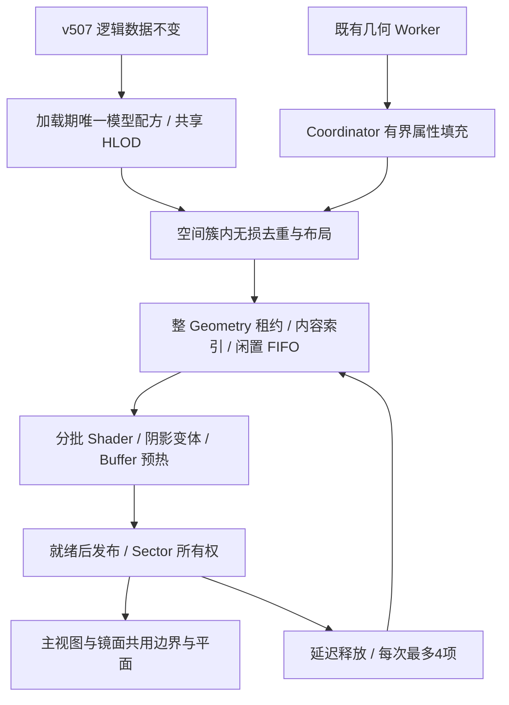

# Runtime V2 Phase 2.1 — Runtime-First

日期：2026-11-17。在 Phase 2 当前未提交工作区上继续修改，起点见 `artifacts/runtime-v21/starting-worktree.json`。保留地图 v507、物理/导航/碰撞、车辆、天气及座舱行为。未 commit/push。

## 实施结果

1. **无损静态缓冲。** `StaticGeometryPacking` 按全部顶点属性的精确位模式去重，保留三角形顺序、UV 接缝、法线、颜色和 tangent W；没有量化路面，也没有删三角形。位置独立存储，使阴影/深度 pass 不必跨过完整颜色和 UV 数据；其余属性交错存储。索引优先 Uint16。填充、索引和包围球计算采用有界生成器，代替驾驶期 clone→变换→大数组合并链路。不兼容的自定义属性布局保持独立，不组合成大型同步 merge。
2. **资源索引与所有权。** `WorldRenderResources` 对交错缓冲只计一次，内容索引改为 32-bit word 批处理并保留完整字节核对；键包含属性布局、索引、groups 和 drawRange。再次借用已拥有的 Geometry 不再错误调用 dispose。跨帧内容比较会临时借用候选，成功后转为正式租约；不匹配或取消立即归还，防止闲置清理在比较中释放候选。保留整 Geometry 引用计数，避免 Three.js 销毁一个 Geometry 时误释放另一个仍使用的属性缓冲。
3. **有界闲置维护。** 12MiB 闲置预算保持不变。独立闲置 FIFO 代替活跃条目全表扫描；重新借用直接移出闲置队列。每次最多释放 4 项且服从统一截止时间，没有用强制 GC 或简单扩大缓存改善数字。
4. **空间管理。** 保留 500m x/z 单元；装饰建筑部件共用管理节点，避免屋顶和立面仅因高度跨带而产生额外节点。道路关键结构保留 8m 高度层。层级边界准备复用已计算的子簇包围球；每帧共用预计算视锥平面，取消距离平方根和矩阵字段重复读取。未知/调试根节点保守可见，不再在驾驶帧同步遍历构建整棵边界。
5. **加载预计算和 HLOD。** 加载期按实际地图准备 118 个唯一配方、36 个共享模型模板，包含可复用几何/材质及代理。昂贵模型创建优先发生在驾驶开放前；不为全图创建实例或上传全图 GPU 数据。无三角形减少收益的代理直接借用原几何，本次 48 个源对象如此复用；已有简洁盒体/单层挤出不会为追求 LOD 名称而被改形。中景建筑接入同一代理缓存，近景及道路安全结构保持完整。LOD 距离和视距未缩短。
6. **后台生成。** 远景页面先排入现有 RuntimeCoordinator，再按小块填充属性和索引、压缩、预热，最后发布。取消/完成后移除生成器引用。加载期的远景树木沿用相同取样与轮廓，改为复用一个原型并分批填充，避免成千个临时 CylinderGeometry 和一次性合并。
7. **统一预算。** RuntimeCoordinator 使用六级复用队列，避免每帧全队列排序和饥饿判断的嵌套扫描。低优先级任务不再在预算耗尽后额外“补跑”；可见/即将进入区域只在有实际余量时获得有限保底。物理时钟、120Hz、单步 dt 和时间债务策略未改。
8. **GPU 准备。** 驾驶期上传批次限制为最多 4 次微绘制/512KiB/约 0.75ms 的软预算，加载期仍可使用较大预算。真实不可抢占成本继续记录。修复“全局局部裁剪开启导致所有静态阴影预热被跳过”：现在逐材质排除真正的裁剪/位移情况。阴影程序复用，透明裁切纹理按实际纹理身份区分，防止相同开关但不同 alpha 图错误共用。

**未实现静态阴影贴图缓存。** 已检查真实调用：太阳位置和阴影视域随车连续移动，动态车体也需要实时投影。直接冻结旧图会错位。本轮保留完整主视图阴影、镜面复用及动态更新，实际改进在缓冲读取/复用和准确预热；没有声称完成静态/动态深度分层合成，也没有以阴影降质换取收益。

## 对照条件与电源记录

采用本轮 `before21` 与最终 `verified21`，不与旧报告直接比较：地图 v507、同一 60 秒城市路线/出生点、`test-6at-sedan`、白天晴天、1186×658 CSS 像素、DPR 1.5、120Hz、相同画质。均完成 4,2→5,2→6,2 并掉头返回。末尾路线 station 2198/2190，有少量模拟时间/位置差别，截图不是同一帧像素对照。

- 两段窗口均全程激活，没有最小化或失焦事件，分辨率/DPR 未变；普通窗口可移动和最小化，没有置顶或反复抢焦点。
- **最终新版：原生记录为全程电池供电，平衡电源计划**（`381b4222-f694-41f0-9685-ff5bb260df2e`），未改变系统能耗设置。
- **本轮旧版：未采集原生电源状态/计划，标为未记录。** 用户说明当前测试使用断电笔记本，但旧样本不能补写成已测得的接电或断电。因此本次时间改善是观察结果，电源未完整锁定是因果验证限制；不承诺接电时同幅度改善。
- 历史 Phase 1/1.5/2 电源状态未记录，均为未知。断电下更快是积极信号，不能单独排除温度、功耗策略、驱动和窗口条件差异。
- 后续每次必须记录 AC/DC、计划、焦点、分辨率、DPR、画质、车辆、出生点、路线；GPU 频率/温度未测得时明确留空。

## 原始数据与结果

`comparison.json` / `comparison.log` / `summarize.mjs` 保存汇总与计算方法。RAF 从真实驾驶开放后统计；CPU 用 RuntimeCoordinator 的驾驶状态和相同时间边界区分加载；CPU Render 提交不是 GPU 执行。

| 指标 | 本轮 Phase 2 基线 | 最终 Phase 2.1 |
|---|---:|---:|
| 加载等待 | 21.69s | 20.02s |
| 加载最大 RAF 间隔 | 410.9ms | 411.4ms |
| 驾驶 RAF P50/P95/P99 | 17.6 / 24.3 / 34.0ms | 16.7 / 21.1 / 27.4ms |
| 最大驾驶帧间隔 | 68.0ms | 61.2ms |
| >33 / >50 / >100ms | 36 / 6 / 0 | 15 / 2 / 0 |
| 场景更新 CPU P95 | 3.0ms | 2.0ms |
| CPU Render 提交 P95/P99 | 17.0 / 21.2ms | 13.6 / 16.4ms |
| GPU Timer Query P95/P99 | 19.80 / 20.59ms（54样本） | 15.22 / 17.66ms（58样本） |
| WebGL Buffer 分配峰值 | 65.82MiB | 58.65MiB |
| WebGL Buffer 数量（结束快照） | 12753 | 9540 |
| Renderer Geometry 峰值 | 2611 | 2527 |
| performance.memory 驾驶峰值 | 552.4MiB | 542.6MiB |
| CDP 主页面 JS Heap 采样峰值 | 370.5MiB | 349.8MiB |
| CDP 主页面 backing storage 采样峰值 | 160.0MiB | 166.1MiB |
| CDP Worker JS Heap 采样峰值 | 269.5MiB | 260.3MiB |
| Draw Calls P95 | 943 | 1042 |
| 提交三角形 P95 | 727759 | 774451 |
| Texture 峰值 | 94 | 148 |
| 驾驶期 world:stream 最大记录跨度 | 15.5ms | 7.6ms |
| 驾驶期 background / maintenance 最大计时 | 4.7 / 0.5ms | 0.5 / 0.4ms |

加载承担了更多真实准备，但本次等待没有增加；不以此作为优化目标或跨次稳定承诺。保留真实进度、取消与可恢复错误，未使用时间动画假进度。

GPU 值来自 `EXT_disjoint_timer_query_webgl2`，不是 CPU render 调用推算。现有采样器在整帧外包裹查询，区间包含指令供给间隙，不能冒充 GPU 纯忙碌率；未测得完整显示器呈现时间或 Electron 合成耗时。Buffer 数字来自真实 WebGL 分配包装统计，不含纹理/RenderTarget/驱动私有显存。公共池 bytes 是 CPU 属性存储，不能等同实际显存。CDP 采样峰值覆盖各自 case 的加载与驾驶，外部 backing 与 JS heap 不应把不同时刻峰值直接相加。

**未下降的指标：** Draw Calls、提交三角形、纹理驻留和主页面 backing storage 增加。两次驻留与发布进度不同，剔除层级也更保守，不能以减图/隐藏内容抵消这些开销；本次没有达成所有计数指标下降。最终有效 Buffer/Geometry 降幅约 11%/3%；早期更大的降幅不能用作最终验收。

## 无效样本和剩余长尾

- `after21`：同一渲染进程依次导航，主页面 JS Heap 从约 370MiB 上升至约 719MiB 后回落至约 342MiB；旧页面延迟回收污染了 Heap/长尾比较。原始数据保留，不作为最终内存结论；没有调用强制 GC。之后改为新进程复核。
- `final21`：记录到中途失焦与约 5 秒帧间隔，不作为性能结论。
- `connection-attempt1-*`：Electron 主进程连接检查接口不适用，尚未开始正式采样；改用其 net API 后继续。
- `verified21`：最终、全程激活、电池状态有原生记录的样本；不挑选失焦样本中的较好数字。
- 仍有 2 次 >50ms：第一驾驶帧约 61.2ms；约 23.88 秒处约 51.8ms。后一帧 simulation 计时跨度约 30.8ms、仅执行 1 步，render 约 12.5ms，streaming/assets/background/maintenance 均为 0。不能归因为静态几何集中发布，也不能据此断言是 GC 或 GPU；缺少该跨度内的 JIT/调度/GC 细分证据。本轮不改车辆模型来掩盖它。
- 加载阶段仍约 411ms 最大停顿，尚未做到所有初始化完全可抢占。

## 正确性与生命周期

- 世界渲染原检查 25 条；新增无损属性/索引、两个流布局、内容/布局索引、重复借用不误释放、跨帧比较与清理/取消交错、闲置淘汰、无收益代理借用、配方准备及无同步可见性扫描等 308 条通过。最终审查补充的跨帧借用修复在驾驶采样之后，仅改变竞争期间的资源存活合同；未追加驾驶基准。
- RuntimeCoordinator/时间策略 24 条、流式接入 16 条通过，未改 FixedStepClock。
- 可见性专项：镜面 34 条、流式几何及雾剔除 86 条、生命周期 10 条通过。完整构建首次实际执行到雾剔除时发现旧夹具未调用加载期边界准备，而依赖被移除的驾驶期同步扫描；已补齐准备步骤，原全部断言未改，另有新检查确保未准备的调试根节点不触发同步扫描。失败记录保留为 `build-visibility-failure.*`。
- 阴影专项：全局局部裁剪开启时仍预热未裁剪材质、不同 alpha 纹理不错误共用、相同程序跨根节点复用，均通过。
- 加载/取消/重试/可恢复错误专项通过；日志中 `Drive loading failed Error: fixture` 是刻意失败夹具，不是产品加载失败。
- 模型静态 kit 与 8 地标包络检查通过；237批次/76单元、全部1377树木保留，685静态kit批次、262灯批次、161树批次保持合同。
- 原轮拱/姿态 468 条、导航显示 30 条通过。所有车辆源码（含坦克500）、正式地图及导航数据未修改。
- 有效实跑无捕获异常，退出后 GL Buffer 字节、公共池 entries/buffers/bytes/idleBytes、世界所有者和道路/地形 recipe 字节归零。未据 60 秒检查宣称数小时无泄漏。
- 结束截图：`artifacts/runtime-v21/before21-drive.png`、`artifacts/runtime-v21/verified/verified21-drive.png`。道路、标线、建筑、路灯与座舱未观察到新缺失；主视图/镜面实现保留。无新一轮全图道路几何诊断或 Node Worker 基准。

## 修改文件

新增：`src/world/render/StaticGeometryPacking.ts`、`RuntimeFirstRendering.selftest.ts`。

调整：`src/world/render/{StaticBatchBuilder,WorldRenderResources,WorldRenderClusters,WorldLODProxies}.ts`；`src/world/city/{PrefabRegistry,SectorManager,FogVisibility,VisualStreaming.selftest}.ts`；`src/world/regional/RegionalBackgroundBatches.ts`；`src/game/runtime/RuntimeCoordinator.ts`；`src/game/StreamingShaderWarmup.ts`；`scripts/run-world-render-selftests.mjs`。

文档：本报告、`CURRENT_CODE_CONTEXT.md` 的架构/测量约定、Phase 2 历史报告的电源未知注记。开发夹具和全部原始记录在 `artifacts/runtime-v21/`；不进入生产场景。

## 构建与发布

**正常完整 `pnpm run build` 通过，退出码 0，dist 已原子更新。** 类型检查、v507 批准、全部核心回归与 Vite 生产构建完成，15 个 manifest 条目及 18 个引用资源核对通过。没有使用 BasicValidation。保留原有 chunk 超过 500kB 的警告，未为消除警告改动无关分包。

此前构建受会话中断终止，记录保留为 `build-interrupted.*`；最终审查发现跨帧借用竞争后主动停止自己的测试进程修复，记录为 `build-review-restart.*`；旧可见性夹具失败记录为 `build-visibility-failure.*`。这些尝试均未更新 dist，最终通过日志为 `build.log`，不能把先前失败当作通过。

**桌面 Build、Package 和正式 EXE 启动检查通过。** 新发布路径：

`D:/DriverSchoolRelease/DriverSchool-RuntimeV2-Phase21-20261117/DriverSchool-win32-x64/DriverSchool.exe`

- 独立目录发布，没有覆盖旧正式版。24 个打包文件与当前 dist/.desktop 完全一致，1093 个源码/配置文件在桌面构建及检查期间未变。
- 正式 EXE 菜单、桌面存储边界、实际 `city-main` 加载、第一人称座舱/镜面画面和雨夜切换检查完成；无捕获的脚本异常、console error、未取消资源请求失败。仅静止功能检查，不能代替人工长时间驾驶或雨夜帧时间验收。普通可移动/可最小化窗口，完成后已关闭。
- 发布功能检查记录为 **接电、平衡计划**（`release/conditions.json`），与电池供电的 `verified21` 驾驶采样分开；30.82s 功能加载计时不作为性能 A/B 数据。
- 新 app.asar SHA256：`d89a61564a6f5b964deaa8e69777855b79a07eb708b16421d8ddfd1cdb10d67c`。
- 旧正式版 `D:/DriverSchoolRelease/DriverSchool-win32-x64/resources/app.asar` 保持 `bcbb042ec363df0525d0ad13df41f8ce771e3c52d771650bcb54cf33ed0f3526`。
- 地图、全部车辆源码和 HEAD 保全核对通过；没有 commit/push。源码变动清单见 `worktree-verification.json`，构建/包/启动证据见 `build-result.json`、`release/package-verification.json`、`release/release-smoke.json`，功能截图见 `release/release-game.png`、`release/release-rain-night.png`。

后续人工体验重点：复杂城区首次进入、连续跨 Sector/掉头返回、雨夜动态灯光与镜面角度、较长时间驾驶资源稳定性。仍需解决两次 >50ms 长尾、加载最大 411ms 停顿，以及更高的 Draw Calls/纹理驻留；本轮没有宣称这些已全部消除。
