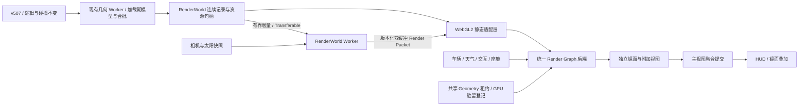

# Runtime V2 Phase 3 — Render Runtime Decoupling

日期：2026-11-17。基于 Phase 2.1 当前工作区；起点 1157 个文件的内容快照和 Git 状态保存在 `artifacts/runtime-v3/starting-worktree.json` / `baseline/`。不 commit/push。

## 已实现

**RenderWorld 已成为流式静态绘制数据和准备结果的正式默认路径。** 不使用区域白名单。道路、路口、建筑、护栏、标线及静态设施经原有空间批处理后进入同一数据库；动态信号灯、车辆、交互物件与特殊材质仍走动态/兼容路径。

- 主线程连续数组存储世界矩阵（Float64×16）、世界球体边界、Geometry/Material Handle、Shadow Flags、所有者、可用 LOD 和 generation。静态矩阵实际从数组应用到 WebGL 适配对象；支持局部 `updateTransform`，同步更新 Worker 边界并保守扩展扇区边界，不要求重建城市。
- GPU 登记与 RenderWorld 使用同一弱引用身份句柄。Source Object3D 保留为构建、环境绑定、生命周期与 Three WebGL 提交适配对象，不再作为逐帧静态细粒度空间索引。没有声称完全消灭 Three.js 场景遍历或将 WebGL 命令移出主线程。
- 专用 RenderWorld Worker 接收有界增量记录，每批最多 512 项，没有发送 Three 对象、JSON 几何或复制几何属性。Worker 维护连续数据库，计算独立主视图/侧镜/车内镜/太阳阴影视锥、可见绘制列表、已准备表示的 HLOD 和材质/几何排序。
- 数据使用 Transferable 往返双缓冲；每次最多一个 query 在途，新相机需求合并为最新快照。结果包含序号和每槽 generation，防止卸载后槽位复用受到旧结果影响。待确认的新对象保守可见；大转头、相机切换、陈旧结果使用适配层精确剔除作为短暂保护，不等待 Worker 阻塞驾驶。
- 建筑近景保留详细几何，并在加载/分块准备期创建和上传已有算法生成的代理。Worker 的 LOD 结果实际选择这些已准备几何；无收益代理复用原几何。道路、桥梁、隧道和安全结构不执行新的简化。现有 Sector 资源需求规划仍在主线程，属于资源驻留策略，未伪装成全量 Worker 迁移。
- Worker 排序结果实际进入静态不透明提交排序；保留 groupOrder、renderOrder、材质和透明深度排序合同。主视图对有效快照不再重复 Mesh 级 frustum 测试，阴影后端保留准确的阴影视锥检查。

## Render Graph 与 GPU

`WorldRenderGraph` 正式管理帧级依赖：`world.visibility → additional.views → main.composite → hud.composite`。所有真实 `renderer.render` 调用（包括停车附加相机、首屏准备和镜面）经过同一个 WebGL 后端。真实 `shadowMap.render` 在 Three 已建立正确渲染状态的时刻由后端接管，切换到独立阴影列表、执行后恢复当前视图列表；没有直接在无效 Three 内部状态下调用 renderBufferDirect。

**Sky/Weather、Opaque、Transparent 和 3D Cockpit 仍按 Three 正确的深度/透明顺序融合提交，未拆成多个重复绘制的 Framebuffer Pass。** Graph 记录真实镜面/主视图/阴影及分类绘制数量；融合阶段没有可靠的独立计时，因此不提供虚构的逐阶段 GPU 数字。DOM HUD 仍由原 UI 更新，WebGL HUD/镜面叠加由 Graph 调用。

GPUResourceResidency 统一登记 Geometry、Instance Buffer、Texture 和 RenderTarget，借用原有资源所有权，不建立第二套 GPU 缓存。共享资源只登记一次；dispose 事件同步移除元数据，RenderTarget 释放也移除其附件纹理记录。统计采用增量计数，不周期性扫描全部资源。CPU backing 字节不是驱动显存；GL Buffer 实际分配继续使用原测量工具，未获知的纹理/驱动驻留字节为未知。

现有 12MiB 几何闲置预算和道路/地形缓存预算未扩大。新数据库容量按 1024 槽分配，卸载后复用空槽；不保留所有历史 Sector。额外 HLOD 使用已共享代理，预热包括实际候选几何，驾驶期只切换引用。WebGL2 扩展探测记录 `WEBGL_multi_draw` 可用性；本轮未绕开 Three 材质/实例状态强行调用扩展，继续使用既有空间实例化和静态批次。

## OffscreenCanvas 决策

本轮 **未迁移 WebGLRenderer 到 Worker**。运行时记录 OffscreenCanvas API 是否存在，但 API 存在不等于完整迁移兼容。实查 `InstrumentCluster` 等座舱持续使用 `document.createElement('canvas')` / HTMLCanvasElement / CanvasTexture；镜面依赖当前车辆 Scene、反射纹理矩阵和 renderer 状态恢复；天气、灯光与环境材质也是同一场景的实时绑定。只搬 renderer 会要求持续传送座舱图像和大量可变场景状态，且破坏当前资源归属边界。

因此采用用户允许的路线：渲染准备真正进入 Worker，WebGL2 提交保留主线程。音频、输入、物理、天气规则和座舱显示代码未迁移或重写。未来完整迁移应先形成动态显示纹理和车辆渲染状态协议，不能把本轮的适配层描述成已经完成独立渲染线程。

## 仍在主线程的工作

| 模块 | 当前职责 |
|---|---|
| 固定 120Hz Simulation | 保留车辆动力学、接触、导航和时间债务策略 |
| SectorManager / RegionalStreaming | 加载需求、道路完整性、少量扇区级雾门控与资源优先级 |
| RenderWorld Worker | 静态细粒度可见性、独立视图、候选 LOD、绘制列表与排序 |
| 加载/发布准备 | 现有有界生成器、共享模型/矩阵构建、部分几何 Worker，服从 Coordinator |
| WebGL2 后端 | 应用已准备矩阵/LOD/可见列表、Three 必要列表与命令提交、阴影状态 |
| GPU 资源准备 | 原有 Coordinator 预算下预热、上传及 fence，不可抢占原子成本仍记录 |
| 动态场景与 UI | 原车辆、天气、座舱、镜面数学和 DOM 行为 |

## 验证与性能状态

- RenderWorld 新增 20 项：独立视锥、阴影、附加相机保护、旧 generation、未确认发布、实际 Transform 消费、局部边界更新、HLOD 切换、句柄、Target 附件释放、真实 Graph 顺序与恢复。
- 既有世界渲染 25、Runtime-First 308、姿态 468、导航显示 30、Coordinator 24、流式合同 16 项通过。
- 镜面 34、流式几何/雾剔除 86、生命周期 10 项通过；阴影变体/不同 alpha 纹理/程序复用专项通过；加载/取消/失败恢复专项通过。加载日志中的 fixture 错误是刻意失败用例。
- 真实城市隐藏窗口功能检查通过：Worker 后端、就绪屏障、主视图、左右镜、太阳阴影、雨夜切换和卸载。末尾样例登记 1932 个静态绘制记录；卸载后 RenderWorld records 和 CPU typed storage 归零，无捕获异常。原始记录与截图 `functional.json`、`functional-*.png`。该检查不提供有效驾驶性能结论，也不能代表数小时稳定性。
- 初次可见采样按用户要求关闭，取消记录保留在 `comparison-cancelled/`，不计入结论。用户随后允许测试，已完成下述一组有效对照，没有使用取消、隐藏或失焦数据补齐。

历史 Phase 2.1 正式记录为电池供电：P50/P95/P99=16.7/21.1/27.4ms。**该历史值不作为本次接电对照的基线**，不能把它与本次 Phase 3 相比来夸大收益。本次两版均重新运行，条件如下。

Worker 当前记录真实编译 CPU、round-trip、二者差值以及主线程 apply CPU。round-trip 差值包括排队、消息传递和主线程接收等待，不能单独叫数据复制耗时；未直接测得 GC 的长尾不能归为 GC。

## 统一性能对照（2026-11-17 补充）

原始数据：`artifacts/runtime-v3/phase21-*`、`phase3-*`；汇总与算法：`comparison.json`、`comparison.log`、`summarize.mjs`。一组对照、各一个新 Electron 渲染进程，非完整 EXE 帧率测试；源码内容已与正式 Phase 3 包的发布清单核对一致，未修改游戏源码。

两版全程激活、无遮挡、未最小化、无供电切换；**均接电、平衡计划**（GUID `381b4222-f694-41f0-9685-ff5bb260df2e`），1186×658、DPR1.5、相同画质、v507、test-6at-sedan、白天晴天、preload-profile 出生点。均完成 60 秒、约 89km/h 路线，跨 4,2→5,2→6,2 并掉头返回，结束 station 同为 2188。普通窗口没有置顶、锁定移动或抢回焦点。温度和实际频率未测量，单组结果不代表统计显著性或所有天气/车辆的表现。

| 指标 | 本次 Phase 2.1 | Phase 3 |
|---|---:|---:|
| 驾驶 RAF P50/P95/P99 | 8.1 / 13.6 / 20.9ms | 8.1 / 13.2 / 19.3ms |
| >33 / >50 / >100ms | 21 / 4 / 0 | 20 / 5 / 0 |
| 最大驾驶 RAF 间隔 | 55.0ms | 58.6ms |
| CPU 总耗时 P95/P99（共同窗口） | 12.5 / 13.8ms | 12.3 / 14.1ms |
| CPU 场景更新 P95（共同窗口） | 1.3ms | 1.1ms |
| CPU Render 提交 P95/P99（共同窗口） | 10.3 / 11.4ms | 10.5 / 11.7ms |
| GPU Query P95/P99 | 12.19 / 14.28ms（114样本） | 11.92 / 12.26ms（115样本） |
| Draw Calls P95 | 949 | 991 |
| Shadow Draw Calls P95 | 126 | 126 |
| 提交三角形 P95 | 743854 | 812009 |
| GL Buffer case 峰值 | 54.00MiB | 54.28MiB |
| GL Buffer 结束数量 | 9198 | 9198 |
| Renderer Geometry / Texture 峰值（共同 CPU 窗口） | 2473 / 122 | 2472 / 126 |
| performance.memory 驾驶 Heap 峰值 | 625.4MiB | 594.8MiB |
| CDP 页面 JS Heap 驾驶采样峰值 | 404.6MiB | 372.1MiB |
| CDP 页面 backing storage 驾驶采样峰值 | 195.3MiB | 150.8MiB |
| CDP 几何 Worker Heap 驾驶采样峰值 | 246.7MiB | 266.3MiB |
| CDP 新 RenderWorld Worker Heap / backing 峰值 | 无该 Worker | 11.7 / 1.29MiB |
| 进入驾驶等待 | 11.24s | 13.33s |
| 加载阶段最大 RAF 间隔 | 244.3ms | 672.9ms |

**口径限制：** RAF、Draw Calls、提交三角形及 performance.memory 覆盖完整 60 秒；RuntimePerformance 的 4096 帧环形缓冲在本次高帧率下覆盖约后 36 秒，故 CPU/Geometry/Texture 仅比较共同的第 23.778～60 秒，未伪称整分钟 CPU 分位。CDP 每类仅 6 个驾驶期采样，不能把不同时间的页面、Worker 与 backing 峰值相加当总进程内存。

GPU 数字为 `EXT_disjoint_timer_query_webgl2` 硬件查询，原采样器包裹 game.frame，包含 CPU 指令供给间隙；不等于 GPU 纯忙碌时间，也不等于完整显示器呈现时间。GL Buffer 分配不含纹理及驱动私有显存。新增 Worker 的采样编译 CPU P50/P95/P99 为 0.3/0.6/0.7ms，主线程 apply P95 0.1ms；消息往返 P95 11.4ms，差值不能归因于复制或 Worker CPU。

**结果判断：部分改善，未达到全面性能验收。** RAF P95/P99 和页面 Heap 改善，CPU 场景更新降低；但主线程 CPU P99、Render 提交、>50ms 次数、最大 RAF、Draw Calls、三角形和纹理驻留没有改善。几何数量基本相同、Buffer 略增，新增及原几何 Worker Heap 开销不能忽略。保守可见性范围和发布驻留差异是需优先审查的方向，本次未隔离各自贡献，不能当作已证明的唯一原因。

长尾仍集中在约第 9～13 秒和部分跨 Sector 时段，两版都有。新版最差 LOAF 约 59ms，其中已归属 RAF 脚本约 14.7ms、强制布局 0，未捕获到驾驶期 >50ms 的 Long Task；多数 >50ms 对应行没有 GL Buffer 上传。这不足以确定其余等待是 GPU、GC 或 Electron/系统调度，不作未经证实的归因。加载阶段 672.9ms RAF 间隔同样尚未精确归属，不能直接称为 673ms CPU 编译。

两版均无捕获异常；退出后实际 GL Buffer 字节、共享几何池、道路/地形配方字节归零，Phase 3 RenderWorld records/typed storage 归零。没有据一分钟检查宣称长时间绝无泄漏。结束截图 `phase21-drive.png` / `phase3-drive.png` 未观察到该视角新增缺失，不替代全图人工验收。

## 修改文件

新增：`src/world/render/{RenderWorld,RenderWorldProtocol,RenderWorldCompiler,RenderWorld.worker,RenderWorld.selftest,GPUResourceResidency,RenderResourceHandles}.ts`，`src/game/runtime/WorldRenderGraph.ts`。

修改：`src/game/{DrivingGame,StreamingShaderWarmup}.ts`，`src/world/DrivingGround.ts`，`src/world/city/{CityGround,SectorManager,PrefabRegistry,FogVisibility}.ts`，`src/world/render/WorldRenderClusters.ts`，`src/world/regional/RegionalBackgroundBatches.ts`，`scripts/run-world-render-selftests.mjs`，本文和 `docs/CURRENT_CODE_CONTEXT.md`。

原始资料与开发夹具在 `artifacts/runtime-v3/`，不进入桌面 payload。地图、车辆（含坦克500）、导航、物理和天气规则不改。

## 构建与发布

**正常完整 `pnpm run build` 通过，退出码 0，dist 已原子更新。** 完成类型检查、v507 批准、正常核心回归和 Vite 生产构建；15 个 manifest 条目及 18 个引用资源核对通过，额外 Worker 资产也进入桌面包。保留现有大 chunk 警告，没有 BasicValidation、跳过断言或改动地图批准机制。

最终审查补齐 Transform 数据消费前主动停止过自己的构建，记录 `build-transform-review.*`，该尝试没有更新 dist；最终通过日志为 `build.log`，没有将中止记录当作通过。

**桌面 Build、Package、正式 EXE 隐藏功能启动检查通过。** 独立发布：

`D:/DriverSchoolRelease/DriverSchool-RuntimeV2-Phase3-20261117/DriverSchool-win32-x64/DriverSchool.exe`

- 25 个打包文件与当前 dist/.desktop 完全一致，1101 个源码/配置文件在桌面构建及启动检查期间未变。
- 正式 EXE 的菜单、桌面协议和隔离边界、完整城市加载、雨夜切换均通过；捕获脚本异常、console error、资源请求失败均为 0。截图见 `release/release-game.png`、`release/release-rain-night.png`。
- 按用户暂不运行可见采样的要求，EXE 功能检查临时通过启动调试器抑制 BrowserWindow.show；**没有修改包文件或游戏/渲染逻辑**，测试进程已关闭，用户正常启动不带该调试参数。此结果不覆盖原生可见窗口呈现验收，不提供性能结论。隐藏条件下记录约 141s 加载时间不能与 Phase 2.1 的激活窗口加载时间比较。
- 发布功能检查与随后补充的驾驶对照均记录为接电、平衡计划；功能检查的隐藏窗口数据没有混入上面的性能结果。
- 新 app.asar SHA256：`a915e457d0c634d6e0713d7b0725f35739c94e667fb473bab553ec600525e923`。
- Phase 2.1 app.asar 保持 `d89a61564a6f5b964deaa8e69777855b79a07eb708b16421d8ddfd1cdb10d67c`，旧 Phase 2 保持 `bcbb042ec363df0525d0ad13df41f8ce771e3c52d771650bcb54cf33ed0f3526`。未覆盖、删除这些发布目录。
- 完整证据：`worktree-verification.json`、`build-result.json`、`release/package-verification.json`、`release/release-smoke.json`、`comparison-status.json`。没有 commit/push。

## 剩余验收与风险

1. **已完成一组有效性能对照，但未全面达标**：长尾没有减少，提交开销、Draw Calls、三角形及部分资源指标有回退；加载最大停顿仍需定位。不要以架构接入成功等同性能问题已经解决。后续应优先处理这些实际瓶颈，而非反复运行相同基准。
2. 主线程仍承担 WebGL2 提交、Three 必要渲染列表、动态对象及加载期部分模型/实例矩阵构建；尚未实现全独立渲染线程。天空/天气/透明/座舱是 Graph 中的融合后端阶段，不是独立 GPU 计时或独立 Framebuffer Pass。
3. 急转头、临时附加相机及 Worker 延迟会短暂使用适配层精确剔除，保证完整性；其实际长尾成本需激活窗口实跑验证。太阳阴影始终更新，不冻结旧图。
4. 隐藏检查覆盖了短时间功能与卸载，不能代替高速跨 Sector、掉头返回、雨夜连续驾驶、窗口最小化/恢复和长时间资源稳定性验收。此前 Phase 2.1 的两次 >50ms 长尾也没有被本轮无数据地宣布消除。
