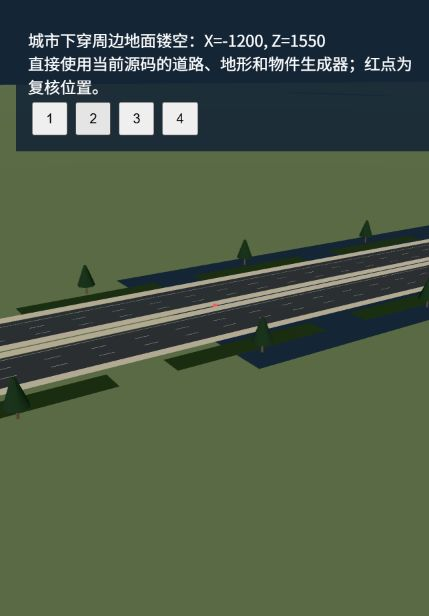
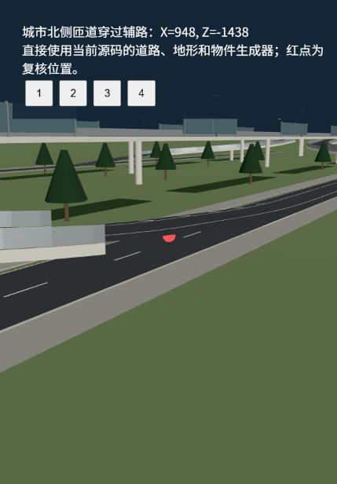
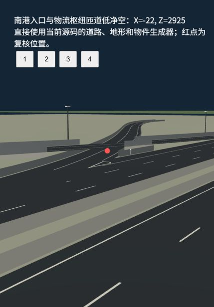
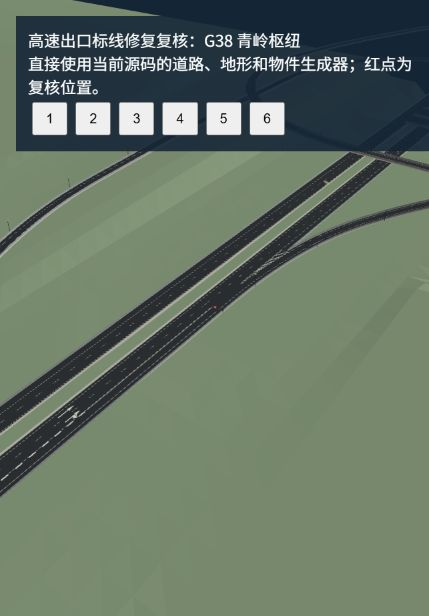
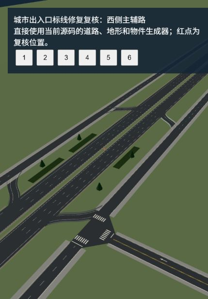
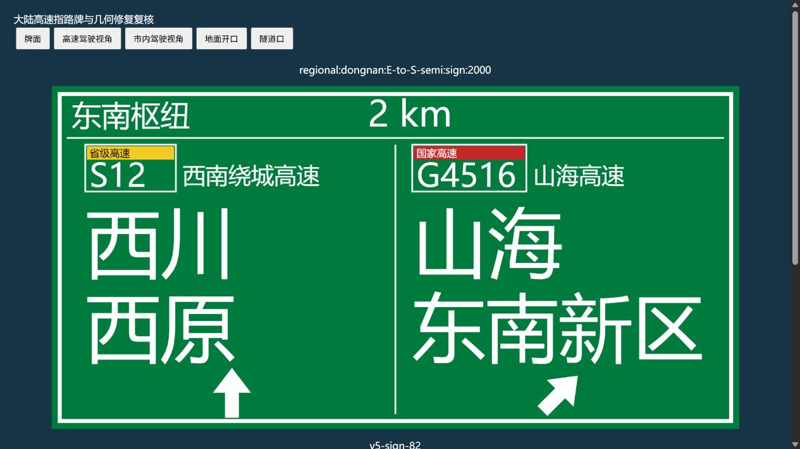
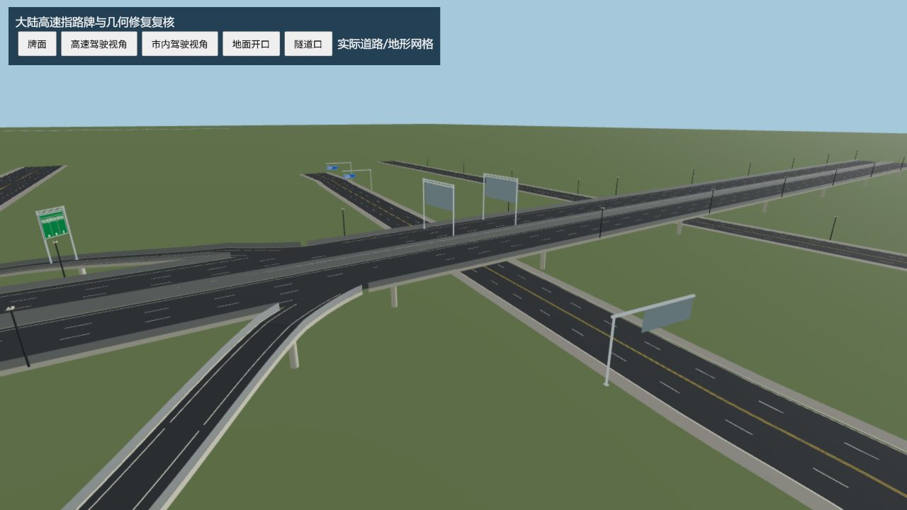

# 城市内部道路与区域高速检查、标线修复

检查日期：2026-10-13。检查的是菜单 `city-main` 实际加载的 `src/world/regional/regional-main.json` version 12，包括 623 条保留城市道路和 1,932 条区域道路，共 2,555 条道路。以本次工作区源码及归一化后的实际网格为准，不使用旧城市地图替代区域地图。此次按用户要求检查几何问题、修复地面标线；以下几何问题仅定位，尚未修复。

## 已确认的几何问题

| 优先级 | 区域 | 复核位置 X/Z（米） | 实际证据及影响 |
| --- | --- | --- | --- |
| P1 | 城市北侧主辅路出入口 | 948 / -1438.1、852 / -1438.1；对向对应位置 Z=-1361.9 | `direct-north` 出入口匝道从辅路上方穿过，两层铺装网格仅约 1.45 米高差。匝道底板还低于其路面 0.65 米，无法提供普通车辆净空。另与环线相交的位置高差约 2.27 米。 |
| P1 | 南港入口、物流枢纽 | -22.4 / 2924.5、21.2 / 2927.2 | `regional:nangang:on:1` 与 `regional:logistics:N-to-E-star`、`regional:nangang:off:-1` 与 `regional:logistics:W-to-N-star` 相交，实际铺装网格分别约 1.39、1.01 米高差，底板侵入车辆通行空间。 |
| P1 | G38、原 G65 区段的隧道洞口 | 2088.2 / -2643.9、1578.5 / -2425.5、5130.6 / -6458.8、4980.9 / -5676.7 等 | 5 个开放道路片段存在地形高于路面，样本最大侵入 1.12–4.25 米；另 4 个洞内片段在门户附近存在低于隧道顶棚的地形。实际 `RegionalTerrain.build(...,'near')` 网格射线查询已复核，不只是高度采样器推断。 |
| P2 | 城市下穿、南侧环线周边地面 | -1200 / 1550 | 城市地面按 20 米整格删除下穿周边草地，扩大了开口；该位置没有草地或道路铺装网格，但地形支持高度仍为 -0.04 米。画面可见阶梯状、矩形漏空，以及悬在开口上的景观。 |

隧道口问题的来源是地形对隧道段保留覆盖层，对相邻开放道路又降低到路面下；门户附近一个 12.5 米网格单元同时连接这两类高度。插值后的三角形横穿道路和洞内空间。当前区域自测只抽查部分路段，未覆盖全部门户网格。

城市地面开口的来源位于 `src/world/city/CityGroundGeometry.ts`：整格删除时使用约 14.4 米额外范围，缺少沿挡墙边界的精确裁切、填补。检查得到 584 个“开口中心不属于负高程开挖路面”的候选格；其中可能包含其他覆盖结构，不能把此数量直接解释成 584 个独立漏洞。上述实测位置及截图证明至少存在真实镂空。

另有 2 条城市道路样本的实际铺装与其中心线理论高度相差约 0.12 米：`v4-inner-0-split` 的斜坡外侧、`v4-diagonal-split` 进入 `urban-junction-44` 的局部位置。它们是后续衔接复核候选，不与上述已确认问题混为一谈。

## 标线修复

修改文件：

- `src/world/city/MarkingOwnership.ts`：扩展现有标线归属规则；同高度的道路铺装交汇处裁掉内部边线，重合平行标线按稳定道路顺序保留一份，连续道路和不同高度的上下层分别处理。
- `src/world/city/RoadBuilder.ts`：城市和区域出入口都使用实际导流区生成器，移除有地图上下文时的整段路肩斜纹；加减速车道只运行专用标线生成，避免再次生成普通边线、分道线。
- `src/world/regional/HighwayLaneRenderer.ts`：渐变段分隔线沿主路边缘过渡，不穿过直行车道；外侧边线只在辅助车道露出主路后出现；出入口采用较粗的白色间断线，并在分流末段/汇流起段保留实线。导流斜纹避开实际行车道和路口，箭头使用现有完整箭头几何，同一站位的相邻出口只生成一组。标线统一保持路面上方 8 毫米。
- `src/world/city/MarkingOwnership.selftest.ts`：回归验证渐变段不侵入主路、专用车道没有第二次普通标线生成、重合平行道路只有一个标线所有者。

参考依据：

- [国家标准 GB 5768.3-2025：道路交通标志和标线 第3部分](https://openstd.samr.gov.cn/bzgk/std/newGbInfo?hcno=A9BE85F3DDD0EC531B98C84B3312E240)，官方平台确认其现行状态和 2026-05-01 实施日期。平台全文预览未通过本次文本抓取，因此不声称逐条实现全部现行条文。
- [交通运输部《公路交通安全设施设计规范》](https://xxgk.mot.gov.cn/2020/jigou/glj/202006/P020220401593792273853.pdf)，5.2.3 对互通、服务区、停车区出入口的交通流组织、禁止跨越分界线和导向箭头提出要求。
- [上海市道路交通管理设施设置技术规程](https://zjw.sh.gov.cn/shsd/userfiles/4%E9%81%93%E8%B7%AF%E4%BA%A4%E9%80%9A%E7%AE%A1%E7%90%86%E8%AE%BE%E6%96%BD%E8%AE%BE%E7%BD%AE%E6%8A%80%E6%9C%AF%E8%A7%84%E7%A8%8B0.pdf)，历史设置示例采用 3 米实段/3 米间断、约 45 厘米宽的出入口引导虚线，并把斜纹限制在三角导流区域。本次借鉴其画法，不将历史地方规程称作现行全国标准。

游戏采用简化画法，重点保证交通流含义清楚、出入口不重复叠画；不构成工程标准符合性认证。

## 验证与范围

- 地图 CLI 验证：0 errors、24 个预留端口 warnings。
- 区域世界专项：76 项通过；区域高速专项：17 项通过。采用临时入口调用现有自测，未覆盖历史结果基线文件。
- 开放道路/洞口地形检查：沿道路每 5 米、中心和两侧车道内采样，城外共 567,616 个样本；异常以真实近景地形网格射线复核。
- 全部道路铺装检查：使用实际道路裁切网格和路口铺装，共 254,253 个三角形；每 10 米、中心和两侧车道内共 330,849 个射线样本，未找到没有铺装覆盖的样本。该离散检查不保证小于采样间隔的缺口不存在。
- 完整生产几何检查返回 324 条诊断，包含旧设计曲率、坡度、景观缓冲和交汇判定；其中有正常汇流或历史设计导致的候选，不据此宣布 324 个实际穿模。已确认问题以表格及网格复核为准。
- 303 条加减速车道的标线网格检查：153,323 个三角形，按 1 厘米量化未发现跨道路完全重复的三角形；368 个箭头未发现不同出口之间同高度、中心相距小于 3 米的重复箭头。此检查不等于所有不同形状的标线都绝无局部交叠。
- 正常 `pnpm run build`：退出码 0，类型检查、66 组核心自测、Vite 暂存构建及正式 `dist` 发布全部通过。保留既有的大体积 chunk 提示。本次首次构建发现新增回归 fixture 的 `gore.end` 字段缺失；补齐字段后重跑正常构建成功，未跳过或放宽检查。

机器结果：[几何检查](../artifacts/city-geometry-review-2026-10-13/geometry-audit.json)、[标线全图检查](../artifacts/city-geometry-review-2026-10-13/marking-map-probe.json)。浏览器复核使用当前生成器直接渲染相关道路、物件及近景地形，未更改地图布局、物理路面、碰撞或车辆代码。

画面证据：

## 后续几何、匝道接缝与路牌修复

本节记录后续授权修改；前面的检查结果和截图属于修复前或仅标线修复时的状态。菜单地图更新至 Regional World v13，城市独立地图更新至 v9。

### 已实现

- 地面开口沿实际开挖挡墙边界裁切，保留原先被整格删除的周边草地。`(-1200,1550)` 的实际地面网格已补齐。
- 九处已确认隧道口/洞内地形样本不再侵入路面和通行净空。区域地形生成时裁切洞口通行体积，保留洞顶覆盖层；车辆物理查询不增加地形裁切工作。
- 北侧四条上下匝道修正离开主路前的侧向轨迹与高度，保持原始端点。南港两条接入匝道及其地面引道移到枢纽前方，通过现有 Map API 分割 S26 连续主路，同步更新路线、结构、路牌和端点链接引用。
- 在实际接入口采样中确认 322 个大于 5 厘米的重叠高度问题，针对明确的 200 条匝道建立逐节点高度修复记录。城市部分 38 条；区域匝道保持原有 6% 纵坡校验，城市匝道不超过 12%。除临港两条及晨江折返匝道的必要局部曲线调整外，保留平面走向、端点和道路参数。晨江单独保留邻近四条支路的通行净空。修复记录包含修改前/后高度及明确道路 ID，回归测试据此验证，而非豁免全部历史道路。
- 显式连接处，窄匝道采用宽主路的端面方向，减少边缘楔形接缝。主路、辅助车道与匝道同高度重叠铺装只保留一个绘制所有者；不同高度的桥面不会被裁掉。
- 全部 408 块城市、1845 块区域指路牌保持原始 ID，牌面位于道路中心线上方。采用龙门架、道路上方悬臂或低净空处悬挂式布局，支柱避开车道和其他道路结构。按真实接收道路更新目的地、方向和实际预告距离，保留高速原有 2 km / 1 km / 500 m / 分流口四级预告要求。
- 高速牌采用绿底白字、白边、国/省高速编号标识、出口编号、目的地分栏和明显方向箭头；主目的地使用较大的常规中文字形，提升纹理分辨率，分开文字与箭头。辅助车道内补充重复的前行引导箭头，主路出口车道保留分流箭头，导流斜纹仍避开行车道。

参考：[GB 5768.2-2022 官方标准信息](https://openstd.samr.gov.cn/bzgk/gb/newGbInfo?hcno=15B1FC09EE1AE92F1A9EC97BA3C9E451&refer=outter)、[湖北交通部门公布的公路交通标志设计指南](https://jtt.hubei.gov.cn/glj/glj_zfxxgk/glj_zc/glj_qtzdgkwj/202309/P020230908558139356691.pdf)。采用常见大陆道路指路牌的颜色、信息层级与编号表现，不声称达到完整工程规范认证。

### 修改文件

- 数据：`src/world/city/maps/city-main.json`、`src/world/regional/regional-main.json`。
- 几何：`CityGroundGeometry.ts`、`RoadEdgeChain.ts`、`JunctionSurface.ts`、`maps/CityGeometryRepair.ts`、区域 `RegionalTerrain.ts`、`RegionalTerrainClearance.ts`。
- 标线：`MarkingOwnership.ts`、`RoadBuilder.ts`、区域 `HighwayLaneRenderer.ts`。
- 路牌：`RoadSignData.ts`、`RoadSignRenderer.ts`、`RoadSignTemplates.ts`、`RoadSignValidation.ts`、`SignPlacementGenerator.ts`、`OverheadSignPlacement.ts`。
- 回归：`CityMainV5.selftest.ts`、`RoadEdgeChain.selftest.ts`、`maps/CityGeometryRepair.selftest.ts`、`MarkingOwnership.selftest.ts`、区域 `HighwaySystem.selftest.ts`。

### 复核结果和限制

- 两份实际地图 CLI 验证：均 0 errors、24 条预留端口提示。城市匝道上限稍收至 11.99%，消除 12% 边界的浮点提示；逐节点最大值为 `0.11990000000000034`，未放宽验证器。
- 城市 V5 专项、区域世界 76 项、高速系统 17 项通过。道路端面/铺装归属回归 50 项通过，验证接入口没有重复铺装和漏铺，并保留上层道路网格。
- 实际铺装网格复核无铺装缺失，最终采样数量见机器证据。两处原有约 0.12 m 的高度偏差仍保留：`v4-inner-0-split` 斜坡外侧、`v4-diagonal-split` / `urban-junction-44` 衔接。离散采样不能排除小于间隔的细微缺口。
- 标线最终复核：303 条加减速车道、163,752 个标线三角形、605 个箭头。按 1 厘米量化无跨道路完全重复的三角形，也没有同高度相距小于 3 米的跨出口箭头重复。服务区设施说明另留独立文字区，避免覆盖下方箭头。
- 修改匝道与附近道路的对比检查未发现新增区域道路净空冲突。西侧 `diamond-west:northbound-entry` 与 `v4-west-residential-split` 的旧交叉净空问题仍需单独调整，采样异常总数由 7 降至 4，但未宣称彻底修复此交叉。
- 正常 `pnpm run build` 最终退出码 0：类型检查、66 组核心自测、Vite 暂存构建和正式 `dist` 发布全部通过。发布时间为 2026-10-13 19:13（本机时间），保留既有的大体积 chunk 提示。中途为收尾版式和横梁修正主动停止构建，最终完整重跑，未使用简化验证。
- 早期候选曾出现可选距离字段的类型错误、旧冻结道路/字体预期冲突及区域匝道超过原有 6% 坡度要求；分别修正类型收窄、建立明确逐节点修复预期和重新调整实际匝道曲线/纵坡。最终专项与正常构建全部通过，没有跳过失败检查或放宽坡度验证。

机器证据：[逐节点匝道修改记录](../artifacts/city-geometry-review-2026-10-13/ramp-mouth-repairs.json)、[几何与专项自测结果](../artifacts/city-geometry-review-2026-10-13/geometry-fixes-verification.json)、[最终网格射线检查](../artifacts/city-geometry-review-2026-10-13/final-mesh-probe.json)、[邻路净空对比](../artifacts/city-geometry-review-2026-10-13/ramp-clearance-comparison.json)。

最终铺装复核：319,822 个三角形、330,756 个道路内采样点；无铺装缺失。其他最终证据：[66 组核心结果](../artifacts/city-geometry-review-2026-10-13/core-final-results.json)、[标线重复检查](../artifacts/city-geometry-review-2026-10-13/marking-final-probe.json)、[城市地图验证](../artifacts/city-geometry-review-2026-10-13/city-final-validation.json)、[区域地图验证](../artifacts/city-geometry-review-2026-10-13/regional-final-validation.json)。区域指路牌最终使用 1403 块龙门架、428 块悬臂牌和 14 块悬挂牌。

