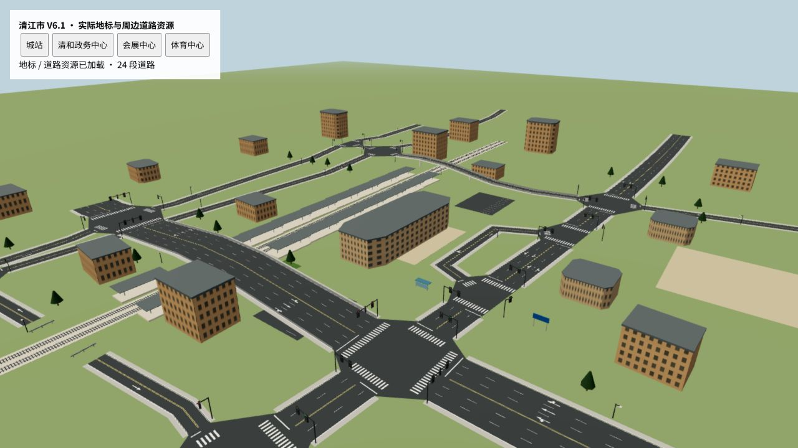
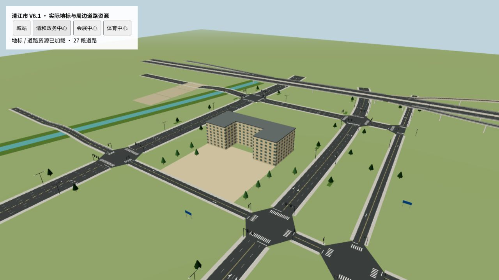
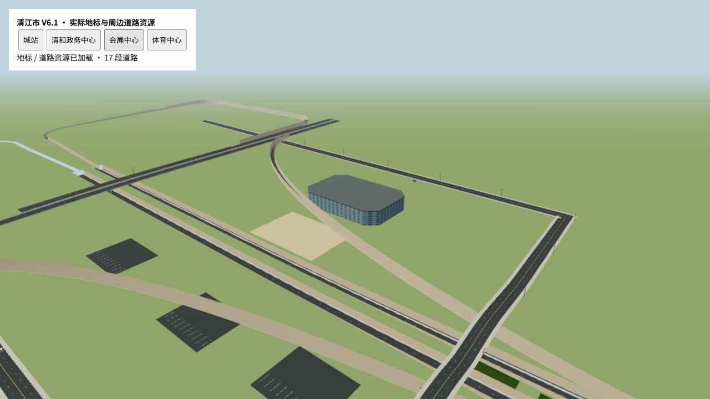
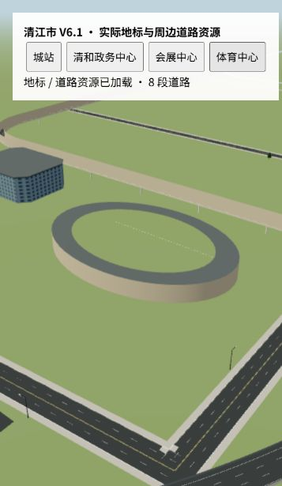

清江市 City V6.1（2026-10-17）

菜单地图已从 V6 的版本 16 增量完善为版本 17。实际数据仍在 `src/world/regional/regional-main.json`，菜单名称为“清江市 · City Main”，地图 ID 和存储入口保持原样。未替换独立旧 City JSON，未改车辆、驾驶、Surface Interaction、Regional 地形或流送系统。

1. **快速路形式**：以最后补充“可以尽量保留原样”为准，没有执行原稿的东西全程抬高、南北整体下沉。东西／南北快速路及中央系统立交共 145 段中心线与当前 V6 基线逐项一致；南北已有地面、桥梁和隧道关系继续保留。环线只在铁路实际穿越处局部抬升，主线最大坡度约 3.75%。

2. **东西辅路**：西兴采用窄双向两车道局部集散；清和、锦城采用双向四车道南北辅路；春晖采用短段四车道辅路接既有普通干路。中央立交附近保留断开，避免在既有低匝道之间硬塞平交与连续辅路。

3. **南北辅路**：保留北部 V6 学院片区集散系统；南部在中央大街至南城大道之间补两条双向两车道辅路，分别服务清和与锦城边缘。没有把两条快速路沿线统一成同一种道路断面。

4. **上下口**：本轮没有新增快速主线匝道。继续使用 V6 学院片区北行上／下、市府片区西行出口及既有菱形互通。新建的辅路、城站环路、求是路、会展路和体育路，通过现有普通道路拆分／路口 API 接入真实路网，没有另造互通或拓扑系统。

5. **城站**：原外围“西城站”移入西兴内部，站房约在 X=−1320、Z=280，正式称“城站”。配套站前广场、城站广场路低速接驳环路、公交候车亭、两处出租／公交落客区、少量老商业及两侧连续站台雨棚。城站路、中山路、人民路和中山广场组成旧城中心联系。原外围站区撤去，旧接入道路改为服务小型机务工坊的西兴机务路。

6. **铁路分割**：西北进入西兴，经过内移的城站后向西南离开，长约 4.47 km。18 处道路中心线穿越采用上跨，1 处复用原屋盖下穿通道（约 −7.5 m）。仓桥／仓储街巷及集市小街两条小路在轨道两侧截断，形成四个明确封闭端头；主要路网仍保持可达。铁路上跨桥共检查 106 个实际桥墩，全部避开轨道中心线 7 m 范围；三处原有桥墩通过现有支撑间距参数重新落位。

7. **河道**：保留 V6 清和河和绿岸。最终检查 19 处道路／水系中心线穿越，桥面满足既有净空要求；河流继续影响道路局部高程与地标地块，不新增水流模拟。

8. **七个城区**：真实 district 定义、道路归属、对象归属、说明、装饰配置均已写入地图。空间分区如下。

| 城区 | 空间与本轮落地内容 |
| --- | --- |
| 西兴 | 西部老城、内移城站、铁路街巷、中山广场、紧凑老商业 |
| 清和 | 中西部政务文化中心、市政府、人民广场、博物馆与清和河 |
| 锦城 | 中东部商务核心、高层群与最高的锦城中心 |
| 星湖 | 北部大学、公园、湖区、北区教学与宿舍 |
| 春晖 | 东部新城、会展中心、科研楼及外延道路 |
| 通港 | 东南物流、仓储、较宽运输道路 |
| 南城 | 南部工业与中低密度住宅、厂房及发展空地 |

9. **地标**：导航共享地点中登记城站、市政府、人民广场、清江博物馆、清江大学、清江国际会展中心、清江体育中心、锦城中心，共八个城市锚点；每个均关联实际道路 ID。另有中山广场、体育馆和站前商业等场景设施。导向牌选择地标关联道路中最近的位置，避免落在同名道路远端。

10. **跨越环线的生长**：北部求是路连接北侧学院辅路并进入教学／科研地块；东部会展路从现有道路实际端点外延，经会展片区返回东部辅路；南部体育路连接通港辅路与物流一路，并有少量南城厂房／通港仓库外延。沿用既有环线立体关系，不增建环城系统互通。西侧只放小型机务工坊，西南继续留空，没有整圈摊开城市。

11. **道路名称**：正式使用城站路、中山路、人民路、解放街、胜利街、西兴南街、人民大道、府前路、学府路、博学路、春晖大道、南城工业大道；增加求是路、会展路、体育路和各区快速辅路名称。沿用名称表与导航读取接口，没有按显示文字判断道路功能。

12. **建筑与装饰**：继承 V6 不同高度、朝向与完整几何轮廓，锦城中心约 207 m，周边办公楼约 65–161 m，外围仍以低中层为主。政务建筑采用院落轮廓，会展中心为宽低体量，新增共享椭圆体育场及独立体育馆。共 209 栋带立面的建筑，五套共享立面；未逐栋创建高成本材质。西兴用小路灯与窄人行道，清和／锦城／春晖用双臂灯，通港用大型道路灯，树色、绿化与间距按城区变化。最终城市对象 3,504 个（V6 为 3,558），含 1,384 棵树、1,021 个独立路灯对象；不包括道路自带的灯。

13. **修复与清理**：保留 V6 已完成的东部小夹角重复道路删除、护栏桥面封边、标牌柱避让、主路分车道箭头／保护左转／倒计时与导航信号接口。本轮重算普通道路穿越处高程和路口平坦落地；圆顺旧西部下穿接线的直角弯；修复道路拆分后引用旧对象造成的连接遗漏；清除铁路新走廊和地标地块冲突的旧填充物；重新校准所有 City 标牌立柱；封闭道路护栏明确落到端头外。

14. **验证结果**：

| 检查 | 实际结果 |
| --- | --- |
| V6.1 专项测试 | 通过；结构错误 0，City 道路 748 段均从核心路网可达 |
| Regional 保护 | 9,497 条外部记录及 Regional 元数据逐项一致 |
| 两条轴线与中央立交 | 145 段中心线与 V6 一致 |
| 道路跨越 | 异常 0；主线最大坡度 3.748%，全城最大 11.99%（既有紧凑匝道） |
| 铁路／河流 | 上跨 18、下穿 1、铁路封闭端 4、水系穿越 19 |
| 地标与立柱 | 5,561 个地标轮廓取样、715 根标牌柱、106 个铁路桥墩净空通过 |
| 车辆通行 | 2,576 组车道取样；四轮有道路支撑，车辆包络无静态碰撞 |
| CityGround 加载 | 完整实际菜单地图实例化、道路接触及释放通过 |
| 信号系统 | 160 个高级路口；640 个相位取样、694 根灯杆及卸载重载／旧配时／导航车道接口通过 |
| 共享渲染资源 | 135 个 prefab 批次，9,319 个子组件实例，5 套立面纹理 |
| 导航与几何一致性 | 导航 205 项、几何 11,152 项断言通过；2,516 条链接、1,591 处连续边检查；端点最大间隙 0.0174 m，车道边缘间隙 0 |
| 类型与差异检查 | `pnpm run typecheck`、`git diff --check` 通过（Git 有换行格式提示） |

专项命令：`node scripts/test-city-main-v6.mjs --v61 .tmp-city-v61-candidate.json .tmp-city-v61-baseline.json`。基线为本轮开始时保存的实际 V6；最终写回的菜单 JSON 与验证候选完整一致。生成入口沿用 `scripts/refine-city-main-v6.mjs --v61 --source <V6 源文件>`，不是第二套独立地图生成器。

结果见 [专项验证](../artifacts/city-v61/validation.json)、[导航与几何](../artifacts/city-v61/navigation.json)。17 条未使用端口提示均有意保留：12 个既有封闭远期预留、4 个铁路边封闭端、1 个科研园尽端。没有降低断言或跳过失败检查来通过验证。

15. **视觉检查与限制**：通过实际 RoadBuilder、IntersectionBuilder、PrefabRegistry、信号与城市地面资源检查城站、政务中心、会展、体育中心局部。预览最初用普通平面地面，遮住旧下沉道路，已改用实际带开口的城市地面；未因该预览问题更改地图。截图是局部资源预览，不代表完整 Regional 场景和性能检查。完整 CityGround 浏览器尝试两次加载超时，未将其记为通过；完整地图的 Node 加载与物理接触检查通过。主观驾驶观感及完整地图浏览器表现仍由实驾确认。

16. **正式构建**：`pnpm run build -BasicValidation` 成功。用户明确要求不跑 full-project/full-core，故使用现有构建入口的参数跳过核心套件；保留 typecheck、标准 Vite 生产构建、源文件一致性检查及 checkpoint 原子发布。转换 324 个模块，Vite 7.86 s；`dist/index.html` 于 2026-10-17 16:56:11（本机时间）发布，入口资源存在且包含新版清江市地图。主包 17,498.20 kB／gzip 4,317.07 kB，仍有大型 chunk 提示。可双击 `start-game.cmd` 进入“清江市 · City Main”。记录见 [构建结果](../artifacts/city-v61/build.json)。

本轮修改文件（V6 既有未提交工作保持）：

| 文件 | 用途 |
| --- | --- |
| `src/world/regional/regional-main.json` | 菜单实际地图中的 City V6.1 数据 |
| `src/world/city/maps/CityMainV61.ts` | V6 增量编排、保护外部记录并合回地图 |
| `src/world/city/maps/CityMainV61Corridors.ts` | 保留快速主线、分区辅路与普通连接 |
| `src/world/city/maps/CityMainV61Rail.ts` | 内移铁路、桥面、街巷封闭、城站接驳与桥墩间距 |
| `src/world/city/maps/CityMainV61Places.ts` | 七城区、地标、道路外延、名称与装饰 |
| `src/world/city/maps/CityMainGroundElevation.ts` | 指定旧接线可编辑、指定新路口扩展平坦落地 |
| `src/world/city/CityMapData.ts` | 增加共享体育场 prefab ID |
| `src/world/city/PrefabRegistry.ts` | 简化共享椭圆体育场 |
| `src/world/DrivingGroundCatalog.ts` | 菜单清江市名称 |
| `src/world/city/CityMainV61.selftest.ts` | 本轮直接影响范围的专项检查 |
| `scripts/refine-city-main-v6.mjs` | 原增量入口支持 V6.1 和指定 V6 源文件 |
| `scripts/test-city-main-v6.mjs` | 原验证入口支持 V6.1 与保存结果 |
| `docs/CITY_V61_2026-10-17.md`、`artifacts/city-v61/` | 本报告、实际验证／构建记录、局部截图 |
