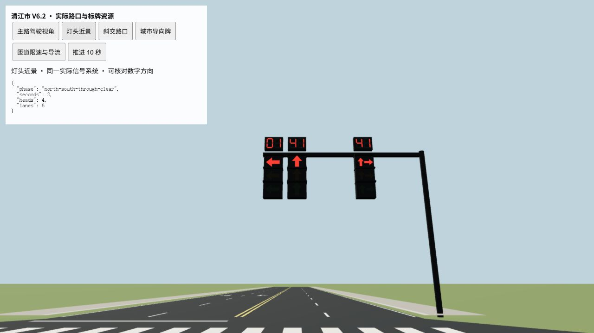
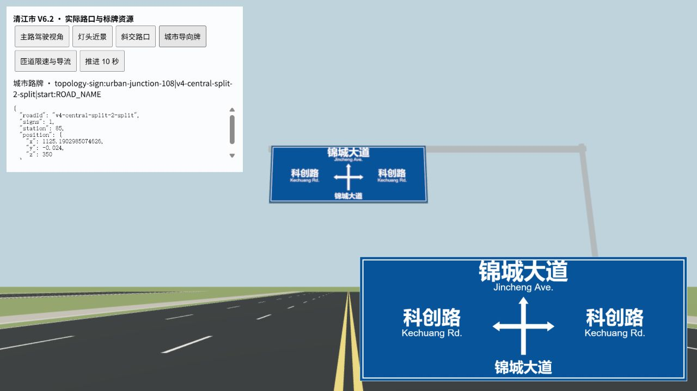
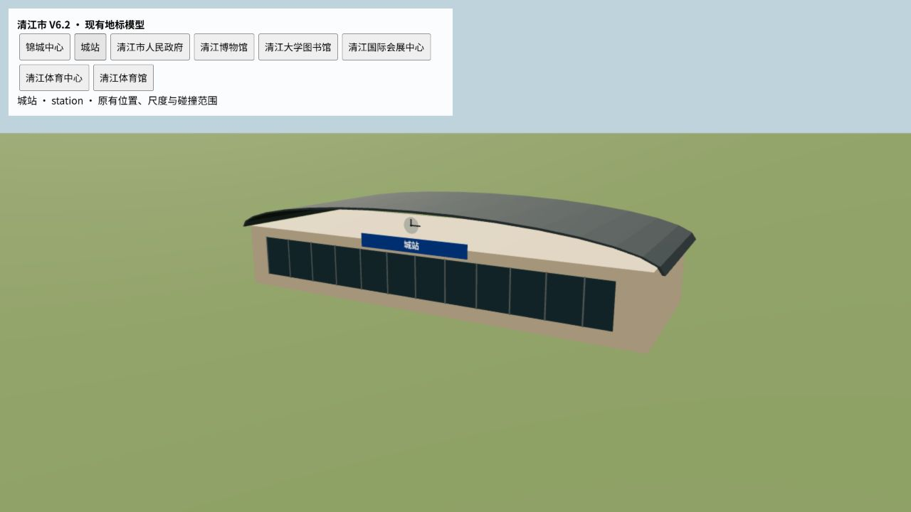
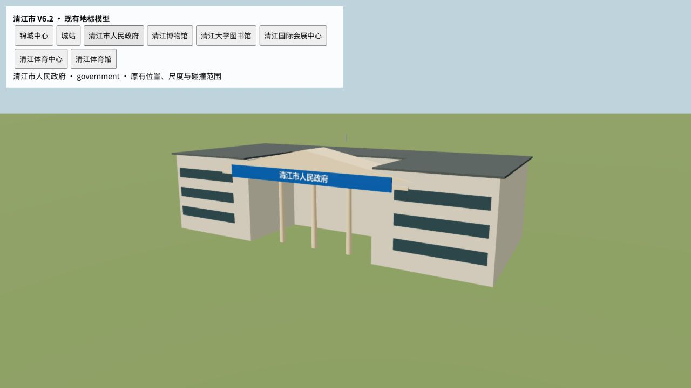

# 清江市 City V6.2 交付记录

菜单实际地图 `src/world/regional/regional-main.json` 已更新到版本 18。七城区、城站位置、铁路与清和河走向、星湖、现有地标位置和城区外扩方向保留。高速本体及 Regional 元数据、外部道路与连接记录保留；独立旧 City JSON 未替换。

## 快速路与连接

- 东西主线保持原有平面轴线，城区 X=−1960～1960 m 连续为 +8 m 高架。按照最后确认“高速本体不动，让高速和快速路平滑连接”，最外侧两端各约 440 m 平顺接回原有高速 Y=0 接口。
- 南北主线北部 Z≤−1000 m 为地面；−1000～−500 m 缓慢下沉；−500～10 m 核心段为 −6.4 m；10～450 m 接入原 −8 m 南部下穿段，南侧既有约 Z=1600～2250 m 回升结构保留。
- 西兴继续采用紧凑、局部中断的两车道集散；清和／锦城保留较完整的四车道辅路；春晖保留与会展、新城道路连接的较舒展局部辅路。南北沿线仍保留学院集散与南部两车道辅路，不复制东西断面。
- 新增清和东向入口 `v62-qinghe-eastbound-on:on--1`，由清和南侧辅路进入东西东行主线；新增南城南向出口 `v62-nancheng-southbound-off:off--1`，由南行下沉主线升至南城大道接线。均实际接入道路及车道网络，长度不少于 280 m。
- 清和入口跨河处设置桥面高点，修正初次检查发现的低跨河段。旧学院出口、市府出口及其短接线中与新中央匝道嘴冲突的部分撤除，其他既有转换口保留。
- 中央立交继续使用原紧凑 X 形式及八个转向，必要外侧接近段延长，适配 +8／−6.4 m 高差。东部系统节点将环线局部提升至 +14.4 m，东西主线仍为 +8 m。现有预设增加可选右转接近段长度；原默认几何不变。
- 主线最大纵坡约 3.41%，本轮调整的匝道最大约 7.95%。道路中心线跨越净空检查无异常。

## 道路连续性收尾

按最后补充，只做直接相关检查与局部修整：

- 两个 0.35／0.86 m 接续碎段并入相邻道路。
- 删除一个无用短尽端，清和三个密集路口合为一个五岔路口，东部一对重复路口合并；共清除七个碎段、减少三个路口节点。
- 一处四／六车道接续点移出过短路口嘴，另三处路口仅小幅移动，并整理原桥梁接近段高度。
- 最终 City 道路 762 段均可达，最短约 10 m；保留的路口短连接具有实际道路用途。没有通过增加折线或绕圈凑长度。
- 端点最大几何误差约 0.0174 m，车道边缘间隙 0；最终全城最大纵坡 11.99%（包括原有紧凑匝道）。铁路、河道净空通过。

最终记录：[continuity.json](../artifacts/city-v62/continuity.json)。

## 信号灯、路牌与名称

- 修正倒计时镜像：十位／个位顺序与每个数字内部七段笔画均按驾驶员观看方向排列。
- 遮光檐移到完整箭头上方，避免挡住箭头；放大箭头、灯箱和数字，暗灯降低亮度。同车道直行／右转共用相位时合并为一个组合灯头，保护左转仍单独显示，灯头之间保留间距。
- City 标准路口使用整齐的矩形灯箱；主路保留分车道箭头、保护左转、黄灯、全红清空和固定周期倒计时。悬臂灯头下缘至少约 5.1 m，立柱继续避让道路各高度层。导航读取原有车道／相位接口。
- 最终 156 个主路高级路口；道路连续性修整涉及的 26 根信号立柱重新检查。
- 201 块 City 匝道限速／导流牌按实际道路站位、切线朝向和坡面高度重新落位。导流方向按当前弯道校准；桥外立柱落地，桥肩支撑落在有效肩部，不留悬空柱脚。
- 323 块城市内部导向牌采用参考图的蓝底白字、白色边框、中央路口示意、上方前行道路、左右分支道路和下方当前道路。大字号中文为主，辅以拉丁字母道路标注；不用缩小的多行高速牌版式。相同方向重复名称合并显示。
- 新牌面沿用内容缓存、共享模板和实例化；城市牌纹理为 1536×584，不增加逐字实体或实时灯。放大后的牌面同时检查上层道路及其下方通行净空。
- 玩家可见的“西兴高架南路”“清和／锦城高架南北路”“春晖高架南路”“清和／锦城快速辅路”“市府北连接路”等工程名称隐藏。未正式命名的支路、纯集散辅路、新短接线显示“未命名道路”；真正匝道显示“匝道”。城站路、锦城大道、人民路等正式名称保留。
- `road.id`、`roadNameId` 和导航拓扑独立保留；`displayName: ''` 表示明确不采用名称表作玩家街名。导向牌寻找有意义的接收道路名称，导航路径不依赖显示文字。

## 地标模型

仅优化八个已有建筑对象，不增加建筑数量或改变位置、尺度与原有碰撞范围：

| 地标 | 识别特征 |
| --- | --- |
| 城站 | 连续拱顶、钟面、大面积入口玻璃、城站名称 |
| 清江市人民政府 | 对称院落、门廊柱列、三角门楣、名称牌 |
| 清江博物馆 | 连续折线屋顶、石材展馆体量、横向展厅窗带 |
| 清江大学图书馆 | 校园院落、入口柱廊、中央钟面、校名／馆名 |
| 清江国际会展中心 | 三跨连续拱顶、大跨度入口玻璃与雨棚 |
| 锦城中心 | 单体收分切角塔楼、斜顶、竖向构件、共享办公立面 |
| 清江体育中心 | 椭圆场馆、开口环形顶棚、支撑及场地标线 |
| 清江体育馆 | 低层椭圆大厅、穹顶、入口玻璃 |

模型只增加少量几何特征，按共享材质合批，不逐窗建模，不使用建筑层层盒子堆叠。建筑文字保持正常字形比例。

其他模型截图保存在 `artifacts/city-v62/landmark-*.jpg`。

## 轻量性能对比

同一批 City 独立静态对象、75 个扇区；BEFORE 为保存的 V6.1 渲染实现，AFTER 包含树灯合批和本轮新增地标细节。下表是全部扇区常驻时的对象／批次量，不是活动视角 GPU draw calls。

| 指标 | BEFORE | AFTER |
| --- | ---: | ---: |
| City 对象／树／独立路灯 | 3504／1384／1021 | 3504／1384／1021 |
| Object3D | 1074 | 902 |
| Mesh／InstancedMesh 批次 | 998／998 | 826／826 |
| 几何子组件实例 | 9319 | 5822 |
| 唯一 geometry／material | 122／22 | 159／23 |
| 估算全部常驻静态 draw calls | 998 | 826 |
| 三角形实例总量 | 308286 | 311274 |
| 三次交替测量的静态构建中位数 | 40.83 ms | 59.43 ms |
| 完整 CityGround 单次 Node 冷构造 | 8.89 s | 9.81 s |

最终批次减少约 17.2%；地标增加约 1% 三角形及少量共享几何，CPU 构建耗时没有测得改善，不宣称加载变快。树干／树冠合为一个共享顶点色几何，各路灯的柱／臂按材质合并，双臂发光头合并后保持正确取样高度。仍按原扇区激活，不合成整城巨型网格。

树与路灯自身新增真实灯光数为 0。沿用现有环境系统的六个无阴影 PointLight 池：白天关闭，夜间只选择附近有限灯位；其余灯头用共享自发光材质。没有修改 Regional 流送架构。

完整浏览器 CityGround 的道路修改阶段曾出现可用帧：初次约 185.9 s，热缓存重载约 11.9 s；加载与释放可完成，但两次状态不同，不能据此声称消除了整图冷加载问题，也不是整车可驾驶生命周期计时。后续信号、路牌与地标采用实际资源局部预览；最后连续性补充后按要求只做必要检查，没有再跑整图浏览器负载测试。

测量：[BEFORE](../artifacts/city-v62/performance-before.json)、[AFTER](../artifacts/city-v62/performance-after.json)、[三次交替样本](../artifacts/city-v62/performance-paired.json)、[浏览器记录](../artifacts/city-v62/browser-smoke.json)。

## 验证与构建

阶段性 City 专项检查覆盖高架／下沉连续性、道路跨越、坡度、2272 组车辆车道支撑与碰撞包络、真实主辅路车道连接、导航名称独立性、树灯合批、八个地标模型边界、信号相位与数字方向、加载释放；外部 9497 条记录及 Regional 元数据逐项一致。阶段结果见 [validation.json](../artifacts/city-v62/validation.json)。

最终连续性增量只检查当前数据有效性、10 m 最短路段、道路可达性、坡度、铁路河道净空、受影响灯杆、720 根 City 标牌柱和接续几何，见 [continuity.json](../artifacts/city-v62/continuity.json)。阶段记录中的道路／牌数早于最后路口清理，最终以连续性记录和当前源文件为准。

`pnpm run build -BasicValidation` 成功，包含类型检查、正常 Vite 生产构建、源文件一致性检查和可玩目录发布。用户明确要求不运行全量验证，使用已有参数跳过 full-core；没有降低生产断言或替换为单独 Vite 构建。325 个模块，最终 Vite 8.41 s；2026-10-17 21:56:49（Asia/Tokyo）发布。入口与引用资源存在，发布包包含最终 City 数据、路牌样式和地标模型。[构建记录](../artifacts/city-v62/build.json)。

可双击 `start-game.cmd`，选择“清江市 · City Main”。仍有约 17.58 MB 主包／gzip 4.34 MB 的大型 chunk 提示；整图冷加载稳定性没有在本轮解决。17 个既有封闭／预留端口提示继续保留。

## 本轮修改文件

| 文件 | 内容 |
| --- | --- |
| `src/world/regional/regional-main.json` | 实际菜单地图中的 City V6.2 |
| `src/world/city/maps/CityMainV62.ts`、`CityMainV62Access.ts`、`CityMainV62Profiles.ts` | 增量编排、走廊高程、真实上下口及匝道拟合 |
| `src/world/city/maps/CityMainV62Continuity.ts` | 当前短路段、重复路口与接近段局部修整 |
| `src/world/city/maps/CityMainV62Signs.ts`、`CityMainV6SignPosts.ts` | 城市牌样式元数据、拉丁标注、限速导流牌和柱位校准 |
| `src/world/city/maps/CityMainV62Landmarks.ts`、`CityLandmarkGeometry.ts` | 八个已有地标标记与共享简化几何 |
| `src/world/city/PrefabRegistry.ts` | 树灯合批、地标模板及名称缓存 |
| `src/world/city/CityMapData.ts`、`CityMapValidation.ts` | 显示名称及地标模型字段 |
| `src/world/city/CityRoadNetwork.ts`、`SignPlacementGenerator.ts`、`src/world/navigation/RoutePlanner.ts` | 名称与拓扑分离、未命名／匝道回退 |
| `src/world/city/RoadSignData.ts`、`RoadSignRenderer.ts`、`RoadSignValidation.ts` | 城市蓝牌内容、版式及数据校验 |
| `src/world/city/CitySignalVisual.ts`、`CityTrafficSignals.ts`、`IntersectionBuilder.ts` | 灯头、数字、方向和安装高度 |
| `src/world/city/presets/InfrastructurePresets.ts`、`CompactInterchangePresets.ts`、`catalog.json` | 既有紧凑预设可选接近段 |
| `src/world/city/CityMainV62.selftest.ts`、`CityTrafficSignals.selftest.ts`、`CityMain.selftest.ts` | 直接相关专项检查及树合批契约 |
| `scripts/refine-city-main-v6.mjs`、`test-city-main-v6.mjs` | 原入口支持 V6.2 增量和专项验证 |
| `docs/CITY_V62_2026-10-17.md`、`artifacts/city-v62/` | 报告、实际检查／构建结果及截图 |

原有 V6／V6.1 未提交工作保留；未提交或推送。
