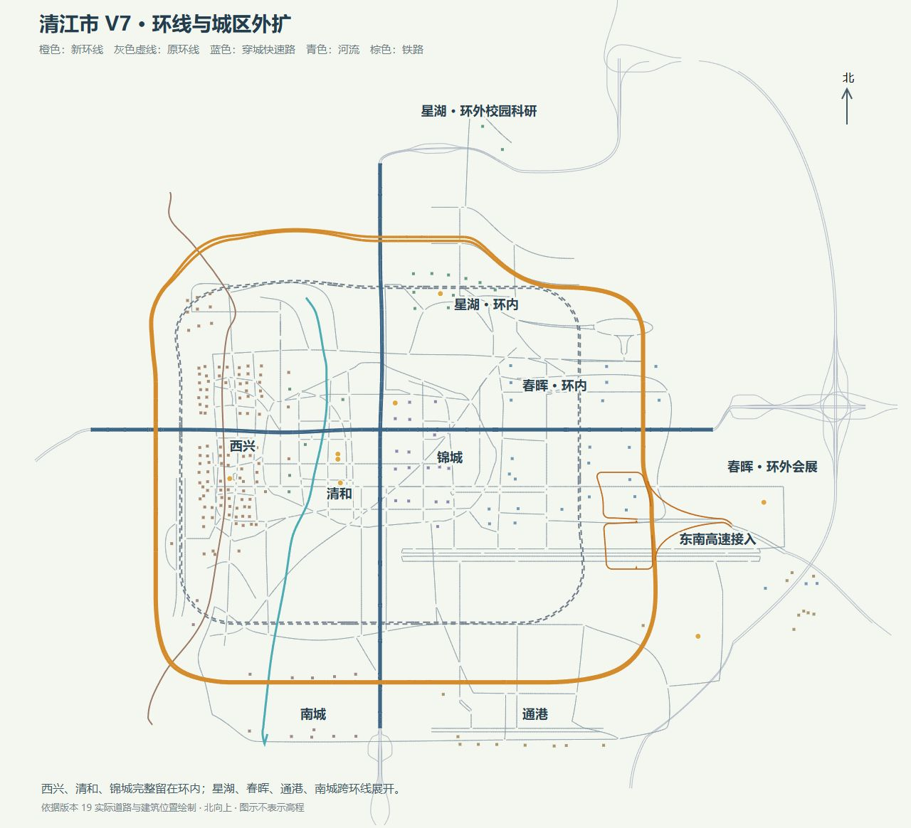

# 清江市 V7 — 环线与城区外扩

本轮更新菜单 City Main 实际使用的 `src/world/regional/regional-main.json`，地图版本 18 → 19。独立旧 City 地图没有替换。

## 已实现

- 环城快速路向北、南、东扩展，西侧适度外移；北弧与东南弧采用不同曲线，环线包络约 4.44 × 3.99 km。
- 西兴、清和、锦城现有建筑全部留在环内；星湖、春晖、通港、南城各有环内和环外部分。校园科研、会展、体育和工业物流用地向外展开。
- 主干道路、穿城快速路与辅路随片区调整，保留既有出入口与逻辑连接；重新匹配跨河、跨铁路桥面、下穿通道和高速接续坡段。
- 东南高速接口重新采用较紧凑的四方向匝道，沿实际弯曲主线衔接。匝道包络由约 1,335 × 870 m 缩为 1,182 × 850 m，平面包络面积约减少 13.5%。
- 调整 52 段附近 Regional 高速接入道路；59 处已登记 Regional 桥梁、隧道和立交的道路数据与结构信息保持原样。
- 清除旧接口盲端、冗余体育片区平行支路、无用途短支路，并吸收重建接口产生的短合流间隔。重新生成城区路牌，校准受影响的高速路牌位置。
- 道路与建筑冲突处局部移动 20 栋建筑及 41 处树木/路灯。保留现有建筑、地标、信号灯和导航拓扑接口。
- 为环外城区增加独立平地范围，避开既有北部隧道山体。修复重复共线下穿开口裁剪产生零面积碎片、导致地面几何失效的问题。

## 本次修改文件

- 地图：`src/world/regional/regional-main.json`。
- 外扩与布局配方：`src/world/city/maps/CityMainV7.ts`、`CityMainV7Parcels.ts`、`CityMainV7Continuity.ts`。
- 复用的高程/匝道配方：`src/world/city/maps/CityMainGroundElevation.ts`、`CityMainV62Profiles.ts`；新增参数保留原默认行为。
- 城区地面与 Regional 地形：`src/world/city/CityGround.ts`、`CityGroundGeometry.ts`、`src/world/regional/RegionalData.ts`、`RegionalTerrain.ts`。
- 生成与必要检查：`scripts/expand-city-main-v7.mjs`、`scripts/test-city-main-v7.mjs`。
- 本说明与 `artifacts/city-v7/` 交付记录。

生成工具使用本地 `.tmp-city-v7-baseline.json` 中的版本 18 原始地图，输出候选地图；`--apply` 写入菜单地图。不要以当前版本 19 作为版本 18 基线再次外扩。

## 必要检查结果

`node scripts/test-city-main-v7.mjs src/world/regional/regional-main.json` 通过。检查范围仅限本轮地图变更：

- 762 段城区道路全部可达，最短约 10.55 m；主线最大纵坡约 5.47%，城区全部道路最大纵坡约 11.99%。
- 环线连续，三片核心城区建筑全部在环内，其余四片均跨环线分布。
- 铁路、河流、普通道路跨线净空及东南立交的 6 处非合流跨越检查通过。
- 683 个来向信号灯柱和 846 个相关路牌立柱的位置检查通过。
- 59 处既有 Regional 结构完整性、邻近接入道路坡度和地形一致性通过。
- 路口/端点几何检查通过，最大端点偏差约 1.73 cm；重复共线下穿开口的地面裁剪检查通过。
- 局部实际地图资源渲染完成，浏览器无错误日志。

地图格式验证为 0 错误、20 警告：17 个封闭/远期预留端口；3 处路口声明臂数多于实际连接（21、88、210）。路口铺装按实际连接生成，保留这些提示供后续地图编辑检查。

按用户要求没有运行全量 core、车辆或平台验证。`pnpm run build -BasicValidation` 已通过类型检查和正常生产构建，并成功发布到 `dist`。首次构建发现的路牌可选高度字段类型错误已修正；最终构建仍提示 JavaScript 包体较大（约 17.51 MB），不影响本次发布。实际构建记录见 [build.json](../artifacts/city-v7/build.json)。

主观驾驶和视觉评估由用户进行；本轮没有进行冷启动性能基准或全地图驾驶调校。
