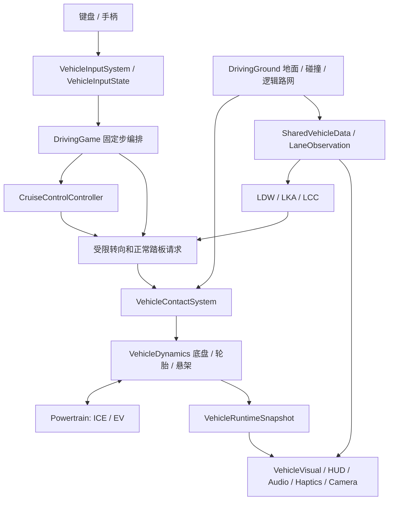

# DriverGame 当前代码说明

源码核对日期：2026-10-12。面向接手代码的开发者与 Chat；功能、标定和测试结果均以当前源码及实际运行结果为准。本文不是原厂车辆规格或完整仿真认证。历史 `*_REPORT.md` 和 `artifacts/` 报告保留为各轮实现记录。

相关文档：[操作与启动](../README.md)、[代理约束](../AGENTS.md)、[审阅报告](CODE_REVIEW_2026-10-12.md)、[可复制的 Chat 指示文本](CHAT_HANDOFF.md)、[地图作者指南](../src/world/city/AGENT_GUIDE.md)。

## 工程与入口

- TypeScript strict、Three.js、Vite、pnpm；没有前端框架、后端服务或网络多人系统。
- `package.json`：Three.js `^0.180.0`、TypeScript `^5.9.2`、Vite `^7.1.7`，声明 `pnpm@11.19.0` 和 Node `^20.19.0 || >=22.12.0`。依赖版本范围不是锁文件中的精确解析版本。
- `src/main.ts`：`?editor=city` 动态导入 CityMapEditor，否则创建 DrivingGame；顶层有启动错误提示。
- 游戏：`pnpm start` / `pnpm dev`。编辑器：`start-editor.cmd` / `pnpm run editor`。已有构建：`start-game.cmd` 通过 PowerShell HTTP 服务运行 `dist/`，不应以 file:// 打开。
- `pnpm run build` 调用 Windows PowerShell checkpoint 脚本。`tsconfig.json` 检查 `src`；`scripts/*.ts` 不属于该工程类型检查范围，esbuild 打包也不能替代其类型检查。
- `vite.config.ts` 的 publicDir 是 `src/world/city/maps`，用于原样提供编辑器 Reload 等 JSON；区域 JSON 由目录静态导入游戏。

## 更新链路与真实边界



物理固定步长 `1/120 s`，帧 dt 上限 0.1 s，累计步数上限 16，慢帧不无限追赶。SI 单位；`+X` 右、`+Y` 上、`-Z` 前。车速显示 km/h，地图 speedLimit 也用 km/h。地图 JSON/API 旋转用弧度，CLI `--rotation` 用度。

物理底盘以纵向/横向速度与偏航积分，结合四角轻量弹簧阻尼、四轮接触和静态 OBB 碰撞；不是完整六自由度刚体/飞行模型。碰撞修正属于接触系统，驾驶辅助不能直接改位置/速度。F3 屏蔽驾驶指令但不完全暂停物理，车辆仍可能滑行；圈速、巡航、车道控制和震动有各自暂停/取消门控。

## 模块地图与阅读起点

| 范围 | 主要入口/职责 | 修改时跟进 |
| --- | --- | --- |
| 游戏编排 | `src/game/DrivingGame.ts` | 输入消费、固定步、显示/附件、切车/切图、持久化和生命周期 |
| 车型平台 | `VehicleCatalog.ts`、`VehicleCapabilities.ts`、`config/validateVehiclePlatformConfig.ts` | 注册 ID、配置副本、已安装结构能力；不能按品牌硬编码物理 |
| 统一几何 | `vehicle/VehicleDimensions.ts`、`visual/VehicleVisualConfig.ts` | 轮距/轴距/外观/碰撞/镜面/驾驶眼位一致性 |
| 底盘与接触 | `physics/VehicleDynamics.ts`、`VehicleContactSystem.ts`、`WheelContact.ts`、`CollisionSystem.ts` | 实际路面、质量布局、轮胎力、轴荷、静态碰撞 |
| 轮胎与制动 | `WheelRotationSystem.ts`、`TyreGripModel.ts`、`TyreThermalPressureSystem.ts`、`BrakeSystem.ts`、`BrakeTorqueCoordinator.ts` | 轮速、联合滑移、压力刚度/滚阻、ABS 最终权限 |
| ICE | `powertrain/ICEPowertrain.ts` 与 `physics/{Engine,FuelSystem,Clutch,Turbocharger}.ts` | 点火序列、启停、传动、燃油质量和消耗 |
| EV | `powertrain/{ElectricPowertrain,ElectricDriveUnit,ElectricMotor,BatteryPack,Inverter,EVPowerCoordinator,EVThermalState,EVLaunchControl}.ts` | 共用电池预算、轴级输出、回收/制动融合和热降额 |
| 传动 | `transmission/TransmissionSystem.ts`、MT/AT/DCT/CVT 后端、`FixedReductionTransmission.ts`、`EVTwoSpeedTransmission.ts` | PRND 与机械挡位独立；驾驶员选挡脚刹联锁 |
| 驾驶功能 | `control/{CruiseControlController,LateralAssistController,LaneDepartureWarningController,LaneAssistState,ElectronicParkingBrake,AutoHoldController,TripComputer}.ts` | 能力、偏好、实时状态及命令仲裁 |
| 感知/显示数据 | `SharedVehicleData.ts`、`TPMSState.ts`、`world/navigation/LaneObservation.ts`、`ui/LocalRoadMap.ts` | 共享源、逻辑车道采样、地图瓦片缓存；显示皮肤不新增检测器 |
| 可视与加载 | `visual/{VehicleVisual,Cockpit,InstrumentCluster,VehicleExterior,VehicleAssetRegistry}.ts`、`VehicleLoadingLifecycle.ts` | 专用 BMW/Tesla/Taycan 显示、资源所有权、暖机与失败态 |
| 相机 | `camera/{DriverCamera,MirrorSystem,MirrorMath,InteriorMirror,ParkingCamera,WindshieldRain}.ts` | 眼位/物理镜面投影、渲染层、状态恢复、R 挡影像 |
| 输入/反馈/音频 | `input/`、`vehicle/feedback/`、`audio/` | 统一输入边沿、改键、标准手柄、震动节奏和合成音 |
| 世界 | `DrivingGround.ts` / `DrivingGroundCatalog.ts` | ground 生命周期、spawn、surface、colliders、roadNetwork、lapCourse |
| City/区域世界 | `world/city/`、`world/regional/` | 数据验证、路口路面、边链、标线/路牌、地形、视觉扇区加载 |
| 编辑与工具 | `editor/CityMapEditor.ts`、`CityEditorHistory.ts`、`city/MapAPI.ts`、`scripts/map-cli.ts` | 浏览器草稿、事务回滚、显式拓扑、导入导出/安全写入 |

上表中车辆局部文件均在 `src/vehicle/` 下。改具体系统时读取入口与调用者/配置/自测即可；除用户要求整体审阅外，不默认扫描全仓库。

## 当前目录

VehicleCatalog 的 11 辆正式车辆按以下顺序用于 F5；默认 `family-sedan`：

| ID | 显示名 | 已安装动力链 |
| --- | --- | --- |
| `family-sedan` | Haiteng S1 Driving School | 1.6 NA I4 / FWD / 5MT |
| `sport-coupe` | GT 3.0 Turbo | 3.0T I6 / RWD / 7MT / 后 LSD |
| `test-6at-sedan` | Mazda CX-4 2.0L 6AT | 2.0 NA I4 / FWD / 液力 6AT |
| `test-7dct-sedan` | Volkswagen Sagitar 280TSI DSG | 1.4T I4 / FWD / 7DCT |
| `cvt-family-sedan` | Nissan Sylphy 2.0L CVT | 2.0 NA I4 / FWD / CVT |
| `executive-lwb-2t` | Audi A6L 45 TFSI quattro | 2.0T I4 / 适时 AWD / 7DCT |
| `road-suv-v6-8at` | Volkswagen Touareg 3.0 TSI 4MOTION | 3.0T V6 / 适时 AWD / 8AT |
| `ferrari-458-italia` | Ferrari 458 Italia | 4.5 NA V8 / 中置 RWD / 7DCT / 后 LSD |
| `tesla-model-3-rwd` | Tesla Model 3 RWD | 单后轴 PSM / 固定减速 / 60 kWh 可用电池 |
| `bmw-530li-g38` | BMW 530Li | 2.0T I4 / RWD / 8AT |
| `porsche-taycan-4s` | Porsche Taycan 4S | 双 PSM AWD / 前单速后两速 / 105 总量、97 可用 kWh |

Capabilities 从已安装配置/拓扑推导支持；用户偏好另存；运行中的 SET/CANCEL、介入/接管是第三层。现实名称是原型，游戏标定不是原厂数据。测试 AWD fixture 不进菜单。

DrivingGroundCatalog 有 9 个入口，默认 `road-course`：`road-course`、`subject-2-training-ground`、`subject-3-shared-city-map`、`simple-circuit`、`mountain-proving-ground`、`city-alpha`、`city-main`、`preset-showcase`、`city-editor-map`。科目二/三、赛道、山地与公路测试场保留各自手工实现；City 入口使用数据地图。自定义编辑器入口读取同源 localStorage，没有有效保存时回退 City Alpha。

### 必须区分的两份 City Main

| 使用者 | 文件 | 当前 version | 道路/路口/物件/路牌数 |
| --- | --- | --- | --- |
| 游戏菜单 `city-main`；`?city=main` / `?city=city-main` | `src/world/regional/regional-main.json` | 11 | 2555 / 155 / 5358 / 1845 |
| CLI `city-main` 别名、旧城市构建脚本 | `src/world/city/maps/city-main.json` | 7 | 623 / 155 / 2436 / 408 |

两文件 id 都是 `city-main`，不是相互替换的同一数据。数量是本次盘点快照。`city-alpha.json` 为 43 道路/12 路口/288 物件；`preset-showcase.json` 为 133 道路/7 路口/15 物件。菜单区域地图包含保留城市、高速网络、机场、服务区、桥隧、近/中/远视觉调度和行进方向预加载。

区域地图验证/修改应传完整路径：`pnpm map validate src/world/regional/regional-main.json`。区域出生点通过 `regionalSpawn` 选择，调试通过 `regionalDebug=1`。`?city=preset-showcase&preset=<id>` 指向设施样本入口，但当前该地图加载失败，见审阅报告。

预设目录当前为 34 项：31 生产项和 3 兼容街区项。原 V1 的 16 项以外，已有 BackbonePresets、CompactInterchangePresets、隧道/下穿、侧接入、主辅路和渠化路口。PRESET_CATALOG.md 的原始尺寸表及 showcase 的 16 样本只覆盖 V1 子集。`scripts/build-city-main.mjs` 仍执行旧 V3 recipe 并覆盖 city-only 文件，不是当前 V5/区域图的重建入口。

## 主要已实现功能与不可混淆的边界

**动力、制动与悬架。** ICEPowertrain 拥有燃油起动/熄火/自动启停；电驱不要求 Engine/FuelSystem/Clutch。ElectricPowertrain 提供前/后轴输出、真实电机回收、反射转子惯量和电量/能耗。双电机共用 BatteryPack，经功率协调器限制机械/端口功率与效率损失/辅助功率；SOC、低温、高温影响能力。Taycan 有四驾驶模式和受时间/能量/温度/SOC/冷却条件限制的 Launch Control。其后两速模型是扭矩退让与连续变比过渡，不是完整齿轮啮合机构。

BrakeTorqueCoordinator 对脚刹/hold/巡航/ESC/eDiff/动态 EPB 合并服务制动，ABS 保留最终权限；EV 回收也受同一步 ABS 限制，剩余需求走液压制动。AT 蠕行来自变矩器，DCT 来自离合滑差，EV 蠕行/松电门保持来自配置。A6L/Touareg/BMW 配置燃油 Start-Stop；这与人工 ignition off 不同。Tesla/Taycan 没有燃油启停。Air suspension 改真实 rest geometry，adaptive damping 改已有阻尼；悬架 camber/toe、anti-dive/anti-squat 为轴级线性标定，不是连杆求解。

**轮胎与 TPMS。** 四轮轮速与联合滑移、法向载荷、路面材质/湿度决定轮胎力；胎宽不是摩擦倍率。TyreThermalPressureSystem 在 120 Hz 积累滑移/滚动做功，在 20 Hz 积分热状态；固定空气量/体积，用绝对压力和温度推导表压。压力修正滚阻与刚度，不建立胎温峰值抓地曲线。TPMSSensor 2 Hz 采样、按时间滤波、1 kPa 分辨率，告警源自未滤波物理状态。没有磨损、漏气、爆胎或水滑模型。

**Cruise 与车道辅助。** Cruise 是实时 SET/CANCEL，走正常油门和服务制动，不是 ACC。A6L/Touareg/BMW/Tesla/Taycan 安装 lateralAssist。SharedVehicleData 在 5 Hz 做局部查询、30 Hz 更新逻辑车道几何；120 Hz 控制器消费缓存。LKA 在临近边界时纠偏，LCC 有 request、override、lane-change override、reacquire；约 50 km/h 起可用，LCC 配置上限 180 km/h。路口、歧义、低置信度、缺失车道和菜单状态抑制介入。没有相机/视觉神经网络感知。

当前 `LaneAssistState` 与 `LateralAssistController` 并非同一个状态机：手柄 Y 循环 OFF/LDW/LKA/LCC 的选择提示，LDW 模式接入偏离声音；它不控制 LKA 偏好或 LCC request。F3 偏好控制实际 LKA/LCC，LCC 另由 I/F3 按钮请求。默认 I 又绑定点火，是已确认输入冲突。不能把 Y 显示 OFF 当作实际转向辅助已关闭。

**显示与相机。** 显示皮肤只借用 SharedVehicleData、powertrain snapshot 和 TPMS；BMW/Tesla/Taycan 的专用绘制不拥有物理拓扑。导航能力目前代表逻辑地图/道路信息显示，route 仍为空，不是自动寻路。八区 proximity、HUD 后方五区提示与后方/俯视影像是不同输出；没有自动泊车/避障制动。真实左右镜采用 DriverEye 反射、物理镜面 aperture 和斜裁剪；支持的中央内镜可显示后舱，俯视 360 是简化场景相机，不是四相机拼接。

**资源、状态与持久化。** VehicleAssetRegistry 共享不可变几何/静态纹理，实例克隆可变材质、保留独立轮子/显示/状态。VehicleLoadingLifecycle 分帧准备→实例→动态状态→纹理/shader/镜面预热→Ready；未 Ready 时抑制输入/物理。Trip 距离按速度绝对值乘 dt，倒车/滑行计入；FuelSystem 提供实际燃油增量。ODO、Trip A/B、燃油/SOC 按车型每约 10 仿真秒及生命周期保存到 localStorage；纯电能量累计在 ElectricPowertrain 中，不能承诺它与 Trip A/B 同步持久化。所有浏览器保存都按 origin 隔离，存储不可用时降级。

**地图与编辑器。** CityMap schema 2 保留道路/路口/物件、显式 XYZ endpoint links、端口、出生点；现有扩展含 roadNames、signs、regional、高速 transition、围护与不规则路口。渲染扇区可以卸载，逻辑路网/地面索引/碰撞常驻。上下层按 support reference height 区分，投影相交不会自动联通。地面道路 Y 可为 `elevation` 非零平台，不再一律为 0。生产预设展开为普通编辑元素；复杂设施优先用现有预设。GUI 草稿/导出不覆盖源码文件，Play 存同源地图。桥隧是程序化简化几何/碰撞/照明，不是工程 CAD/通用地形开挖。服务区 `fuel`/`charging` 仅为设施元数据。

仍未实现：AI 交通、行人、考试评分、导航寻路、比赛多人、ACC/BSD/Hybrid、完整六自由度或车辆损伤、主动空气动力、轮胎损伤/磨损/水滑。不要根据旧报告再建议“首次引入 EV/LKA/胎压”，也不要因为已有能力字段就推断未实现功能已存在。

## 验证入口

| 修改范围 | 已有检查入口 |
| --- | --- |
| 类型/常规核心 | `pnpm run typecheck`、`pnpm run selftest` |
| 目录/场地/车辆体验 | `pnpm run selftest:vehicles`、`selftest:grounds`、`selftest:experience` |
| 平台资源与共享显示 | `scripts/run-vehicle-platform-foundation-selftests.ts` |
| EV / EV V2 | `scripts/run-electric-selftests.ts`、`run-ev-platform-v2-selftests.ts` |
| 胎热/胎压/TPMS | `scripts/run-tyre-thermal-pressure-selftests.ts` |
| BMW / Tesla / Taycan | `scripts/run-bmw-530li-selftest.ts`、`run-bmw-530li-front-cabin-selftest.ts`、`run-tesla-experience-selftests.ts`、`run-taycan-hmi-selftests.ts` |
| 输入快捷键/加载 | `scripts/run-assist-shortcut-selftests.ts`、`run-vehicle-loading-selftests.ts` |
| 车道观测/控制/LDW | `scripts/run-lateral-assist-selftests.ts`、`run-adas-controller-selftests.ts` |
| 传动需求回归 | `scripts/run-transmission-demand-selftests.ts`、`transmission-review.validation.ts` |
| 地图 API/生产预设 | `pnpm map validate <实际文件>`、`pnpm map validate-presets`、`node scripts/validate-city-toolchain.mjs` |
| 区域/高速 | `node scripts/test-regional-world.mjs`、`node scripts/test-highway-system.mjs`、`node scripts/validate-regional-double-c.mjs` |
| 最终可玩发布 | `pnpm run build` |

独立 TS runner 一般通过项目已有 esbuild 打包后运行，例如：

```powershell
pnpm exec esbuild scripts/run-vehicle-loading-selftests.ts --bundle --platform=node --format=esm --outfile=.tmp-vehicle-loading-selftests.mjs
node .tmp-vehicle-loading-selftests.mjs
```

部分 runner 会改写 `artifacts/` 下的历史 JSON 结果；先读脚本，整体审阅可用忽略目录中的临时 runner 直接调用现有自测函数，把新结果保留在本次审阅记录中。不要误运行生成/升级地图的脚本来“验证”，不要静默覆盖地图或历史基线。旧 City V3/V4/V5 检查面向对应版本，不应盲目要求所有历史版本同时成立。

`build` 会记录源码指纹→typecheck→核心 selftest→暂存 Vite 产物→校验指纹→资源复制→原子替换 `dist/index.html`。它不是所有 standalone runner 的全集；失败时保留上一可玩入口。正常构建失败不能用 BasicValidation/单独 vite build 冒充完整发布成功。当前失败详情见审阅报告。

## 交付与后续指导约束

只改用户授权范围；保留现有行为、稳定 ID、存储兼容与物理/显示/输入/编排分层。不新增依赖、不按车型名加物理分支、不加假抓地/假胎压、不放宽验证以隐藏错误。新增标定优先扩展已有配置；120 Hz 路径避免新增遍历全地图/大量分配。代码修改先相关测试，重大车辆系统修改加核心和平台验证，最后必须正常 build。未授权不 commit/push/reset/discard；主观手感与最终视觉由用户判断。
