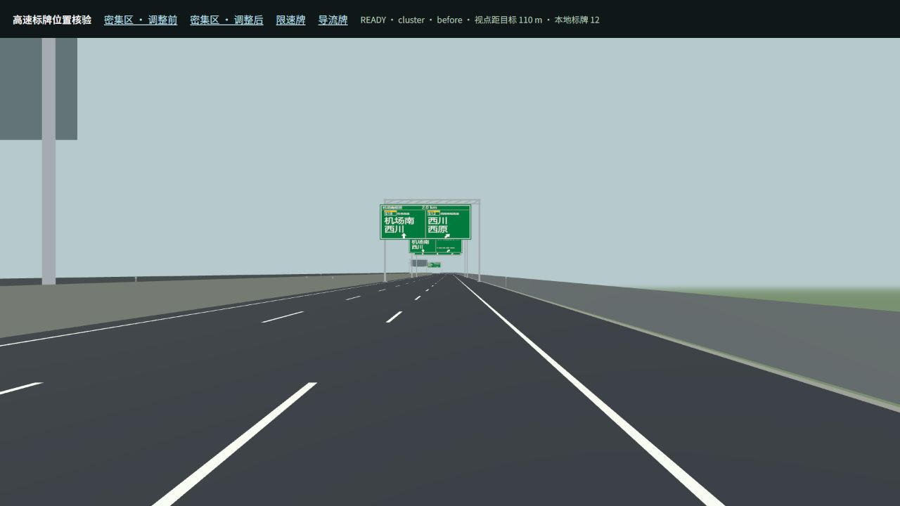
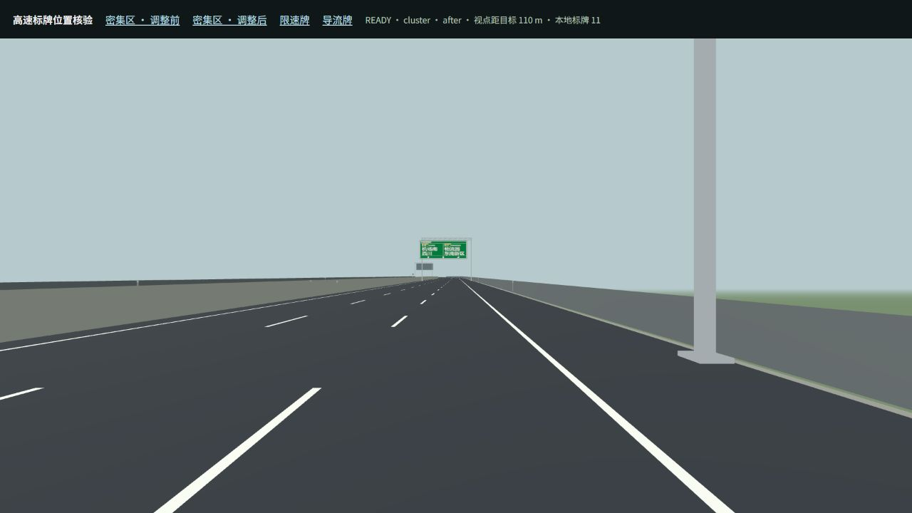
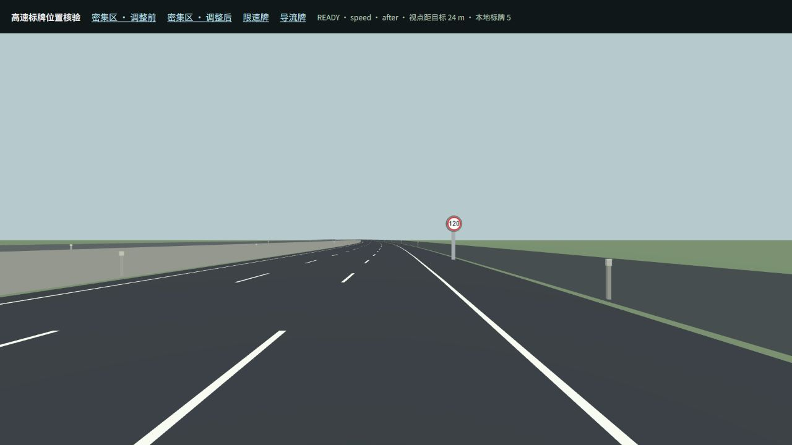
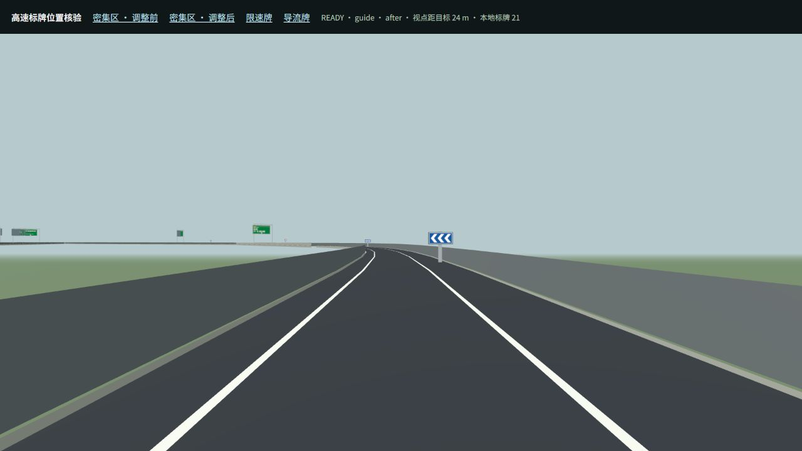

# 2026-10-16 高速与快速路标牌整理

本轮只调整标牌数据、离线摆放规则、牌面模板及相应验证。两份地图的道路、路口、路面限速、物件、显式连接和区域拓扑均保持不变；更新地图版本以发布标牌变化。没有新增依赖、提交或推送。

## 摆放与数量

检查覆盖菜单区域地图 `src/world/regional/regional-main.json` 和城市地图 `src/world/city/maps/city-main.json`。同向标牌按牌面宽高、道路限速和纵横向间距检查阅读带；不同朝向、不同支撑层和横向分开的道路独立处理。阅读间距为游戏摆放参数：最低 45 m、最高 120 m，中间按限速数值乘 0.9；不是现实道路规范认证。

| 项目 | 区域地图：前 → 后 | 城市地图：前 → 后 |
| --- | --- | --- |
| 高速/快速路指路牌 | 1621 → 1586 | 184 → 184 |
| 全图门架/悬臂/吊顶大牌 | 1845 → 1689 | 408 → 408 |
| 同向阅读带冲突 | 414 → 0 | 40 → 0 |
| 挪位的指路牌 | 341 | 39 |
| 大牌改为小型路侧牌 | 121 | 0 |
| 新增限速牌 | 769 | 143 |
| 新增弯道/分流导向牌 | 656 | 126 |

区域地图移除 35 块重复或非必需牌，包括不属于既有覆盖要求的额外 200 m 预告、路段起点被截短的重复远预告和冲突里程牌。现有必备 200 m 提示保留，能安全放置时改成小型路侧提醒；出口决策牌优先，受原有精度约束的出口预告保持原位置附近。确实无法使用双柱门架的地面位置复用既有悬臂模板。跨 JSON 分段挪位只沿显式同名连续道路，更新实际距离和显示距离；桥面不能凭空增加地面路侧基础。

新增小牌覆盖的是约 966 km 主线/匝道，并非集中堆放在少数路口。限速值直接读取 `CityRoad.speedLimit`：入口、限速变化处布置，连续路段约每 2 km 重复，跨数据分段继续累计距离。导向牌根据驾驶方向下的实际曲率朝左/右，分流后的匝道也有提示；每段最多四块，候选间距 75 m，并排除与已有低牌的阅读冲突。牌柱和低牌完整宽度均避开通行车道，保留物理碰撞边界。

限速圆牌为 256 × 256，导向牌为 384 × 192；相同限速/箭头共享牌面与实例几何。区域地图的小牌只使用 16 种纹理，城市地图 12 种。总标牌数因增加小型安全提示而上升：区域 3235、城市 677；减少的是密集大型指路牌，而不是删除有用提示。

## 改动入口

- `src/world/regional/FastRoadSignPlacement.ts`：离线排布、冲突检查、数量控制、限速及导向牌生成。
- `src/world/regional/HighwaySigns.ts`、`src/world/city/SignPlacementGenerator.ts`：生成后使用同一整理规则，避免下次生成恢复拥挤。
- `src/world/city/RoadSign{Data,Templates,Renderer,Validation}.ts`：小牌内容、尺寸、绘制、共享资源和结构校验；编辑器原样导入/导出。
- `scripts/optimize-road-signs.mjs`：默认只预览；加 `--apply` 仅更新两份地图标牌，不重跑历史道路生成器。`--from-baseline` 是本轮复现选项，要求拓扑哈希与保存的基线一致。
- `src/world/regional/FastRoadSignPlacement.selftest.ts`、`scripts/test-road-signs.mjs`：专项验证；核心入口也包含新回归。城市核心将新低牌按其实际物理净空检查，既有指路牌仍执行原有门架/吊顶断言。

## 验证记录

- `node scripts/test-road-signs.mjs`：11918 项新断言通过，另有原有区域 76 项、高速 17 项检查通过。原有必备 200 m 覆盖和出口预告 ±30 m 距离断言保持不变。覆盖分段不增加限速牌、限速变化、双向朝向、挪位后真实距离、驾驶员相对弯向、全牌宽车道净空、物理边界及小纹理复用。见 [专项结果](../artifacts/road-signs-2026-10-16/tests.json)。
- `pnpm map validate regional-main` 与 `pnpm map validate city-main-city`：均 0 errors / 24 warnings，全部 warnings 是既有预留接口 `port.unused`。见 [区域结果](../artifacts/road-signs-2026-10-16/regional-validation.json)、[城市结果](../artifacts/road-signs-2026-10-16/city-validation.json)。
- 首次正常构建发现挪动后的 `v5-sign-386` 立柱接近坡面，净空检查缺少底部 0.3 m 余量。已修正摆放规则并重新生成，不修改或跳过失败断言。
- 最终 `pnpm run build` 完整执行 typecheck、71 组核心测试和 Vite 生产构建，退出码 0；314 个模块完成构建并原子发布，入口为 `assets/index-xx7DJaIW.js`。见 [构建摘要](../artifacts/road-signs-2026-10-16/build.json)。没有使用 `-BasicValidation`。主包约 16.58 MB（gzip 约 4.07 MB），仍有既有大 chunk 提示。
- 浏览器在固定驾驶视点抽查密集区前后对照、120 km/h 圆牌与左弯导向牌，未记录控制台错误。预览使用真实道路/牌面几何，省略车辆和环境物件；它不代替用户的整图驾驶及主观视觉评价。本轮没有另跑驾驶性能基准。
- 正式生产包完成车辆/场地预热并进入区域地图，未记录控制台错误，见 [浏览器记录](../artifacts/road-signs-2026-10-16/browser.json) 与 [生产包截图](../artifacts/road-signs-2026-10-16/production.png)。

证据：[区域排布报告](../artifacts/road-signs-2026-10-16/regional-placement.json)、[城市排布报告](../artifacts/road-signs-2026-10-16/city-placement.json)、[可复现视角夹具](../artifacts/road-signs-2026-10-16/preview.mjs)。几何阅读带冲突为零不代表所有视角、建筑遮挡或远处透视叠合都绝对消失。

