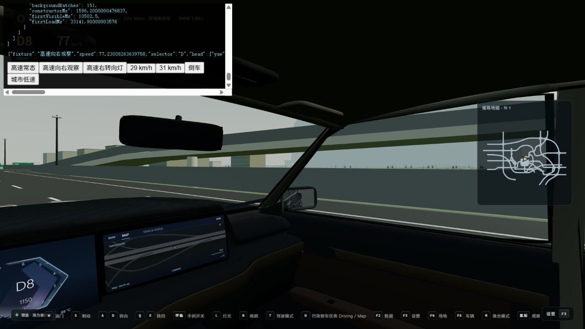

# 高速 runtime hitch 优化 · 2026-10-13

本次修改保留 120 Hz 物理、车辆标定、地图数据、逻辑路网和碰撞体。最终镜面策略已按驾驶反馈撤掉降频：**可见实体镜面逐帧刷新；右上角独立视图仅在绝对车速低于 30 km/h 或 R 挡显示。** 高速转头、转向灯和驾驶辅助会保留相关实体镜面的渲染，但不覆盖右上角的速度/R 挡规则。

## 实现与修改文件

| 范围 | 实现 | 文件 |
| --- | --- | --- |
| 流式计算 | 原生模块 Worker 调用原有 RoadBuilder/RegionalTerrain；道路、地形、中景条带通过 typed-array transfer 交付。逻辑道路/路面/碰撞不移入 Worker，也不卸载。 | [SectorManager](../src/world/city/SectorManager.ts)、[RoadVisualCompiler](../src/world/city/RoadVisualCompiler.ts)、[VisualStreamingWorker](../src/world/city/VisualStreamingWorker.ts)、[Worker](../src/world/city/VisualStreaming.worker.ts)、[VisualStreamingData](../src/world/city/VisualStreamingData.ts)、[MidRoadVisual](../src/world/city/MidRoadVisual.ts)、[RegionalTerrain](../src/world/regional/RegionalTerrain.ts) |
| 流式发布 | 约 3 ms 的软时间预算、每帧最多两次详细发布步骤；按地形、路面、设施、路口、物件类型和路牌分段发布，路牌纹理提前初始化。更新层级期间保留旧视图。远景每个 Worker 作业最多 8 个扇区，主线程每帧最多发布 4 个并受时间预算约束。 | [SectorManager](../src/world/city/SectorManager.ts)、[DrivingGame](../src/game/DrivingGame.ts)、[DrivingGround](../src/world/DrivingGround.ts)、[CityGround](../src/world/city/CityGround.ts) |
| 远景和资源 | 远景地形/水面按 8×8 扇区分组追加缓冲，避免每次推进永久增加 Mesh；本图完整远景为 151 个空间批次。取消/替换发布时释放实例和信号灯资源；地图切换终止旧 Worker。地形缓存有容量上限，环境灯光材质按原材质复用。 | [RegionalBackgroundBatches](../src/world/regional/RegionalBackgroundBatches.ts)、[RegionalStreaming](../src/world/regional/RegionalStreaming.ts)、[EnvironmentVisual](../src/world/environment/EnvironmentVisual.ts)、[trafficSignals](../src/world/subject3/trafficSignals.ts) |
| 镜面 | 使用驾驶摄像机的保守视锥边界剔除视野外镜面；转头目标、转向灯、转向输入、R/P/泊车、匝道/路口和辅助状态提高关键视图优先级。可见镜面没有低频计时器。缓存画面随移动镜面重定位，重新进入视野立即渲染。 | [AdaptiveMirrorRendering](../src/camera/AdaptiveMirrorRendering.ts)、[MirrorSystem](../src/camera/MirrorSystem.ts)、[InteriorMirror](../src/camera/InteriorMirror.ts)、[DrivingGame](../src/game/DrivingGame.ts)、[Hud](../src/ui/Hud.ts)、[RoadNetwork](../src/world/navigation/RoadNetwork.ts)、[CityRoadNetwork](../src/world/city/CityRoadNetwork.ts) |
| 高频分配 | snapshot 四轮复制去掉 map/fromEntries 临时数组；只复制所需底盘状态，避免生成整套悬架 snapshot 后丢弃车轮信息。镜面渲染状态和向量复用，加载状态 DOM 只在变化时更新。公开 snapshot 仍保持独立副本。 | [VehicleDynamics](../src/vehicle/physics/VehicleDynamics.ts)、[SuspensionSystem](../src/vehicle/physics/SuspensionSystem.ts)、[MirrorSystem](../src/camera/MirrorSystem.ts)、[Hud](../src/ui/Hud.ts) |
| 验证/文档 | 新增镜面和视觉 streaming 回归，并注册进正常核心检查；更新当前代码说明。 | [镜面测试](../src/camera/AdaptiveMirrorRendering.selftest.ts)、[流式测试](../src/world/city/VisualStreaming.selftest.ts)、[专项 runner](../scripts/run-runtime-rendering-selftests.ts)、[核心 runner](../scripts/run-core-selftests.ts)、[代码上下文](CURRENT_CODE_CONTEXT.md) |

首次进入/地图切换等待当前近景扇区准备好，显示明确加载状态；之后移动产生的 streaming 不暂停物理。编辑器、非区域 City 地图和 Node 地图验证保留同步实现。没有新增依赖，没有修改地图 JSON、车辆模型或物理参数。

## 实际前后对照

基线是 `ca67e96381372f9d65b5d3a15c8684cf2b8f5a99`，优化后为本次工作区。使用同一浏览器前台、1280×720、BMW 530Li、菜单区域 City Main；140 km/h 初始化后走正常物理/巡航路径，采样实际均速约 134 km/h。每场景运行 15 秒，排除前 3 秒。直线起点为 `ring-cw-0-split-split` 的第 230 个中心线点；复杂道路为 G17 河桥和服务区/结构包附近，起点 `(6048, 18, -341.375)`，沿正常道路行驶。

预热场景先等待目标扇区及发布队列完成，并确认 **4,988 个远景扇区全部生成**。前后复杂道路预热结束都包含 96 个活动扇区、85 条近景道路、50 个路牌及相同护栏计数。所有有效场景均无碰撞，逻辑路网/碰撞数组引用保持稳定。原始数据、方法和验证证据保存在 [artifacts](../artifacts/runtime-hitch-2026-10-13/)。

| 场景 | 平均帧时间，前→后 ms | P95，前→后 ms | P99，前→后 ms | >50 ms 帧数，前→后 | >100 ms 帧数，前→后 |
| --- | ---: | ---: | ---: | ---: | ---: |
| 高速直线，目标区域冷加载 | 75.66 → 30.16 | 255.8 → 71.0 | 582.5 → 113.6 | 97 → 35 | 18 → 4 |
| 高速直线，完整预热 | 58.35 → 28.09 | 71.1 → 42.7 | 99.3 → 71.1 | 139 → 11 | 2 → 1 |
| 复杂桥梁路段，目标区域冷加载 | 49.01 → 16.61 | 113.6 → 28.5 | 170.5 → 56.9 | 47 → 12 | 13 → 0 |
| 复杂桥梁路段，完整预热 | 38.57 → 18.17 | 56.7 → 28.6 | 57.1 → 42.7 | 18 → 2 | 0 → 0 |

这是单轮本机诊断对照，含少量 CPU 计时包装，不是跨设备性能保证。前后实时物理追帧可能造成少量行驶距离/扇区差异。冷加载阶段后台完成数量不同，因此渲染收益以**完整预热**结果为主；隐藏页采样、不同视口采样、旧的降频镜面采样和发生碰撞/降速的早期复杂路线均未纳入此表。

关键变化：

- 高速直线冷加载的主线程 streaming 峰值 **505.5 → 22.3 ms**；复杂道路冷加载 **125.4 → 27.9 ms**。道路编译不再位于主线程计时区间。
- 完整预热直线的游戏帧 CPU 平均 **50.42 → 22.81 ms**；复杂道路 **33.64 → 13.91 ms**。CPU 计时包含嵌套系统调用，不能将各系统时间直接相加。
- 直线预热镜面 CPU 平均 **18.22 → 6.19 ms/显示帧**；复杂道路 **14.82 → 5.04 ms**。收益来自视野外视图剔除和静态远景合批，可见镜面仍每帧渲染。
- 主线程 heap 采样上限有所下降，但 `performance.memory` 不涵盖 Worker 全部内存，也没有 GC trace；不据此声称总内存或 GC 停顿已按相同比例下降。

## 验证

- 镜面专项：31 条断言通过，包括可见侧镜和内镜连续逐帧渲染、30 km/h 边界/R 挡、转向/观察/辅助、视锥剔除、缓存纹理随车移动、渲染状态及材质恢复。
- Streaming 专项：53 条断言通过，包括两个既有道路类型的全部三角形/设施实例保留、传输几何一致、合批内容与边界、资源释放、取消发布不误删替换信号灯。
- `pnpm run selftest:systems`：18 组通过，退出码 0，包括车辆平台、EV/TPMS、BMW/Taycan/HMI、加载、车道/ADAS 和区域高速。见 [实际整合结果](../artifacts/runtime-hitch-2026-10-13/systems-validation.json)。
- 浏览器：29 km/h 显示、31 km/h 隐藏、R 挡显示；高速直视/向右观察实体镜面逐帧运行，右上角保持隐藏。区域→城市切换正常，控制台无错误。BMW 此场景未安装内镜，内镜路径由专项测试单独验证。
- 最终 `pnpm run build` **通过，退出码 0**：typecheck、68 组核心回归、Vite 构建和源码指纹核对完成，已原子更新 `dist`。当前入口引用 `index-VN8Zh7x1.js`，包含最新远景小批量任务的 `VisualStreaming.worker-wQYqB2Wl.js`，入口及 Worker 资源存在。见 [发布验证](../artifacts/runtime-hitch-2026-10-13/validation.json)。新增内镜测试曾因材质类型标注导致 typecheck 失败，已修正，未削弱任何断言。构建保留了既有的大包体积提示。

## 剩余瓶颈与后续建议

**仍有主要长尾，尚未完全消除卡顿。** 冷加载最重的一帧游戏 CPU 约 140 ms，其中 `renderer.render` 累计约 135 ms，streaming 仅约 1.3 ms；计时只能定位到渲染调用，不能单独区分 GPU 等待、shader 首用或驱动上传。预热直线仍有 1 个 >100 ms 显示帧。单次路牌纹理上传、复杂路口生成及资源退役仍是不可抢占步骤，3 ms 是软预算，不是最长帧保证。

| 后续方向 | 预计作用 | 风险/边界 |
| --- | --- | --- |
| 提前异步预热新出现的材质程序、继续平滑单张路牌纹理上传 | 优先压低冷加载 P99/首次使用长帧；具体收益需 GPU/驱动 trace 验证 | 中等：预热和发布必须分阶段，避免将峰值集中到另一帧 |
| 阴影投射批次的空间拆分与距离预算 | 降低复杂场景渲染负担，保留驾驶近景阴影 | 中等：需检查驾驶、转头、夜间和镜面，不能整体降低质量 |
| 更紧凑的常驻碰撞/路面索引与静态矩阵存储 | 降低大量常驻对象及长期内存压力 | 较高：必须保留道路/碰撞语义，适合作为独立任务；本次未改 |

本次 Worker/发布/资源管理属于中等集成风险，已保留原同步编辑器/Node 路径并检查切图释放；镜面视锥采用保守边界，优先保证边缘可见画面连续。用户提出的贴图化/扁平化仅做讨论，本次未实施。
