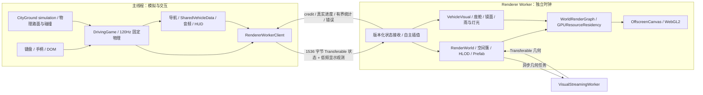
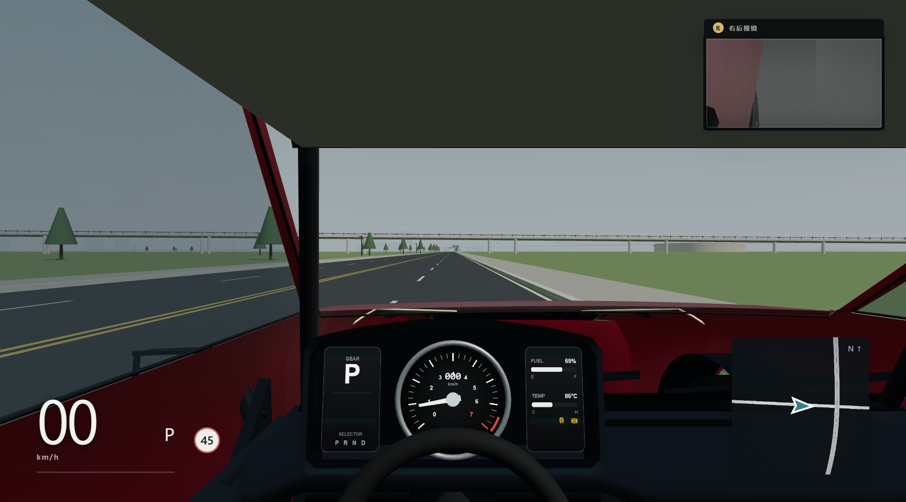
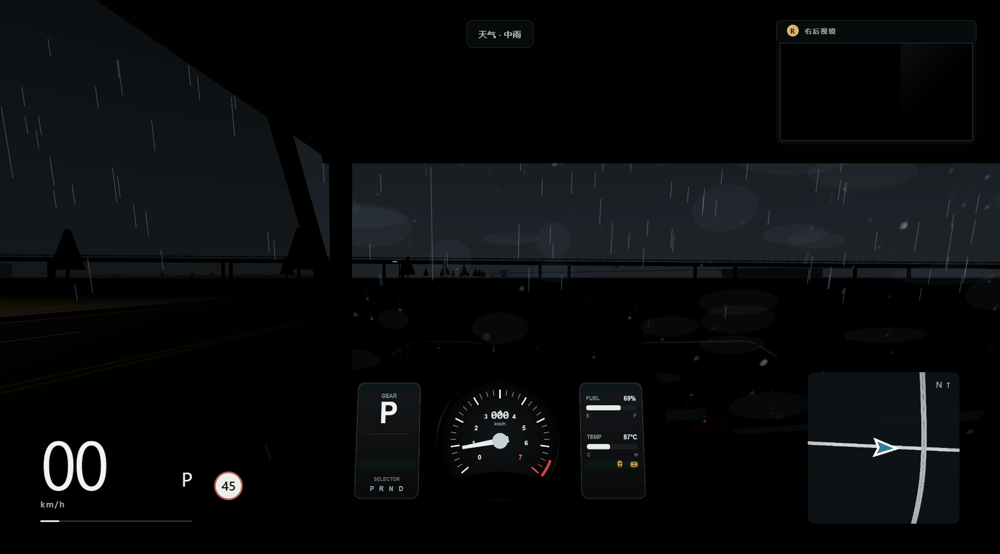

# Runtime V2 Phase 4 — Independent Rendering Runtime

日期：2026-11-18。基于 Phase 3 工作区；1166 个起点文件、Git 状态和不可变对照源码保留于 `artifacts/runtime-v4/baseline/`、`starting-worktree.json`。本轮不 commit/push。正式地图仍为批准的 v507。

## 实际迁移范围

**正式驾驶的 WebGL2 上下文现由 Renderer Worker 持有。** 主线程 `DrivingGame` 使用 `RendererWorkerClient`，没有可调用的正式 `render()` / `getContext()` 提交接口。`HTMLCanvasElement.transferControlToOffscreen()` 将驾驶画布交给专用模块 Worker；Three.js、Scene、车辆模型、CanvasTexture 和 GPU 资源全部在该 Worker 内创建。

菜单车辆展示仍在进入驾驶前使用主线程的小型 WebGL 上下文，开始驾驶时 dispose 并主动丢失其上下文。地图编辑器的独立作者预览不属于本轮驾驶运行时迁移。不能将上述结论扩写为“页面任何时候都不创建主线程 WebGL”。

Phase 3 的主线程此前承担城市可见性结果应用、Three 场景准备、车辆/天气/座舱图形更新、镜面/阴影/Main/HUD 提交。Phase 4 将这些正式工作搬到 Renderer Worker。原 RenderWorld 的 typed compiler 在渲染线程本地执行，沿用现有数据结构与可见性算法，不再套一层额外可见性 Worker。几何编译仍交给 VisualStreamingWorker，主线程只维护模拟所需的区域和权威世界状态。

### 协议、时钟与所有权

- 协议 v1，固定 `Float64Array(192)`，1536 字节；单个 in-flight Transferable credit 加最新待发状态，不累积历史消息。渲染端保留 previous/current/sample，有世界、车辆、姿态 epoch 与 sequence 校验。
- 相机/车体/车轮/悬架/转向/雨刷/气动状态和快变灯光走紧凑状态。车内相机以车体局部空间插值，步行/检查相机使用世界空间；重生、换车、切图和坐标空间变化重置插值。禁止外推和追赶物理时间。
- 仪表显示观测至多约 20Hz；剔除网络、地图索引、传感器实例和 Three 对象，只发送道路 ID 与显示值。Renderer Worker 使用自己的 LocalRoadMap 图形缓存。导航、传感器、声音与车辆控制仍由主线程权威计算。
- 控制命令最多 16 个待回复；启动消息合并状态、resize 和 visibility，队列有上限。资源通过 ID/URL 载入，自定义地图通过加载期 Blob URL 交付，不逐帧复制整张地图。
- 未启用 SharedArrayBuffer，不要求增加跨源隔离。使用所有权转移与版本校验，渲染不等待物理，物理也不等待渲染。
- 主线程的 `SimulationVehicleRig` 只保留眼位、镜面调节、上下车与点击命中所需的数学锚点。City 的 simulation role 不创建视觉 SectorManager；visual role 不再重复构建物理路面/碰撞索引。
- 旧解析式训练场暂保留加载期“构造合同、释放视觉输出”的兼容适配，因此它们在主线程加载时仍有一次旧构造 CPU 工作；驾驶期不在主线程渲染。并非宣称所有加载期视觉构造均已消失。

### 加载、调度和异常

加载界面沿用原有真实任务收据。先准备物理合同及 Worker 车辆/地图，完成当前区域发布、精确 Shader/阴影预热、主视图、左右/车内镜面、HUD 合成及停车影像资源，之后才开放驾驶。Worker 内 CanvasTexture 使用 OffscreenCanvas，字体等待实际 FontFace 加载，不等待可能没有布局机会的 worker FontFaceSet.ready。

Worker 沿用 RuntimeCoordinator；流式更新通过其 visible 任务在有效 deadline 内运行，避免在帧回调内读取过期的零预算。重型资源准备仍有分批与取消；渲染线程在驾驶时只给饥饿的必要可见任务一次有界机会，不为远景制造第二套预算。主线程物理策略不变。

最小化/隐藏后停止无意义绘制；恢复重置渲染时钟。resize/DPR 合并，保留镜面独立相机。渲染报错反馈 DOM 提示、拒绝失败的加载/切换承诺，不停止主线程物理；重新进入时拒绝使用失效客户端并重建。退出顺序为取消任务、等待准备借用与 Sector 释放、销毁图形资源、丢失上下文、回执、终止 Worker；主线程有有界终止后备。

Render Graph 仍统一管理 visibility → additional views → main composite → HUD composite，实际 shadow pass 通过原生阴影入口登记。天空、透明与 3D 座舱继续使用 Three 的融合排序，避免另拆 pass 破坏透明/深度合同。太阳、天气和动态车辆没有被冻结。WebGL2 仍是正式后端，没有启用 WebGPU 或虚报 multi-draw 已使用。

## 性能对照：电池供电，驾驶阶段有效

原始记录：`artifacts/runtime-v4/phase3-*.json`、`phase4-*.json`、`comparison.json`。使用相同 v507 runtime fixture、`test-6at-sedan`、preload-profile 出生点、既有 60 秒路线、画质/镜面/阴影和 120Hz 物理。路线约 89km/h，Sector `4,2 → 5,2 → 6,2`，含掉头。

两次正式驾驶均为**电池供电**、Balanced 计划、普通窗口激活且无遮挡，CSS 1186×658、DPR 1.5、显示器报告 165Hz；没有置顶或抢回焦点。历史没有供电记录的数据不用于本轮因果结论。旧版仅加载阶段短暂失焦，**加载时间与加载帧不作 A/B 比较**。

第一次新版记录器 CPU 总列被新增列偏移覆盖，已修复并以回归断言保护；这次记录完整保留在 `comparison-first/`。用户批准后仅补测一次全新进程的新版，顶层 `phase4-*` 为有效补测。CPU 使用相同保留窗口约 0.026–60 秒；RAF 原始采样覆盖整个驾驶分钟。

| 指标 | Phase 3 | Phase 4 有效补测 |
| --- | ---: | ---: |
| 主线程 RAF P50/P95/P99 ms | 15.8 / 30.4 / 34.4 | 14.2 / 18.6 / 28.5 |
| 主线程 RAF 最大 ms | 53.5 | **227.0** |
| 主线程 >33 / >50 / >100ms 帧数 | 59 / 2 / 0 | **20 / 6 / 1** |
| 主线程 CPU P50/P95/P99 ms | 10.4 / 23.0 / 26.3 | 2.1 / 4.6 / 5.8 |
| 主线程场景更新 CPU P95 ms | 2.6 | 0.9 |
| 主线程 render 阶段 P95 ms | 18.2（WebGL 提交） | 1.0（状态发布，已无 WebGL 提交） |
| 实际渲染线程 RAF P95/P99 ms | 28.5 / 28.7 | 28.6 / 29.0 |
| 实际渲染线程最大 RAF ms | 56.8 | **156.7** |
| Renderer Worker CPU P95/P99 ms | — | 20.7 / 23.5 |
| GPU Query P95/P99 ms | 28.57 / 31.03 | 28.45 / **33.70** |
| 实际提交 Draw Calls P95 | 965 | 946 |
| 实际提交三角形 P95 | 794219 | 764302 |
| 跟踪到的 GL Buffer 峰值 MiB | 47.57 | 44.34 |
| performance.memory 报告峰值 MiB | 504.25 | 333.77 |
| CDP 主线程 Heap 采样峰值 MiB | 363.49 | 308.33 |
| CDP 主线程 backing storage 峰值 MiB | 117.13 | 16.39 |
| CDP Renderer Worker Heap / backing 峰值 MiB | — | 198.43 / 140.61 |

**主线程已明显减负，但渲染节奏、GPU 长尾与 >50/100ms 尾帧没有全面通过。** 不能据主线程 P95 或 Draw Calls 下降宣称所有卡顿已消除。

GPU 数据来自同范围的稀疏 Timer Query，含 additional/main/shadow/HUD；elapsed query 可能含命令供给与驱动调度空隙，不是纯 GPU busy、利用率或实际显示呈现。没有可靠的逐显示器呈现时间。本轮不以 CPU render() 时间替代 GPU 时间。

`performance.memory` 不是跨全部线程的总内存。旧版几何 Worker CDP Heap/backing 采样峰值 263.64/42.88MiB，可见性 Worker 6.13/1.27MiB；新版嵌套几何 Worker 未被计时采样器自动附加，其 Heap 峰值未知。**不能将未知当零，也不能宣称进程总 Heap 已降低。** 没有强制 GC，GL 字节是 API 分配跟踪，不是驱动实际显存驻留。

### 已定位尾帧与最后修复

- 新版驾驶早期 227ms 主线程 RAF 间隔：对应 LOAF 约 221ms，blockingDuration 为 0，已归属回调 CPU 约 6ms；该帧仅执行 2 个物理步，没有集中偿还时间债务。没有证据将其归因为 227ms 主线程 CPU 或 GC。
- 渲染线程一次约 158ms CPU 帧，Graph 将约 148ms 定位到第一次 mirror HUD composite。相邻 API 跟踪没有单个 >2ms 编译/上传调用，能确定 pass 位置，不能再细分驱动/合成等待。
- 发现冷资源在精确预热前曾被加载期完整绘制，出现约 2.45 秒 render。最后修复在 prepared 前只运行场景/流式准备；并补齐 HUD 的**独立无雾场景/相机**预热和真实首个合成提交、停车影像资源提交。无需删减镜面或画质。
- **上表是这处最后预热修复之前的有效整段采样。** 后续仅做针对性功能/预热检查，不再追加整段基准；修复后的长尾改善尚未有同条件整段计时证据，不伪造验收通过。
- 末尾显式诊断 capture 返回较大原始报告，曾形成约 57ms onmessage 长任务；它是测试捕获操作，不是正常每秒小型统计发布。原始记录保留，不混称日常 Sector 发布或 GC。

## 验证记录

- 完整类型检查通过；最终正常 build 仍会执行自己的完整类型检查。
- `runtime-tests-final.log`：Coordinator 24、Streaming 16、Renderer 协议/插值/合同 82 项断言通过，含总 CPU 列与阶段列隔离、150ms 停顿不外推/追赶、过期状态丢弃、灯光快状态、旧仪表观测兼容、物理支撑/碰撞一致性和全部 prefab 尺寸合同。
- `world-tests.log`：静态世界、runtime-first、RenderWorld、悬架 stance、导航显示专项通过；`loading-tests.log`、`physics-tests.log` 通过。加载测试中预设的 fixture 失败是预期失败态检查，并非静默忽略异常。
- 分段车辆迁移检查覆盖现有目录：早期顺序检查推进至第 14 辆迈巴赫时发现切换预算问题；修复后最后 5 辆（迈巴赫、SU7、Jesko、坦克500、秦PLUS）有独立完成记录 `functional.json`。前 13 辆在前段逐项检查中完成；不将早期中止轮次写成一份从头到尾全成功记录。
- `targeted.json`：城市 → 综合道路测试场 → 科目三 → 城市，暂停、resize、隐藏/恢复、取消与重试全部通过。隐藏期间 frames 1105→1105，恢复后 1200。主线程 WebGL 请求数为 1，来自驾驶前菜单，驾驶期间没有新增上下文。
- `recovery.json`：实际 Worker 协议错误注入后主线程模拟继续、DOM 报错可见、旧会话退役，新渲染器重新进入成功。fixture 的 Invalid vehicle / Drive loading failed 为有意故障注入，单独记录。
- 退出回执：RenderWorld records/cpuBytes=0，GPU 驻留登记 geometry/texture/target/registered/cpuBackingBytes=0，contextLost=true、acknowledged=true、terminated=true。短时多次切换未发现残留登记；不据此保证长时间绝无泄漏。
- `worktree-verification.json`：非任务源码和原有未提交成果保护、车辆源码/正式地图不变；物理 while 步进循环的 AST 打印内容与起点一致；既有三个独立正式包归档哈希保持一致。

隐藏窗口截图仅作为功能证据，不用于帧时间结论：

## 文件清单

新增：

- `src/game/render/Renderer.worker.ts`、`RendererRuntime.ts`、`RendererWorkerClient.ts`：独立上下文、渲染循环和客户端。
- `RendererProtocol.ts`、`RenderStateBuffer.ts`、`RenderLightingState.ts`、`RenderTelemetry.ts`：紧凑协议、插值、快状态与显示观测。
- `WorkerCanvasEnvironment.ts`：OffscreenCanvas/字体适配；`SimulationVehicleRig.ts`、`SimulationGroundVisuals.ts`：模拟侧兼容边界；`RenderDebugOverlays.ts`：开发图形诊断迁移。
- `src/world/city/CitySimulationSectors.ts`、`PrefabContracts.json`：无视觉区域合同和既有 prefab 尺寸表。
- `RendererRuntime.selftest.ts`；本报告与 `artifacts/runtime-v4/` 原始记录/操作工具。

修改：

- `src/game/DrivingGame.ts`、`createGameRenderer.ts`、`startup/StartupApplication.ts`、`startup/MenuScene.ts`、`VehicleVisualDebugView.ts`、`StreamingShaderWarmup.ts`。
- `src/game/runtime/{RuntimeCoordinator,RuntimePerformance,VehicleRenderPose,WorldRenderGraph}.ts`。
- `src/ui/MirrorOverlayRenderer.ts`。
- `src/world/{DrivingGround,DrivingGroundCatalog}.ts`；`city/{CityGround,CityMainResource,CityPhysicsSectors,PrefabRegistry,SectorManager}.ts`。
- `src/world/render/RenderWorld.ts`；`subject3/{Subject3Ground,trafficSignals}.ts`。
- `scripts/run-runtime-selftests.mjs`、`scripts/performance-deep-instrument.ts`、`vite.config.ts`；`docs/CURRENT_CODE_CONTEXT.md` 的迁移入口说明。

完整文件级起点差异以 `worktree-verification.json` 为准，不能将整个 dirty Git 工作区都算成本轮改动。

## 构建和发布

正常完整构建与新目录桌面发布正在收尾；最终结果记录于 `artifacts/runtime-v4/build-result.json`、`release/package-verification.json`、`release/release-smoke.json`。未通过之前不将该项标为成功。独立目标为 `D:/DriverSchoolRelease/DriverSchool-RuntimeV2-Phase4-20261118/DriverSchool-win32-x64`，保留 Phase 2.1、Phase 3 和既有正式目录。

## 剩余风险与人工验收

1. 相同供电条件下，最后 HUD 预热修复后的正常驾驶长尾仍需人工体验；当前计时证据不支持“尾帧已全部改善”。
2. GPU query P99 尚未改善，渲染线程仍会承担 WebGL 提交与驱动等待；独立线程并不自动消除 GPU/合成瓶颈。
3. 嵌套几何 Worker 的计时 Heap 峰值未获取；整体进程内存变化未验收。短期登记释放通过，长时间跨区域资源稳定性仍需更长实际游玩。
4. 用户应检查各车型第一人称读数/点击、上下车和镜面调节、R 挡影像、雨夜雨刷/灯光、窗口最小化恢复及连续跨区掉头。已有自动功能检查不能代替主观驾驶/画面验收。
5. 解析式旧训练场尚有加载期主线程构造兼容层；它没有驾驶 WebGL 提交，不应与已迁移的正式渲染线程混淆。后续可按合同逐步移除剩余加载期视觉构造，而无需维护第二套驾驶渲染器。
